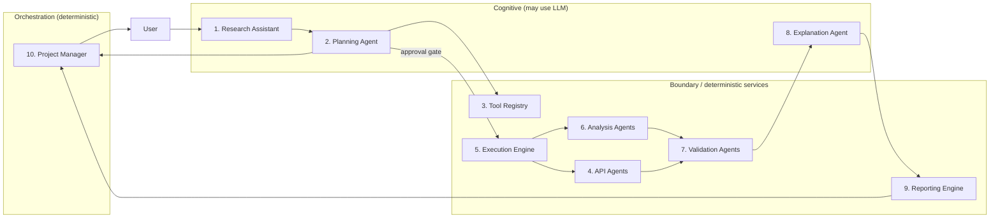

# AI Agent Architecture — Smart Bioinformatics AI

**Version:** 1.0 (vision reset, 2026-11-24)
**Companion:** `SYSTEM_ARCHITECTURE.md`, `PRODUCT_REQUIREMENTS.md`, `PRODUCT_VISION.md`.

---

## 1. Core policy: what AI may and may not do

> **AI may** understand requests, propose plans, select registered tools, draft evidence-bounded explanations, and suggest next questions.
>
> **AI may not** compute scientific values, fabricate citations/statistics/findings, execute unapproved steps, modify validated results, or transmit user data without consent.

This split is the central design decision. Every agent below is constrained by it. An LLM is treated as an **untrusted probabilistic component** whose output must be parsed into a typed structure and validated before use.

**Agent count discipline:** we define exactly the ten responsibilities required by the mission. New agents are added only when an existing agent's responsibilities become incoherent — not to decorate the system.

## 2. Agent map



Only agents 1, 2 and 8 may call an LLM. Agents 3–7, 9 and 10 are deterministic services with typed contracts.

## 3. Agent contracts

### 3.1 AI Research Assistant (agent 1)

- **Input:** `user_text`, `dataset_summary` (file type, size, sequence alphabet, record count from preflight), `project_history`, optional `conversation_id`.
- **Output (typed):** `{ domain, intent, confidence, missing_parameters[], clarifying_questions[], dataset_valid, summary }`.
- **LLM use:** optional. Default implementation uses keyword/intent rules over a fixed catalog (sequence stats, 16S identification, BLAST, taxonomy, benchmark).
- **Guardrails:**
  - Never reads raw file contents into an LLM prompt; receives only an aggregated summary.
  - If `confidence < threshold`, must ask a clarifying question instead of guessing.
  - Must echo back its understanding for user confirmation.
- **Failure mode:** returns `intent: "unsupported"` with a list of capabilities from the registry — never a confident wrong answer.

### 3.2 Planning Agent (agent 2)

- **Input:** validated intent + dataset summary + tool registry + policy constraints.
- **Output:** `Plan` conforming to `shared/schemas/plan.schema.json`:

```json
{
  "plan_id": "...",
  "domain": "microbiome-16s",
  "intent": "identify_taxa",
  "steps": [
    {
      "id": "validate-1",
      "tool_id": "sequence-stats.validate",
      "backend": "local-python",
      "params": { "sequence_type": "dna" },
      "inputs": ["dataset:dataset_123"],
      "external_egress": false,
      "cost_hint": "free",
      "estimated_seconds": 2
    },
    {
      "id": "taxonomy-1",
      "tool_id": "microbiome-16s.taxonomy",
      "backend": "local-python",
      "params": { "schema": "auto", "top_n": 10, "min_consensus": 0.8 },
      "inputs": ["dataset:<blast_tsv_dataset_id>"],
      "external_egress": false,
      "requires": ["dataset:blast_tsv"],
      "cost_hint": "free (local CPU)",
      "estimated_seconds": 30
    }
  ],
  "external_services": [],
  "consents_required": [],
  "limitations": ["16S often cannot resolve to species level"]
}
```

- **LLM use:** optional; when enabled, the LLM proposes a draft plan which is then **validated field-by-field** against the registry (tool IDs must exist, params must match JSON Schema, egress flags must be set). Any invalid field causes replanning or a deterministic fallback.
- **Guardrails:**
  - Cannot introduce a tool not present in the registry.
  - Must mark `external_egress: true` for any third-party call and add a consent requirement.
  - Must prefer local backends over remote ones when both satisfy the capability.
  - Must not invent database names; allowed values come from a configured catalog.
  - Plan is versioned and immutable once approved.
- **Human gate:** the plan is rendered before execution; approval creates `approvals` rows per step.

### 3.3 Tool Registry (component 3)

- **Role:** single source of truth for available capabilities.
- **Manifest fields:** `id`, `version`, `domain`, `capabilities[]`, `input_schema`, `output_schema`, `backends[]` (type, requirements), `validation_rules[]`, `references[]`, `limitations[]`, `demo_command`, `tests`, `docs`.
- **Operations:** `list()`, `get(id, version)`, `validateStep(step)`, `findByCapability(capability)`, `availability(backend)`.
- **Guardrail:** if a backend's requirements are unmet (e.g. no `blastn`), the registry reports `available: false` and the planner must choose another backend or ask the user to install it. No silent downgrade to mock data.

### 3.4 API Agents (agent family 4)

One agent per external service, all sharing a base contract:

- **Input:** typed request validated against the service schema + a consent token.
- **Output:** typed response + `source` metadata (`url`, `retrieved_at`, `release`, `license`).
- **Duties:** rate limiting, retry with backoff, timeout, error normalization, response schema validation, audit logging.
- **First implementation:** NCBI BLAST URL API (existing Worker endpoints), reused via the local agent or Worker as appropriate.
- **Roadmap:** UniProt, EMBL-EBI, InterPro, PDB — only after `API_INTEGRATION_ROADMAP.md` records verified terms.
- **Guardrails:**
  - Refuse to execute without a matching consent record.
  - Never put API keys in browser code or logs.
  - Mark the platform with contact information where the provider requires it.
  - Store responses as artifacts with hashes; do not silently refetch.

### 3.5 Execution Engine (component 5)

- **Role:** durable job state machine and dispatch.
- **States:** `queued → running → succeeded | failed | cancelled` (the plan is approved *before* the job row is created; there is no `planned` job state).
- **Backend selection:** local Python agent (MVP), optional Galaxy/container adapters later.
- **Guardrails:**
  - Starts a job only if an approval exists for that exact step and plan version.
  - Enforces timeouts and attempt limits.
  - Records `execution_mode: "real"` or `"mock"` on every result; mocks are never presented as real science.
  - Does not accept arbitrary code from the planner — only registered tool IDs.

### 3.6 Analysis Agents (family 6)

- **Role:** domain-specific adapters that invoke a tool and return normalized artifacts.
- **First adapters:**
  - `sequence-stats@1` → wraps `smartbio.fasta.validate_records`, `smartbio.statistics.calculate_statistics`.
  - `microbiome-16s@1` → wraps `smartbio.blast_runner.run_blastn`, `smartbio.blast.analyze_blast`, `smartbio.taxonomy.run_taxonomy_analysis`, `smartbio.taxonomy.report`.
- **Contract:** `run(step, inputs, context) → { artifacts[], tool_runs[], logs[], warnings[] }`.
- **Guardrail:** all adapter parameters are passed through the tool's schema; no LLM-generated string is executed as code or shell.

### 3.7 Validation Agents (family 7)

Two layers:

1. **Generic validation** — JSON Schema conformance of outputs, required provenance fields present, non-empty artifacts, hash consistency, execution mode label.
2. **Domain validation** — supplied by the plugin manifest, e.g.:
   - DNA GC% within [0,100] and consistent with base counts.
   - Taxonomic verdict has supporting hits and meets consensus/coverage thresholds.
   - No verdict when `malformed_blast_rows > 0` without a caution flag.
   - Suspicious-pattern detection: all queries identical results, all no-hit, 100% identity, impossible lengths.

- **Output:** `{ status: "pass"|"warn"|"fail", flags[], checked_rules[], checked_at }`.
- **Guardrails:** cannot change scientific values; `fail` blocks explanation and report generation. Warnings are displayed, not hidden.

### 3.8 Research Explanation Agent (agent 8)

- **Input:** validated artifacts, provenance bundle, curated `references` table, plugin `limitations`.
- **Output:** structured explanation `{ summary, findings[], limitations[], references[], uncertainty }` where every `finding` carries `artifact_id` + `field_path` references.
- **LLM use:** optional. Default is a deterministic template renderer driven by artifact fields.
- **Hard rules:**
  - Every number must be copied from a validated artifact; a number checker verifies this.
  - Every citation key must exist in the `references` table with `verified_by` set; unverified references are omitted.
  - If evidence is insufficient, the explanation says so explicitly ("no taxonomic verdict could be supported") instead of filling gaps with plausible text.
  - Never claim experimental validation, significance, or novelty that is not in the evidence.
- **Citation checker:** independent deterministic component; can veto the explanation.

### 3.9 Reporting Engine (component 9)

- **Input:** plan, approvals, tool runs, artifacts, validation result, explanation, provenance DAG.
- **Output:** self-contained HTML report + JSON + CSV + `provenance.json`, stored in R2.
- **Rules:** report sections are generated from records, not from free text; includes a `Reproducibility` section (tool versions, parameters, input hash, database release, timestamps) and a `Limitations` section. Reuses conventions from `smartbio/taxonomy/report.py`.
- **Guardrail:** the engine refuses to render a report if any step has `validation.status === "fail"`.

### 3.10 Project Manager (component 10)

- **Role:** **single writer and owner** of projects, datasets, request history, plan versions, workflow versions, approvals, and the append-only audit log. The Request manager and Consent service in `SYSTEM_ARCHITECTURE.md` are internal services *of* this component, not competing owners.
- **Operations:** create/list projects, attach datasets by hash, list runs, retrieve provenance DAG, export bundle, append audit events.
- **Guardrail:** exposes only read APIs for audit events; appending is done by other components.

## 4. Agent communication rules

1. Agents exchange **typed records**, never free-form text, except the final explanation shown to humans.
2. Every message carries `run_id`, `step_id` and a timestamp.
3. LLM output is parsed into a typed object; parse failure → deterministic fallback, never a retry loop with escalating creativity.
4. No agent calls another agent's LLM provider directly; all LLM calls go through one adapter with logging and enable/disable control.
5. A step's output artifact is immutable once written; corrections create new versions.

## 5. LLM provider adapter (optional, pluggable)

```text
interface AIProvider {
  name: string
  enabled: boolean
  proposePlan(input: PlanInput): Promise<PlanDraft>
  draftExplanation(input: ExplanationInput): Promise<ExplanationDraft>
}

implementations:
  - DeterministicProvider (default; rules + templates; offline; free)
  - OpenAICompatibilityProvider / AnthropicProvider / OllamaProvider (optional, BYO key or local model)
```

**Default is `DeterministicProvider`.** The MVP is fully functional with no network LLM. Paid providers are documented as optional in `COMPUTE_INFRASTRUCTURE.md`; no key is required to run tests or the demo.

**Deployment note:** the configured 9Router endpoint is a *local* OpenAI-compatible proxy (`http://127.0.0.1:20128/v1`). A deployed Cloudflare Worker cannot reach it, so the optional LLM adapter lives in the **local Python agent** layer and is used only to rephrase already-validated explanation text. The prompt contains no raw sequences and the output must pass the deterministic number/citation gate. Marking this explicitly prevents a false claim that the Worker itself calls an LLM.

## 6. Failure and abuse handling

| Failure | Behaviour |
|---|---|
| LLM returns invalid JSON | Reject; use deterministic provider; log event |
| LLM names a non-existent tool | Reject plan; ask user to rephrase or select a capability |
| External API times out | Mark step `failed`, preserve partial provenance, offer retry after approval |
| Validation fails | Block explanation/report; show flags and raw artifacts |
| Agent posts forged result | Reject: agent token + plan step binding + hash check |
| Consent missing for external step | Job is never created; audit records the blocked attempt |
| Dataset hash mismatch | Refuse to start; uploaded data may have changed since planning |

## 7. What we deliberately do *not* build (yet)

- Autonomous multi-agent debate / "society of mind" — no evidence it improves scientific correctness here.
- Self-modifying prompts or agents that write their own tools.
- Vector-store "memory" of experimental results — provenance records are the memory.
- Fine-tuned biological LLMs — cost and evidence burden are unjustified for the MVP.
- Free-form code execution by the LLM; only registered tool adapters run.

## 8. Acceptance checks for this architecture

- [ ] Plans validate against the schema and contain only registered tools.
- [ ] No job can be created without an approval record.
- [ ] No external call can occur without consent.
- [ ] Explanations contain zero numbers absent from artifacts and zero unverified citations.
- [ ] Reports are blocked on validation failure.
- [ ] The entire MVP works with the deterministic provider and no secrets.
