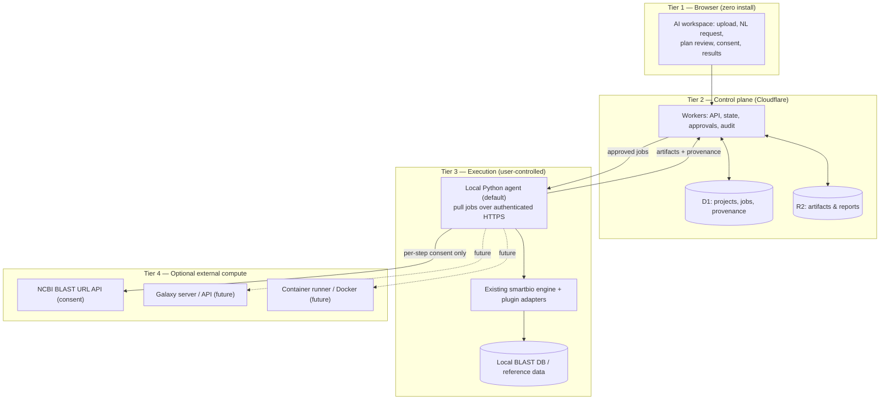

# Compute Infrastructure — Smart Bioinformatics AI

**Version:** 1.0 (vision reset, 2026-11-24)
**Detailed research:** `docs/discovery/RESEARCH_compute_infra.md` (source URLs and access dates).
**Core decision:** Cloudflare Workers are the **control plane**, not the **compute plane**. Heavy bioinformatics runs on a user-controlled local agent or an external workflow service — never inside a Worker request.

---

## 1. Why Workers cannot run the science

Cloudflare Workers are isolated V8 contexts with hard CPU/memory/body caps. **Verified limits (official docs, 2026-11-24):** Free plan 10 ms CPU per request; Paid plan 30 s default / 5 min maximum CPU, 128 MB RAM on both plans, 64 MiB bundle, 100 MB incoming request body. (The 100 MiB outbound-body figure in the research report applies to Durable Objects/Containers, not to the Worker request path — do not quote it as a Worker limit.) Durable Objects share the same CPU/memory envelope. These are designed for routing, API composition and small transformations. BLAST, aligners, QIIME 2 and RNA-seq quantification require seconds-to-hours of CPU, gigabytes of memory, local database files and native binaries — **categorically incompatible with the Worker model**. Exact figures and source URLs: `docs/discovery/RESEARCH_compute_infra.md`.

The existing project already documents this: `docs/OPENCODE_HANDOFF_PROMPT.md:15` explicitly bars heavy BLAST+ from Workers; `web-platform/wrangler.toml` configures the site as **static Pages output** (`pages_build_output_dir = "public"`) with a D1 binding whose `database_id` is still a placeholder.

**What Workers are good for here:** API gateway, request validation, plan/approval records, D1 state machine, job dispatch, small-file preflight validation, report assembly, serving static UI.

## 2. Tiered execution architecture

**Data locality:** uploaded sequences are stored in the browser until a job is approved, then written to the agent's isolated local workspace. Tier 4 calls occur only when the plan declares `external_egress: true` and the user consents.

## 3. Execution backends

| Backend | What it runs | When | Requirements | Cost |
|---|---|---|---|---|
| **In-process JS (Worker)** | Request validation, plan parsing, report assembly, small-file checks | Always | None | Free tier; no heavy compute |
| **Local Python agent (default)** | `smartbio` FASTA/stats, BLAST parsing, taxonomy, reports; plugin adapters | MVP | Python 3.11+, installed package; optional `blastn` + local DB | $0 (user's machine) |
| **NCBI BLAST URL API** | Remote blastn against NCBI databases | Only with consent | Network, email/tool identification | Free subject to NCBI limits |
| **Galaxy (future)** | Published workflows, containerized tools | Post-MVP | Galaxy account/API key or self-host | Free public server quotas or self-host cost |
| **Container runner (future)** | Docker/Apptainer images for new domains | Post-MVP | Docker/Podman/Apptainer on user machine or VM | $0 locally; VM costs if remote |

### 3.1 Local execution agent design

- **Transport:** agent polls `GET /api/ai/jobs?agentId=...` over HTTPS with a long-lived token. No inbound port or firewall changes needed on the user's machine.
- **Workspace:** one temporary directory per job; path traversal checks; file-size caps; subprocess timeouts; cleanup on completion/failure.
- **Result submission:** `POST /api/ai/jobs/:id/result` with artifact hashes, tool versions, parameter echo, logs and provenance fragment.
- **Trust:** agent token is bound to a job and plan version; a forged or mismatched submission is rejected.
- **Off-line capability:** the agent can run pure-Python steps (FASTA validation, statistics) without `blastn` or a database, so the MVP demo works on a bare Python install. Availability of each backend is reported by `/api/tools`.

## 4. Workflow engines and containers (expansion)

- **Nextflow / nf-core**, **Snakemake**, **Cromwell/WDL**, **CWL** are mature, open-source workflow systems. They are candidates for a future adapter that executes an AI-generated DAG, but none is required for the MVP.
- **Galaxy** is MIT-licensed (since 2025-02-25) with free public servers (usegalaxy.org quota 250 GB/account). Public servers are a shared resource; an adapter must be rate-limited and must not assume guaranteed capacity.
- **Containers** (Docker, Singularity/Apptainer, Bioconda/biocontainers) are the practical way to distribute domain tools reproducibly. Local execution avoids per-job cloud cost.
- AI-generated plans are **never executed as arbitrary shell code**; they are validated against registered tool IDs and executed by adapters.

## 5. Cost and quota posture

| Resource | Free / open option | Paid option | Default in this project |
|---|---|---|---|
| API gateway + state | Cloudflare Workers Free + D1 free tier | Workers Paid / additional D1 | Free |
| Artifact storage | R2 free tier (classic) | R2 paid beyond free allowance | Free |
| FASTA/BLAST analysis | Local Python + local BLAST+ | — | Free |
| Remote BLAST | NCBI URL API (free, rate-limited) | — | Optional, consent-gated |
| Workflow execution | Self-hosted Galaxy / Nextflow / Snakemake | Seqera / cloud VMs | Not in MVP |
| LLM planning/explanation | Deterministic rule-based planner (built in) | Optional LLM API (BYO key) | Deterministic |
| Browser testing | Playwright local | Cloud browser services | Local |

**No paid dependency is required for the MVP.** Any future paid service must be added to this table with its actual price and an explicit decision before enablement.

### Optional LLM provider — 9Router (opt-in)

The environment provides a `NINEROUTER_API_KEY`. 9Router is a **local OpenAI-compatible proxy** (verified live 2026-11-24 at `http://127.0.0.1:20128/v1`, 555 models including `auto`). It is wired as an **optional phrasing aid only**:

| Variable | Meaning | Default |
|---|---|---|
| `AI_LLM_PROVIDER` | Must equal `ninerouter` to enable | unset → deterministic only |
| `NINEROUTER_API_KEY` | Proxy key; read from env, never logged or stored in code | required when enabled |
| `NINEROUTER_BASE_URL` | Proxy endpoint | `http://127.0.0.1:20128/v1` |
| `NINEROUTER_MODEL` | Model name | `auto` |
| `AI_LLM_TIMEOUT_SECONDS` | Request timeout | `20` |

Because 9Router may route to remote models, only already-validated finding text and numbers are sent — **never raw uploaded sequences**. Every LLM-produced string must still pass the deterministic number/citation gate; failure falls back to the deterministic explanation. The report records when model-assisted phrasing was used. Enabling this is an operator decision; the platform remains fully functional with no key.

## 5.1 Newly available platform capabilities (verified, but out of MVP scope)

- **Cloudflare Queues** support **HTTP pull consumers** from any language: 128 KB messages, 12 h visibility timeout, lease/ack/retry, multiple agents. This is a better dispatch mechanism than D1 polling for a future multi-agent deployment: messages carry only job IDs + R2 keys. The MVP uses D1 polling for simplicity and local-development friendliness.
- **Cloudflare Containers / Sandboxes are GA** (changelog 2026-04-13) on Workers Paid ($5/mo): up to 4 vCPU / 12 GiB / 20 GB per instance, with included allowances then usage pricing. MicroVM isolation with `enableInternet: false` is the right pattern for untrusted or LLM-written code. Instances are still too small for genome-scale indexes, and this introduces a paid dependency — therefore **not enabled by default**.
- **Public Galaxy**: free but constrained (usegalaxy.org 250 GB / 6 concurrent jobs, one account per user, PII/HIPAA prohibited, quotas enforced; UseGalaxy.eu ToS addresses AI-enabled abuse). Any future adapter must be rate-limited and must never send human/proprietary data.
- **Workflow engines**: Snakemake is Python-based and easiest for LLM-generated DAGs; WDL 1.3 / CWL are good structured interchange formats; Nextflow/nf-core are production-grade. A future planner emits a typed DAG, validates it, dry-runs it, and pins container digests.

## 6. Scientific limits of AI-assisted analysis

- LLMs hallucinate citations, statistics and results; they must never be the source of scientific values.
- Context windows cannot hold large datasets; agents pass aggregates, not raw omics files, into prompts.
- Reproducibility requires pinning tool versions, parameters, database releases and input hashes — not just saving a transcript.
- An LLM-generated "plausible" workflow can be scientifically inappropriate; registry validation and domain rules constrain it.
- The honest outcome of weak evidence is **abstention**, not a confident answer. Our benchmark reports call rate and wrong-call rate together (`docs/PROJECT_SUMMARY.md`).

## 7. Security of the execution path

- Agent jobs are authenticated and bound to a plan version; results are hash-checked.
- No arbitrary code from an LLM is executed; only registered adapters.
- Untrusted biological files are parsed with size/time limits; CSV exports neutralise formula injection (note: `blast_runner.py` still has a CSV-safety gap per `docs/discovery/AUDIT_api_infra.md`, to be fixed).
- External egress is logged and consent-gated; a "locality receipt" in the provenance record shows exactly which steps stayed local.

## 8. Decision summary

1. MVP runs everything heavy on a **local Python agent**; Workers orchestrate.
2. Default planner/explainer is **deterministic and offline**; LLM providers are optional.
3. NCBI BLAST remains the only external service in the MVP, behind consent.
4. Galaxy/containers/remote compute are **post-MVP options**, not assumptions.
5. Exact numeric limits, current pricing and free quotas are maintained in `docs/discovery/RESEARCH_compute_infra.md` with source URLs and access dates; do not quote numbers here without re-verifying them there.
