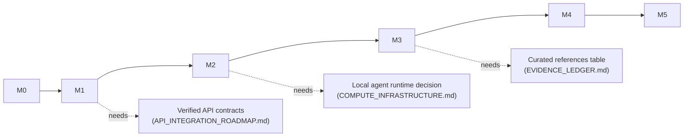

# Implementation Roadmap — Smart Bioinformatics AI

**Version:** 1.0 (vision reset, 2026-11-24)
**Status:** Living document. Update after every milestone with actual dates and evidence.
**Companion:** `PRODUCT_REQUIREMENTS.md`, `SYSTEM_ARCHITECTURE.md`, `docs/EVIDENCE_LEDGER.md`, `docs/IMPLEMENTATION_LOG.md`.

---

## 1. Sequencing rationale

We ship the smallest system that exercises the **whole** AI pipeline (request → plan → approval → real execution → validation → explanation → report) before expanding domains. A wide but shallow platform would violate the mission's "real, functional, scientifically responsible" requirement.

**Rule:** every milestone must end with something a user can run, and with tests that prove the claim.

## 2. Milestones

### M0 — Discovery and specification (this deliverable)

| Item | Deliverable | Done when |
|---|---|---|
| Code / UX / API / infra / docs audits | `docs/discovery/AUDIT_*.md`, `BASELINE_TESTS.md` | Evidence with file:line citations exists for the 7 required audit areas, consolidated into **4** reports: backend+science (`AUDIT_backend_science.md`), frontend/UX (`AUDIT_frontend_ux.md`), APIs+deployment (`AUDIT_api_infra.md`), documentation+tests/reproducibility (`AUDIT_docs_consistency.md`, `BASELINE_TESTS.md`) |
| Competitor and API research | `docs/discovery/RESEARCH_*.md` | Sources + access dates recorded; no unverified claims promoted |
| Eight foundation documents | Root `*.md` listed in vision | Independent reviewer confirms consistency and no fabricated claims |
| Baseline test run | `docs/discovery/BASELINE_TESTS.md` | Existing pytest + node suites recorded as green/red with commands |

**Exit criterion:** the team knows exactly what exists, what is claimed, and what is missing.

### M1 — Contracts and control-plane skeleton (no UI yet)

| Item | Files | Acceptance |
|---|---|---|
| Plan / provenance / plugin / API schemas | `shared/schemas/*.schema.json` | All schemas validate example fixtures; negative fixtures rejected |
| D1 migration | `web-platform/migrations/0002_ai_platform.sql` | Migration applies to a fresh local D1; existing `blast_requests` untouched |
| Worker API scaffold | `web-platform/functions/api/ai/**`, `/api/tools` | Endpoints return typed errors; `execution_mode` present; no science logic |
| Tool registry with 2 manifests | `shared/plugins/*.json`, registry module | `/api/tools` lists `sequence-stats@1`, `microbiome-16s@1` with schemas and availability |
| Unit tests | `web-platform/tests/ai_*.test.mjs` | Plan/approval/consent gates tested with fake backends |

**Exit criterion:** a plan can be created, validated and approved in the API, but nothing executes yet.

### M2 — Local execution agent + existing engine as plugin (real compute)

| Item | Files | Acceptance |
|---|---|---|
| Python agent | `python-engine/src/smartbio/aiagent/agent.py` | Polls jobs with token, isolated workspace, subprocess timeout, posts artifacts + provenance |
| Plugin framework | `python-engine/src/smartbio/plugins/**` | Manifest loader + adapter base class; plugin discovery via entry points or manifest files |
| 16S/sequence adapters | `python-engine/src/smartbio/plugins/sequence/**` | Calls existing `fasta`, `statistics`, `blast_runner`, `taxonomy` functions; no reimplementation |
| Job result / validation endpoints | `web-platform/functions/api/ai/**` | Result schema checked; validation flags produced; real vs mock distinguishable |
| Integration test | `python-engine/tests/test_ai_agent.py`, JS test | A real FASTA is processed by real Python code; output hash deterministic |

**Exit criterion:** an approved job produces genuine scientific artifacts from the existing engine, with complete provenance.

### M3 — Validation, explanation, reporting

| Item | Files | Acceptance |
|---|---|---|
| Generic + domain validation | `python-engine/src/smartbio/aiagent/validation.py` and/or Worker module | Suspicious-output fixtures detected; `fail` blocks downstream stages |
| Explanation agent + citation checker | `aiagent/explanation.py` | Numbers cross-checked against artifacts; unverified citations removed |
| Report builder | `aiagent/report.py` | HTML/JSON/CSV/provenance bundle; reuses `taxonomy/report.py` conventions |
| Tests | `test_validation.py`, `test_explanation.py`, `test_report.py` | Fabrication tests: injected fake number/citation is rejected |

**Exit criterion:** a completed run yields an evidence-bounded explanation and a reproducible report; fabricated content is provably blocked.

### M4 — AI workspace UI + end-to-end MVP

| Item | Files | Acceptance |
|---|---|---|
| Natural-language request UI | `web-platform/public/ai.html`, `public/js/ai-workspace.js` | Upload FASTA + type request + review plan + approve in browser |
| Plan review / consent controls | same | External steps explicitly show "will send data to NCBI" with approve/decline |
| Results / report view | same | Shows validation flags, limitations, download links, provenance viewer |
| Remove/replace the inert "BLAST coming soon" tile | `public/index.html:80` | Tile links to a working page or is removed |
| E2E demo test | `web-platform/tests/` (node + optional Playwright) | Full MVP pipeline demonstrated (request → plan → approval → execution → validation → explanation → report); `execution_mode` explicitly labelled |
| Docs | `docs/DEMO_SCRIPT.md` update, `docs/IMPLEMENTATION_LOG.md` | Demo script matches actual UI |

**Exit criterion:** Phase 5 of the mission is satisfied end-to-end and can be shown without a paid LLM key.

### M5 — Expansion kit (Phase 6)

| Item | Acceptance |
|---|---|
| `docs/plugins/PLUGIN_AUTHORING.md` + template plugin | A new domain can be added by manifest + adapter + tests + docs only |
| Second domain plugin (phylogenetics or basic sequence motif) | Appears in registry, runs through the same pipeline, has its own tests/docs/references |
| Plugin compliance check in CI | Fails if a plugin lacks schemas, validation rules, references, tests or docs |
| Architecture/roadmap/docs update | Living docs reflect reality |

**Exit criterion:** adding a domain does not change control-plane code.

### M6+ — Future (architecture only, not committed)

- Locality receipt in provenance (FR-8.5) and education mode (FR-8.6) — the two differentiators that currently have requirements but no implementation.
- Galaxy adapter and container runner (subject to `COMPUTE_INFRASTRUCTURE.md` costs).
- Additional external API agents (subject to `API_INTEGRATION_ROADMAP.md` terms).
- Multi-user auth, team projects, workflow version UI, remote compute credits.

## 3. Dependency graph

## 4. Risks and mitigations

| Risk | Impact | Mitigation |
|---|---|---|
| No LLM key available for demo | Blocks AI features | Deterministic provider is default; LLM optional |
| Local Python + BLAST not installed on user machine | Blocks execution | Document one-command setup; validate backend availability in `/api/tools`; offer pure-Python stats path first |
| LLM invents tools or citations | Scientific integrity | Schema validation + registry allowlist + citation checker + number checker |
| Cloudflare limits exceeded | Runtime failures | Keep heavy work out of Workers; documented in `COMPUTE_INFRASTRUCTURE.md` |
| External API terms change | Integration breaks | API catalog separate from implementation; re-verify before enabling each agent |
| Scope creep into all 7 domains | Shallow product | Hard gate: M5 only after M4 passes |
| Existing tests regress | Loss of trust | Run both suites in every milestone; preserve `python-engine` and `web-platform/tests` |

## 5. Definition of done (global)

A milestone is complete only when:

1. Code is committed with a clear message and a `docs/IMPLEMENTATION_LOG.md` entry.
2. All existing tests pass plus new tests for the milestone.
3. Independent reviewer (agent that did not implement) has reviewed and no blocking issues remain.
4. Independent tester has run the tests / demo and recorded evidence.
5. Documentation and the eight foundation docs are updated if reality changed.
6. No unverified claims were added to README, UI, slides, or evidence ledger.

## 6. File ownership during implementation

- Worker API + UI: **implementation agent (frontend/API owner)**.
- Python agent + plugins + validation/report: **implementation agent (backend owner)**.
- Schemas + manifests: **platform orchestrator** (shared contract, changed deliberately).
- Review: **independent reviewer agent** (read-only, different from implementers).
- Verification: **independent tester agent** (runs commands, writes `docs/discovery/TEST_REPORT.md`).
- Living docs: **orchestrator** after each milestone.

## 7. Progress log

| Date | Milestone | Status | Evidence |
|---|---|---|---|
| 2026-11-24 | M0 | Complete — 4 audits + 3 research reports + baseline captured | `docs/discovery/AUDIT_*.md`, `RESEARCH_*.md`, `BASELINE_TESTS.md` |
| 2026-11-24 | M1–M4 | **Complete and independently verified** | `web-platform/functions/api/ai/**`, `public/ai.html`, `python-engine/src/smartbio/aiagent/**`, `shared/schemas/**`, `0002_ai_platform.sql`; evidence: `docs/discovery/TEST_REPORT.md` (FINAL section, 41/41 assertions), `REVIEW_foundation_docs.md`, `REVIEW_python_agent.md`, `REVIEW_worker_ui.md` — all blocking issues fixed and re-verified |
| 2026-11-25 | M4 audit | Complete — legacy BLAST consent bypass closed, transport documented, roadmap reconciled, historical reports re-labelled (findings retained) | `docs/DATA_TRANSPORT.md`, `API_INTEGRATION_ROADMAP.md`, `migrations/0003_blast_consent.sql`, `0004_blast_consent_unique.sql`, `docs/discovery/AUDIT_*.md` (HISTORICAL headers) |
| 2026-11-25 | M5 | **Complete and independently verified** — framework, template, CI gate, real phylogenetics plugin, browser-side planner/UI | `docs/plugins/**`, `scripts/check_plugins.py`, `shared/plugins/phylogenetics.json`, `python-engine/src/smartbio/plugins/phylogenetics.py`, `web-platform/functions/api/ai/planner.js`, `public/ai.html`; evidence: `docs/discovery/TEST_REPORT_M5.md`, 3 independent reviews (science/security/plugin contract), `PLUGIN COMPLIANCE OK`, 231 pytest + 144 JS tests, 26/26 independent assertions |
