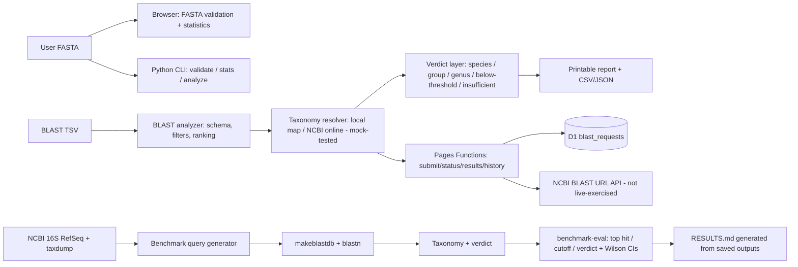

# Smart Bioinformatics Toolkit

> **RESEARCH AND EDUCATION USE ONLY — NOT A CLINICAL DIAGNOSTIC DEVICE.** This toolkit
> interprets BLAST similarity evidence; it does not prove species identity, is not clinically
> validated, and must not be used to make treatment or patient-management decisions. See
> [Research use only and limitations](#research-use-only-and-limitations).

A modular, framework-free bioinformatics workspace for FASTA quality checks and 16S rRNA
BLAST evidence interpretation. Two matching interfaces are provided:

- A browser application built with plain HTML, CSS and vanilla JavaScript ES modules.
- A Python command-line interface built with Biopython, Pandas and `argparse`.

Each tool is usable independently. FASTA validation and statistics run locally in the
browser; those tools upload no sequence. Remote BLAST is an explicit, opt-in feature backed
by Cloudflare Pages Functions and D1 (see [Live deployment](#5-live-deployment-and-deploying-your-own)).

## Product vision reset (2026-11-24)

This repository is now the first module of **Smart Bioinformatics AI**, a modular
research platform where a user describes a biological question in natural language,
reviews a generated plan, approves it, and receives validated results plus a reproducible
report. The original 16S toolkit is preserved and reused as the first analysis plugin.

- Vision and scope: [`PRODUCT_VISION.md`](PRODUCT_VISION.md), [`PRODUCT_REQUIREMENTS.md`](PRODUCT_REQUIREMENTS.md)
- Architecture: [`SYSTEM_ARCHITECTURE.md`](SYSTEM_ARCHITECTURE.md), [`AI_AGENT_ARCHITECTURE.md`](AI_AGENT_ARCHITECTURE.md)
- Infrastructure and APIs: [`COMPUTE_INFRASTRUCTURE.md`](COMPUTE_INFRASTRUCTURE.md), [`API_INTEGRATION_ROADMAP.md`](API_INTEGRATION_ROADMAP.md)
- Market and plan: [`COMPETITOR_ANALYSIS.md`](COMPETITOR_ANALYSIS.md), [`IMPLEMENTATION_ROADMAP.md`](IMPLEMENTATION_ROADMAP.md)
- New AI workspace: `/ai.html` (plan review → approval → real local execution → validation → explanation → report)
- Exact MVP wire contract: [`shared/AI_PLATFORM_CONTRACT.md`](shared/AI_PLATFORM_CONTRACT.md)
- Reproducible demo: [`docs/DEMO_SCRIPT.md`](docs/DEMO_SCRIPT.md); independent verification: [`docs/discovery/TEST_REPORT.md`](docs/discovery/TEST_REPORT.md)

The AI planner and explainer are **deterministic by default** — no LLM key or paid service
is required. All scientific values come from the existing `smartbio` engine, never from a
language model. The historical benchmark figures below are **UNVERIFIED in this tree**
(the source `benchmark_data/RESULTS.md` is absent and was never tracked); do not quote them.

## Claim provenance

Scientific and external claims here are mapped to rows in
[`docs/EVIDENCE_LEDGER.md`](docs/EVIDENCE_LEDGER.md) (format: `claim | source URL opened |
date | agent | verified-by`). **UNVERIFIED ledger rows are labelled as such and are not
presented as settled fact.** Historical benchmark numbers were copied from
`benchmark_data/RESULTS.md`, but that file and the `benchmark_data/` tree are **absent and
were never tracked in git**. They are therefore UNVERIFIED in this tree and must be
regenerated (`docs/BENCHMARK_PROTOCOL.md`) before external use.

| Ledger claim (abbreviated) | Status | Used here |
| --- | --- | --- |
| NCBI BLAST URL API CMD=Put/Get params and limits | verified | remote backend, API notes |
| 16S database name `16S_ribosomal_RNA` | verified | local/remote BLAST commands |
| Bacterial 16S RefSeq targeted-loci data | verified | benchmark provenance |
| Benchmark numbers (held-out/noisy) | **UNVERIFIED in this tree** (source `benchmark_data/RESULTS.md` absent/untracked) | benchmark results — do not quote |
| Deployment succeeded (Cloudflare Pages Free) | verified (tester independent) | live deployment |
| Curated 16S unresolved at species level (B. cereus group) | UNVERIFIED | difficult-group warning |
| Viridans streptococci genus-only ID | UNVERIFIED | difficult-group warning |
| E. coli/Shigella 16S >99% similarity | UNVERIFIED | difficult-group warning |
| RDP official pages unreachable -> REJECT | UNVERIFIED | what did not work |
| Correction: Kim et al. 2014 98.65% paper is PMID 24505072, NOT 24357014 | UNVERIFIED (citation checker) | 98.65% caveat |

Operational commands, local paths, test commands and backend configuration are documented in
local project files (`docs/BENCHMARK_PROTOCOL.md`, `docs/CONTRACTS.md`,
`web-platform/functions/README.md`, `web-platform/wrangler.toml`) rather than the ledger;
they are reproducibility instructions, not external factual claims.

## Quickstart (clean clone)

### Prerequisites

- Python 3.10+ with `pip` (`python-engine/requirements.txt`: Biopython, Pandas, pytest).
- Node.js 18+ for the JavaScript tests (npm optional; the static app has no build step).
- NCBI BLAST+ (`blastn`, `makeblastdb`, `blastdbcmd`) **only** for local BLAST runs and the
  benchmark. Install it from NCBI; no installer is bundled in this repository.
- `npx` / Wrangler **only** if you want to deploy your own copy.

### 1. Run both test suites

From the repository root:

```bash
cd python-engine
python -m pip install -r requirements.txt
python -m pytest
```

```bash
cd web-platform
npm test                 # equivalent to: node --test tests/*.test.mjs
```

Both suites must pass. The Python suite covers validation, statistics, the BLAST analyzer,
taxonomy/verdict logic and the benchmark evaluator; the JavaScript suite uses the same
shared fixtures and additionally tests the Pages Functions against a fake D1 in
`MOCK_NCBI=1` mode.

### 2. Serve the web app locally

No frontend framework, Node build step or package installation is required to view the app:

```bash
cd web-platform
python -m http.server 8000 --directory public
```

Open <http://localhost:8000>. Opening `web-platform/public/index.html` directly also works,
but a local server is recommended for ES modules. The `/api/blast/` endpoints exist only
after deployment (or under a local Wrangler dev server); the static pages work without them.

### 3. CLI commands

```bash
cd python-engine

# FASTA validation and statistics
python main.py validate --input ../shared/test-cases/dna_valid.fasta --type dna
python main.py stats --input ../shared/test-cases/dna_valid.fasta --type dna --csv-out output/sequence_statistics.csv
python main.py analyze --input ../shared/test-cases/dna_valid.fasta --type dna --out-dir output/demo-run
python main.py analyze --input ../shared/test-cases/protein_valid.fasta --type protein --out-dir output/protein-run

# BLAST tabular analyzer (standard outfmt 6, extended 11-column, or blastn_local_v1)
python main.py blast --input ../shared/test-cases/blast_sample.tsv --schema auto --min-query-coverage 80 --query-lengths ../shared/test-cases/ql.tsv --out-dir output/blast-run

# Local BLAST+ execution (requires installed blastn and a local database)
python main.py blast-run --input ../shared/test-cases/dna_valid.fasta --database /path/to/16S_ribosomal_RNA --task megablast --evalue 1e-5 --max-target-seqs 500 --threads 1 --out-dir output/local_blast

# Taxonomy consensus + verdict
python main.py taxonomy --input ../shared/test-cases/verdict_pipeline.tsv --taxonomy-map ../shared/test-cases/verdict_pipeline_map.tsv --schema blastn_local_v1 --out-dir output/verdict-demo

# Benchmark helpers (see next section)
python main.py benchmark-queries --reference reference_16S.fasta --mode heldout --n 50 --out-dir output/bench
python main.py benchmark-eval --analysis output/verdict-demo/taxonomy_analysis.json --truth output/bench/truth.tsv --out-dir output/bench-eval
```

Available commands: `validate`, `stats`, `analyze`, `blast`, `blast-run`, `taxonomy`,
`benchmark-queries`, `benchmark-eval`. Run `python main.py <command> -h` for options.

### 4. Reproduce the verified real benchmark

The verified chain is section "Verified real pipeline" of
[`docs/BENCHMARK_PROTOCOL.md`](docs/BENCHMARK_PROTOCOL.md). **It cannot run from a clean
clone alone**: `benchmark_data/` is not tracked in git, and the NCBI reference, taxdump and
accession-to-taxid mapping must be downloaded first. Verified inputs, download dates and
hashes are recorded in `benchmark_data/RESULTS.md`.

```bash
# 1. taxonomy map (nodes + names; fails loudly if neither name source is supplied)
python scripts/build_taxonomy_map.py \
  --nodes benchmark_data/taxdump_extract/nodes.dmp \
  --names benchmark_data/taxdump_extract/names.dmp \
  --accessions benchmark_data/accession2taxid.tsv \
  --output benchmark_data/taxonomy_map.tsv

# 2. taxid map for makeblastdb: accession<TAB>taxid, header removed; handled by run_benchmark.py

# 3. full pipeline (held-out headline). This is the protocol command verbatim;
#    it lists seeds 1-5, while the published RESULTS.md headline is the seeds 1,2,3 run.
python scripts/run_benchmark.py \
  --reference benchmark_data/bacteria.16SrRNA.fna \
  --taxonomy-map benchmark_data/taxonomy_map.tsv \
  --taxid-map benchmark_data/taxid_map.tsv \
  --out-dir benchmark_data/benchmark_runs_expanded/heldout_L500_s0.5 \
  --mode heldout --seeds 1,2,3,4,5 --n 200 --length 500 --substitution-rate 0.005
# other conditions: --length 300 / 1000, --substitution-rate 0.01, --indel-rate 0.01

# 4. regenerate RESULTS.md from saved JSON (never hand-edit it)
python scripts/generate_results.py
```

The 2026-11-24 NCBI taxdump contains `nodes.dmp` and `names.dmp` but **no**
`rankedlineage.dmp`; the accession-to-taxid mapping (26,888 rows) was extracted from
`bacteria.16SrRNA.gbff.gz`. Saved raw outputs and command logs are under
`benchmark_data/benchmark_runs_heldout4/`, `benchmark_runs_noisy2/`,
`benchmark_runs_expanded/` and `run_*.log`.

### 5. Live deployment and deploying your own

A preview deployment is live at **https://4e5048a8.smart-bioinformatics-toolkit.pages.dev**.
Deployment on the Cloudflare Free plan succeeded (EVIDENCE_LEDGER: "Deployment succeeded
(Cloudflare Pages Free)"). Live browser rendering was **not** independently verified in the
build environment: both the paired browser and `curl` rejected the `pages.dev` TLS
certificate there; the Cloudflare API confirmed the deployment exists and succeeded.

The static UI is served by Cloudflare Pages, and the `/api/blast/*` endpoints are
**Cloudflare Pages Functions** (plain ES modules, no framework, no R2, no paid services)
backed by a **D1** database:

- `web-platform/functions/api/blast/{submit,status/[rid],results/[rid],history}.js`.
- D1 binding `BLAST_DB`, table `blast_requests`
  (`web-platform/migrations/0001_create_blast_requests.sql`).
- `web-platform/wrangler.toml` declares `database_id = "REPLACE_WITH_D1_DATABASE_ID"`.
  **Create a D1 database and replace this placeholder before deploying**, then apply the
  migration:
  ```bash
  npx wrangler d1 migrations apply smart-bioinformatics-toolkit-blast --remote
  npx wrangler pages deploy public
  ```
- Set `NCBI_TOOL` and `NCBI_EMAIL` to identify the client to NCBI. Set `MOCK_NCBI=1` to
  disable all NCBI network calls: submission returns a deterministic RID, the first status
  check advances the job to `complete`, and results are a small synthetic TSV explicitly
  labelled `MOCK DATA` — not biological data. The tests use this mode with a fake D1.
- Only a SHA-256 hash of submitted FASTA is stored; the sequence itself is never written to
  D1, logged, or returned. Status polling is limited to once per minute per RID.

The backend submits to the NCBI BLAST URL API against `16S_ribosomal_RNA` with
`PROGRAM=blastn`. **No live NCBI request was exercised in this project** — only MOCK mode
and mocked tests. See [`docs/CONTRACTS.md`](docs/CONTRACTS.md) and
[`web-platform/functions/README.md`](web-platform/functions/README.md).

## Architecture



## Research use only and limitations

- **Research and education only.** Not a validated clinical diagnostic device; no clinical
  treatment recommendations. BLAST similarity is evidence, not proof of species identity or
  function. Support fractions are evidence fractions, not calibrated probabilities.
- **Difficult-group member lists need curator review.** The groups in
  `shared/difficult-groups.json` (Bacillus cereus group, mitis-group viridans streptococci,
  Escherichia/Shigella complex) carry `needs_curator_review: true`. Their member lists,
  display names, notes and sources are illustrative and **UNVERIFIED** in the ledger (ledger
  rows: B. cereus unresolved at species level, viridans genus-only ID, E. coli/Shigella
  >99% similarity). All such claims are pending human expert review in
  [`docs/EXPERT_REVIEW_REQUEST.md`](docs/EXPERT_REVIEW_REQUEST.md).
- **Name drift is not implemented.** There is no valid-name / name-drift flag and no
  nomenclatural-validity check. The handling of "uncultured", "sp." and "Candidatus" is only
  an uninformative-name filter. See [`docs/NAME_DRIFT_NOTES.md`](docs/NAME_DRIFT_NOTES.md).
- **98.65% is a screening reference, not a universal species boundary.** A value below it
  does not establish a novel species. The originating paper citation is itself UNVERIFIED
  pending a citation checker (ledger correction: PMID 24505072, not 24357014).
- **Benchmark limits** (all from `benchmark_data/RESULTS.md`): truth comes from FASTA headers
  and can be wrong; one database release; simulated substitutions/indels are not real
  sequencing error or strain variation; queries are the first 500 nt (V1-V3-like start
  region); held-out removes the source accessions but the true species may still be
  represented by other strains; group-level containment of truth was 0 in these runs. The
  verdict makes far fewer wrong calls but also calls a species far less often — compare call
  rates together with wrong counts.
- **FASTA is not sequencing quality.** No per-base Phred scores; AB1/FASTQ assessment is a
  future feature. N50/L50 are descriptive collection metrics, not identification evidence.
- **Online NCBI taxonomy resolution (`--online`) and the remote BLAST backend were only
  mock-tested**; no live NCBI request was made. The live `pages.dev` page was not re-verified
  in a real browser in this environment (TLS certificate rejection).

### Benchmark results (headline, copied from `benchmark_data/RESULTS.md`)

Held-out, n=200 per seed, length=500 nt, substitution rate=0.005, seeds 1, 2, 3:

| Method | Calls/200 (mean) | Wrong calls (mean) | Wrong rate among calls | Abstentions (mean) |
| --- | --- | --- | --- | --- |
| Plain top hit | 200.0 | 143.3 | 0.717 | 0.0 |
| Top hit + 98.65% cutoff | 87.7 | 38.0 | 0.431 | 112.3 |
| Toolkit verdict | 49.7 | 12.7 | 0.257 | 150.3 |

Noisy sanity, same conditions:

| Method | Calls/200 (mean) | Wrong calls (mean) | Wrong rate among calls | Abstentions (mean) |
| --- | --- | --- | --- | --- |
| Plain top hit | 200.0 | 9.0 | 0.045 | 0.0 |
| Top hit + 98.65% cutoff | 196.7 | 9.0 | 0.046 | 3.3 |
| Toolkit verdict | 142.0 | 1.3 | 0.010 | 58.0 |

Per-seed wrong calls (top / cutoff / verdict) — held-out: seed 1: 142 / 45 / 13; seed 2:
133 / 25 / 10; seed 3: 155 / 44 / 15. Wilson 95% CI on the correct-call rate (seed 1): top
[0.2315, 0.3564], cutoff [0.4374, 0.6321], verdict [0.6113, 0.8445]. Noisy per-seed values,
Wilson intervals and full provenance hashes are in `benchmark_data/RESULTS.md`.

## Detailed reference

### Validation rules and metric definitions

The accepted symbols are configured in `shared/sequence-rules.json`.

- DNA accepts the IUPAC nucleotide alphabet `ACGTRYSWKMBDHVN`. `U` is not accepted in DNA
  mode; RNA support can be added as a separate explicit mode later.
- Protein accepts the standard amino acids plus `B`, `Z`, `J`, `X`, `U`, `O` and `*` (stop).
- Lowercase sequence letters are normalized to uppercase; spaces and tabs inside sequence
  lines are ignored; the identifier is the first whitespace-delimited header token.
- Duplicate identifiers are flagged; every record sharing a duplicated identifier is invalid.
- Ambiguous but valid IUPAC DNA symbols are warnings, not errors. For protein, `B`, `Z`,
  `J`, `X`, `U` and `O` are non-canonical; `*` is counted separately as a stop symbol.
- DNA GC% is `(G + C) / (A + C + G + T) * 100`; ambiguous bases are excluded from the
  denominator and counted separately.
- Statistics use only valid, non-empty records. N50 is the sequence length at which the
  cumulative length of sequences sorted longest-to-shortest reaches at least 50% of the total
  valid length; L50 is the number of sequences needed to reach that point.
- These are data-quality checks, not sequencing-quality assessment. FASTA has no Phred
  scores. N50/L50 are shown for DNA collections only and are not identification evidence.

### BLAST Results Analyzer (independent tool)

Imports a tabular BLAST file produced elsewhere; it does not run BLAST. Supported schemas:
standard 12-column outfmt 6, extended 11-column, and `blastn_local_v1`. Schema selection is
explicit or inferred by uniform column count (12 or 11); mixed/unrecognized counts require an
explicit choice. For standard input `qlen` is absent and is never invented. Query coverage
is `(|qend - qstart| + 1) / qlen * 100` when `qlen` is available. Rows are ranked within each
query by bitscore, then E-value, identity and aligned length; ties are preserved. Queries with
no hits are listed when a query list or query FASTA is supplied. Exports: full JSON and a CSV
of displayed rows. BLAST similarity is not proof of species identity or function; an
insufficient-evidence outcome is acceptable.

### Local BLAST+ execution (`blast-run`)

Runs an installed NCBI BLAST+ `blastn` via subprocess and feeds tabular output into the
analyzer. Verify with `blastn -version` and `blastdbcmd -version`; create a database with
`makeblastdb -in references.fasta -dbtype nucl -out 16S_ribosomal_RNA`. Outputs:
`blast_results.tsv` (`blastn_local_v1`), `filtered_results.csv`, `analysis.json`,
`blast_run.json` (parameters, version, hashes, timing, warnings) and `execution.log`.
`max_target_seqs` can truncate tied hits; the tool warns when a query reaches the limit.
Database release/version is recorded only when `blastdbcmd` provides it.

### Taxonomy Analyzer (independent tool)

Builds a transparent consensus from compatible BLAST TSV. The optional taxonomy mapping TSV
has header `taxid  scientific_name  rank  parent_taxid  full_lineage`; the tool walks
`parent_taxid` chains so ancestors keep real taxids, and resolves `;`-separated `staxids` /
`sscinames` independently. It groups hits by query, ranks candidates by bitscore/E-value/
identity/coverage, keeps exact ties at the cutoff, computes LCA and support fractions over
unique species-level taxonomic units, and reports no-hit queries as insufficient evidence.
Outputs: `taxonomy_analysis.json` and `taxonomy_summary.csv`. `--schema auto` infers by column
count; `blastn_local_v1` is also 12 columns, so failed standard parsing deterministically
re-parses using the sibling `blast_run.json`. The browser page sets the schema explicitly.
Defaults `--top-n 10` and `--min-consensus 0.8` are experimental, not biological standards.

### Project layout

```text
smart-bioinformatics-toolkit/
├── shared/                 # sequence rules, shared test cases, difficult groups
├── python-engine/          # CLI, src/smartbio, tests, requirements.txt
├── web-platform/
│   ├── public/             # static HTML/CSS/JS (no build step)
│   ├── functions/api/blast/# Pages Functions: submit / status / results / history
│   ├── migrations/         # D1 schema for blast_requests
│   └── tests/              # JavaScript tests (incl. Pages Functions with fake D1)
├── scripts/                # benchmark and taxonomy-map build scripts
└── docs/                   # protocol, contracts, evidence ledger, reviews
```

### Development rules for future contributors

- Keep the frontend framework-free: HTML, CSS and vanilla JavaScript ES modules only.
- Keep quick tools independently usable; do not force a single full pipeline.
- Do not upload user sequences unless a feature explicitly requires a remote service and the
  user initiated that action; do not store FASTA in R2.
- Do not run BLAST+ inside Pages Functions; local BLAST+ belongs in the Python CLI, remote
  BLAST uses the NCBI URL API. Respect NCBI usage limits and identify the client.
- Keep scientific interpretations evidence-based; BLAST similarity is not proof of identity
  or function; never claim clinical validity.
- Add Python and JavaScript tests whenever validation or metric behavior changes; preserve
  compatibility between the two output schemas.
- Record third-party dependencies and licences before copying or adapting source code.
