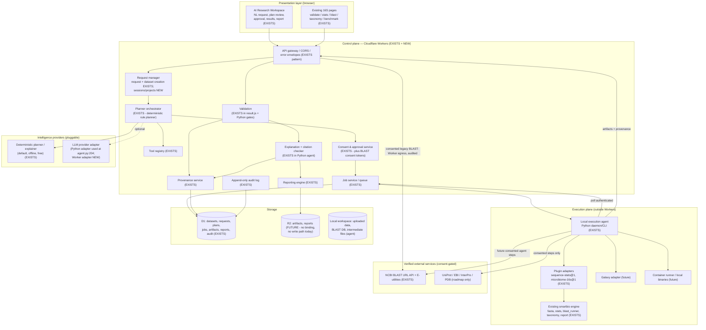

# System Architecture — Smart Bioinformatics AI

**Version:** 1.0 (vision reset, 2026-11-24)
**Status:** Architecture with status labels reconciled against code on 2026-11-24. Components marked **EXISTS** are present in milestone 0.5; **NEW** are to be built; **FUTURE** is planned but not implemented. The diagram below retains its original shape; labels were corrected where the code already implements a component. Storage reality: D1 only — **no R2 binding or R2 write exists today**.
**Companion:** `AI_AGENT_ARCHITECTURE.md`, `COMPUTE_INFRASTRUCTURE.md`, `API_INTEGRATION_ROADMAP.md`, `docs/DATA_TRANSPORT.md`.

---

## 1. Architectural principles

1. **Control plane ≠ compute plane.** Cloudflare Workers orchestrate, validate, store and serve. They never run BLAST, aligners or statistics over large data.
2. **Deterministic compute, probabilistic interface.** LLMs may interpret, plan and explain; only registered tools produce scientific values.
3. **Plan → approve → execute → validate → explain → report.** This is a hard pipeline; later stages cannot be reached without earlier ones.
4. **Provenance is a first-class record**, written by the engine at each step, not reconstructed from logs.
5. **Plugins are the extension seam.** The control plane knows nothing about domain algorithms.
6. **Consent is a data-flow gate**, not a checkbox in a settings page.
7. **Offline-first default.** No mandatory paid API key; deterministic fallbacks keep the MVP functional.

## 2. High-level architecture



**Status reconciliation (2026-11-24).** The labels above follow the code, not the original aspiration: the AI workspace UI, request/dataset creation, deterministic planner, registry, approval gate, job queue, report/provenance assembly, audit log and Python agent all exist; the Worker-side LLM adapter, session/project management and R2 storage do not. The `R2` box is therefore **FUTURE**, not an implemented tier: `web-platform/wrangler.toml` declares only the `BLAST_DB` D1 binding and no `functions/**` module writes to R2. All artifacts and reports are inline D1 rows (`functions/api/ai/jobs/[id]/result.js:119-170`). See §10 and `docs/DATA_TRANSPORT.md`.

## 3. Component responsibilities

| Component | Owns | Does **not** own |
|---|---|---|
| **API gateway** | Request validation, CORS, consistent error envelope, `execution_mode` flag | Scientific logic |
| **Request manager** *(internal service of the Project Manager)* | NL request records, conversation state | Independent ownership of projects/datasets (owned by Project Manager) |
| **Planner orchestrator** | Builds a typed plan from intent + registry + policies; calls LLM adapter only if enabled | Executing steps |
| **Tool registry** | Manifests, JSON Schemas, capability/backend matching, availability | Running tools |
| **Consent service** *(internal service of the Project Manager)* | Per-step external-data flags, approval tokens, expiry | Storing datasets; writing audit events |
| **Job service** | Durable job rows, state machine, agent dispatch, timeouts | Scientific validation |
| **Local execution agent** | Fetch approved job, sandbox workspace, invoke plugin adapter, capture outputs + provenance, post results | Deciding what to run |
| **Validation agent** | Schema checks, consistency, suspicious-output detection | Rewriting results |
| **Explanation agent** | Evidence-bounded prose, citation checking, limitations | Inventing numbers |
| **Reporting engine** | Deterministic HTML/JSON/CSV report assembly | Interpretation beyond validated fields |
| **Provenance service** | Immutable step records, artifact hashing, DAG reconstruction | UI rendering |
| **Audit log** | Append-only record of approvals, egress, failures; written only through the Project Manager | Read-time mutation |

## 4. Data flow — MVP sequence

```mermaid
sequenceDiagram
    participant U as User (browser)
    participant W as Worker control plane
    participant P as Planner (rule/LLM)
    participant D as D1
    participant A as Local execution agent
    participant T as smartbio plugin
    participant N as NCBI (optional, consented)
    participant V as Validation + Explanation

    U->>W: POST /api/ai/requests {text, datasetId, projectId}
    W->>W: preflight dataset validation (format/size/alphabet)
    W->>P: build plan(intent, dataset summary, tool registry)
    P-->>W: plan {steps[], external_egress[], estimated_cost}
    W->>D: persist plan + request
    W-->>U: plan + consent prompts (human + machine readable)
    U->>W: POST /api/ai/plans/{id}/approve {step approvals, consents}
    W->>D: create jobs, provenance "planned" records, audit "approved"
    loop agent poll
        A->>W: GET /api/ai/jobs?agentId=...&status=queued
        W-->>A: approved jobs
    end
    A->>T: run tool with exact recorded parameters
    T-->>A: real artifacts + tool version
    opt consented external step (legacy BLAST: Worker egress)
        W->>N: CMD=Put with single-use consent token (approved hash/db/program)
        N-->>W: RID / results
    end
    A->>W: POST /api/ai/jobs/{id}/result {artifacts, provenance, logs}
    W->>V: validate → explain → cite-check
    V-->>W: validation flags + explanation + references
    W->>D: persist results/provenance/audit
    W->>D: build report HTML, store in D1 (report_runs.report_html; R2 future)
    W-->>U: GET /api/ai/runs/{id} → results, explanation, report URL
```

**Invariant:** no arrow from `A` to `N` exists unless the approval record for that step contains `consent.granted === true`. The implemented legacy path is `W -> N`: the Worker submits with a granted, single-use token and records the egress in `audit_events` before and after NCBI contact.

**Legacy BLAST consent gate (implemented).** The legacy endpoint `/api/blast/submit` transmits from the **Worker**, not from the agent. The approval step now issues a short-lived, single-use `consent_token` bound to the SHA-256 of the approved FASTA, database and program; the endpoint rejects any direct POST without a matching, unexpired, unused token with a typed 403, in mock mode as well. Status and results use `CMD=Get&RID=...` only and transmit no sequence. See `docs/DATA_TRANSPORT.md` §4.

## 5. Data model (D1, additive migrations `0002_ai_platform.sql` and `0003_blast_consent.sql`)

Existing table: `blast_requests` (rid, status, timestamps, input_hash, result_tsv). Kept unchanged by every migration.

New tables (logical names):

| Table | Key fields | Purpose |
|---|---|---|
| `projects` | id, name, owner, created_at, settings | Project manager root |
| `datasets` | id, project_id, filename, sha256, size_bytes, mime, storage_ref, created_at | Uploaded data; hash is the identity |
| `ai_requests` | id, project_id, dataset_id, raw_text, inferred_intent, confidence, created_at | NL request record |
| `plans` | id, request_id, version, plan_json, created_at | Immutable plan versions |
| `approvals` | id, plan_id, step_id, approved_by, consents_json, approved_at, expires_at | Consent gate evidence |
| `jobs` | id, plan_id, step_id, status, backend, agent_id, attempts, timeout_s, created_at, started_at, finished_at | Durable work items |
| `tool_runs` | id, job_id, tool_id, tool_version, params_json, input_refs_json, output_refs_json, started_at, finished_at | Provenance per invocation |
| `artifacts` | id, run_id, kind, storage_ref, sha256, bytes, mime | Content-addressed outputs |
| `references` (physical table `evidence_references`) | id, key, title, url, doi, license, verified_by, verified_at, notes, verified | Evidence ledger (curated, not LLM-generated) |
| `report_runs` | id, plan_id, job_id, report_ref, explanation_ref, validation_ref, report_html, created_at | Generated deliverables |
| `audit_events` | id, actor, action, target, detail_json, timestamp | Append-only |
| `blast_consents` (additive `0003_blast_consent.sql`) | token, input_hash, database, program, granted, expires_at, created_at, used_at | Single-use consent grants for legacy BLAST egress |

**Storage reality:** datasets, artifacts, reports and audit events live in **D1 rows today** — `datasets.fasta_text`, `artifacts.content`, `report_runs.report_html` (`functions/api/ai/jobs/[id]/result.js:119-170`) — with `d1://...` storage references. There is no R2 bucket binding and no R2 write path. Raw uploaded datasets are **never silently uploaded to Cloudflare R2**.

**Provenance record shape** (emitted by `tool_runs` + `artifacts`):

```json
{
  "run_id": "...",
  "step_id": "stats-1",
  "tool": { "id": "sequence-stats", "version": "1.0.0", "backend": "local-python" },
  "input": { "dataset_id": "...", "sha256": "...", "path": "..." },
  "parameters": { "sequence_type": "dna" },
  "database": { "name": null, "release": null, "retrieved_at": null },
  "output": { "artifact_ids": ["..."], "sha256": "..." },
  "timing": { "started_at": "...", "finished_at": "..." },
  "execution_mode": "real"
}
```

## 6. API surface (Workers)

| Method | Path | Purpose |
|---|---|---|
| POST | `/api/ai/requests` | Create request + dataset reference, return inferred intent |
| GET | `/api/ai/plans/:id` | Retrieve plan |
| POST | `/api/ai/plans/:id/approve` | Approve steps with consents → creates jobs; returns `blast_consent` token for consented external-egress steps |
| GET | `/api/ai/runs/:id` | Results, validation flags, explanation, report URL |
| GET | `/api/ai/projects/:id` | Project history |
| GET | `/api/tools` | Registered tools, schemas, availability |
| GET | `/api/ai/jobs` | Agent polling (authenticated by agent token) |
| POST | `/api/ai/jobs/:id/result` | Agent result submission (authenticated) |
| GET | `/api/ai/runs/:id/provenance` | Provenance DAG |
| GET | `/api/ai/runs/:id/report` | Downloadable HTML report |
| GET | `/api/audit` | Append-only audit events (read-only) |

Existing endpoints remain available for backward compatibility with one intentional change: `POST /api/blast/submit` now **requires** a `consent_token` in its JSON body (403 with a typed `code` when missing, invalid, denied, expired, used or mismatched); `/api/blast/status/:rid`, `/api/blast/results/:rid` and `/api/blast/history` are unchanged and carry no sequence data. Mock mode enforces the same gate.

No R2-backed endpoint exists. Reports are served from D1 (`GET /api/ai/runs/:id/report`).

## 7. Technology choices

| Layer | Choice | Rationale |
|---|---|---|
| Frontend | Vanilla HTML/CSS/JS (matches existing `public/**`) | No framework migration; preserves current UI |
| Control plane | Cloudflare Workers + D1 (R2 future, not bound) | Already deployed; cheap; good for orchestration |
| Validation / schema | JSON Schema (draft 2020-12) in `shared/schemas/**` | Language-neutral plugin contracts |
| Local agent | Python 3.11+, `httpx`/`urllib`, stdlib `argparse`, existing `smartbio` package | Reuses entire existing engine |
| Plugin contract | JSON manifest + Python adapter class | Allows future non-Python adapters |
| LLM provider | Adapter interface with deterministic default | No mandatory paid dependency |
| Reports | Existing `smartbio.taxonomy.report` patterns + new platform report builder | Reuse reproducibility metadata conventions |
| Tests | `pytest` (Python), `node --test` (JS) | Matches existing suites |

## 8. Security and trust boundaries

- **Browser → Worker:** HTTPS, request size limit, validated JSON, no direct calls to biological APIs.
- **Worker → Agent:** long-lived agent token; agent pulls jobs (no inbound port needed); result submissions authenticated and schema-checked.
- **Agent → external API:** only via approved step; `email`/tool identification where required; rate-limited; recorded in audit log.
- **Agent workspace:** each job gets an isolated temp directory; path traversal checked; file sizes capped; subprocess timeouts enforced.
- **LLM output:** untrusted. Never executed, never used as a scientific value, never used as a citation. Parsed into a typed plan and validated against registry schemas before use.
- **Artifacts:** content-addressed by SHA-256; report links verify hashes before display.

## 9. Evolution path

| Phase | Change |
|---|---|
| MVP (now) | Local Python agent, 2 plugins, rule planner default, optional LLM, NCBI retained |
| Next | Galaxy adapter, more plugins (phylogenetics, transcriptomics), R2 artifact browser |
| Later | Container runner, multi-user auth, team projects, remote compute credits, workflow versioning UI |

No phase changes the control-plane contracts defined above.

## 10. Dataset transport and data-flow controls

See **`docs/DATA_TRANSPORT.md`** for the exact transport mechanism, the per-path table (path / what moves / trigger / consent requirement / validation / provenance / storage) and source citations. Summary of the controls that this architecture depends on:

- **Browser-local by default.** Local files are read into memory; analysis modules make no network calls.
- **D1-only cloud storage today.** Dataset text, artifacts and report HTML are inline D1 rows with `d1://...` references; R2 is a **future** tier with no binding and no write path. "No silent upload of local datasets to Cloudflare R2" is therefore verifiable in code.
- **Bounded inline execution path.** `MAX_FASTA_BYTES = 64 * 1024` caps browser → Worker → D1 → agent input; the agent stages it in an isolated temporary workspace and returns capped results inline; heavy compute stays out of Workers.
- **Consent-gated external egress.** The legacy NCBI `CMD=Put` path requires a single-use `consent_token` issued by the approval endpoint and bound to the exact input hash, database and program. Missing/denied/expired/used/mismatched tokens are rejected with typed 403 responses, including in mock mode.
- **RID-only polling.** Status and results endpoints transmit only an RID to NCBI, never the user sequence.

Known gaps are tracked in `docs/API_INTEGRATION_ROADMAP.md` (RID TTL, global rate limit, tool/email identification, evidence-ledger disagreement) and are **not** implied to be implemented by this section.

## 11. M7.4 unified research workspace (status: API layer EXISTS, browser UI NOT BUILT)

- A new owner-scoped `/api/workspace/**` surface indexes projects, dataset **metadata** (no bytes, no public URLs), a unified run lifecycle and provenance on the existing D1 binding. See `docs/M7_4_WORKSPACE_DESIGN.md`.
- **Authorization is owner scoping on the existing single operator token, not multi-user accounts.** `deriveOwner` hashes `X-Agent-Token` with SHA-256 and stores only `owner_<hex16>`; the raw token is never persisted or returned. Every workspace row is filtered by that owner in SQL; cross-owner reads return 404. There is no login/session system.
- Additive `0011_workspace.sql` extends `projects`/`datasets` and adds `workspace_runs` + `provenance_records`. Reports reuse `report_runs` (parent-run owner check), so no new reports table and no R2 binding.
- The static catalog has exactly two entries. `16s-rrna-identification` is `available-browser-and-local-agent`; `msa-phylogenetics` is `partial-not-production-ready` per `docs/M7_3_PHYLOGENETICS_WORKFLOW_REPORT.md`. No live Galaxy call and no fabricated execution result is introduced.
- Batch 2 (browser UI) is **not** part of this change.
