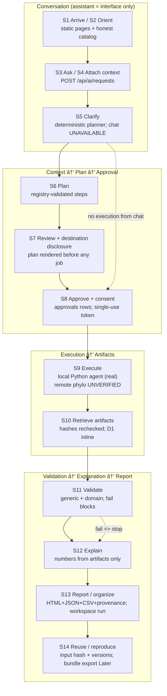
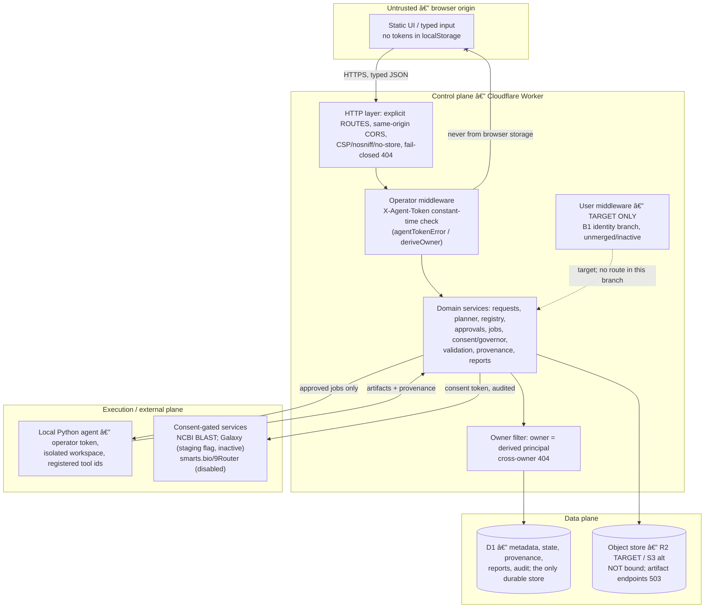
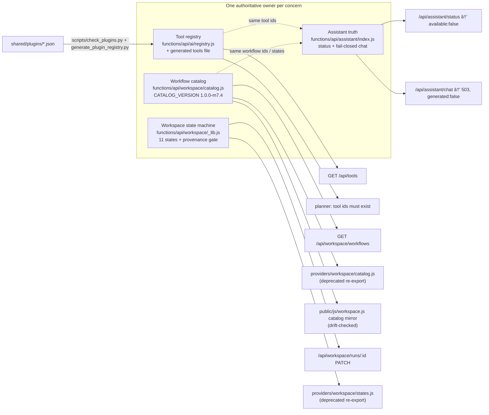
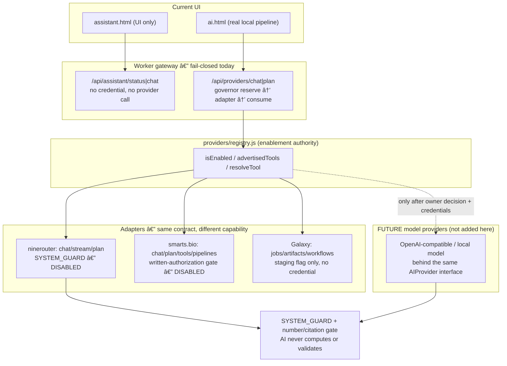

# Core Product Architecture — CORE PRODUCT COMPLETION

**Verification date:** 2026-11-26
**Branch:** `product/core-completion`
**Base commit:** `8105956c908ea6c0d5c053b5ed2c13b86516d2a2`
**Starting commit (M7.6 reconciliation):** `0303e615e4cdf71a9b97038773a537beab9acdb9`
**Final commit:** `543358f8aa466b78fa8fab8c78eb2392e40f5881` (M7.6 code fix + documentation reconciliation)
**Current staging deployment:** `c00c6245-c91e-4bc2-9b64-881677b97972`
**CURRENT implementation snapshot:** branch `product/core-completion`, base `8105956…`, starting commit `0303e615…`, staging deployment `c00c6245-c91e-4bc2-9b64-881677b97972`, verification date 2026-11-26. A separate code-fix worker is adding the corrected NCBI database identifier and 16S readiness changes after the starting commit; this document claims none of that code. The earlier statement that current-state statements describe base `8105956` with concurrent uncommitted `worker.js` (`/api/tools/catalog`), `providers/tools/` and assistant UI changes is retained as **history** for the M7.5 pass. Earlier staging deployments `892f4266-2afa-4a0f-aa3f-00585764faf5` / `ed08189a-5db2-41b1-98f3-732b5c97992f` and HEAD `32abf86e6ab8da6819454103286c06e0b62d1076` are **history only**.

**Status:** target architecture + honest current state. Documentation-only: no code, config, migration, secret or deployment was changed. This document **does not** introduce a second design system; the existing **Precision Instrument Bench** system (`docs/DESIGN_SYSTEM.md:8`, `docs/BRAND_IDENTITY.md:5`) remains the only visual language.

**Hard environment statement:** **no provider credential is available in this branch, and no live Galaxy call is permitted.** All three provider flags are `"false"` in production, staging enables Galaxy only, and the B1 identity branch is not merged (`web-platform/wrangler.toml:15-18,39-43`; `docs/M7_1_LIVE_ACTIVATION_REPORT.md:6,70-81`; `docs/M7_3_PHYLOGENETICS_WORKFLOW_REPORT.md:98`). Nothing below authorizes activating a provider, installing a key or calling an external service. A genuine consent-governed NCBI submission was made historically (RID `GF4KCK07016`) and is reported as history; a **corrected live submission requires EXPLICIT OWNER AUTHORIZATION and has NOT happened**. No new NCBI call was made in this documentation pass.

---

## 1. Architectural contract (unchanged from the approved foundations)

1. **Control plane ≠ compute plane.** Workers orchestrate, validate, store and serve; they never run BLAST, aligners or large statistics (`SYSTEM_ARCHITECTURE.md:11`; `PRODUCT_REQUIREMENTS.md:113,120-121`).
2. **Deterministic compute, probabilistic interface.** AI may interpret, plan and phrase; only registered tools produce scientific values (`SYSTEM_ARCHITECTURE.md:12`; `AI_AGENT_ARCHITECTURE.md:8-14`).
3. **Plan → approval → execution → validation → explanation → report is a hard pipeline** with immutable records (`SYSTEM_ARCHITECTURE.md:13`; `PRODUCT_REQUIREMENTS.md:30-34,69-82`).
4. **Provenance is first-class**; `succeeded` is blocked on a complete record (`docs/M7_4_WORKSPACE_DESIGN.md:94-106`).
5. **Consent is a data-flow gate**, not a settings checkbox; single-use, scoped, short-lived (`docs/DATA_TRANSPORT.md:63-64`; `functions/api/providers/consent.js`).
6. **Offline-first, fail-closed.** Deterministic planner by default, no mandatory paid key, no silent mock or provider fallback (`PRODUCT_REQUIREMENTS.md:111`; `PROVIDER_USAGE_POLICY.md`).
7. **One source of truth per concern** (آ§4). Compatibility shims re-export; they never own a second list.

---

## 2. End-to-end journey (14 steps mapped to the 8 canonical phases)

The canonical pipeline is `conversation → context → plan → approval → execution → validation → explanation → report` (`SYSTEM_ARCHITECTURE.md:1,114-148`). The mission's 14 researcher-visible steps are enumerated in `PRODUCT_NORTH_STAR.md آ§2`; the diagram labels each step with `S##` and marks what is real today.



**Evidence for each arrow:** `web-platform/worker.js:129-197` (routes), `functions/api/ai/plans/[id]/approve.js` (gate before jobs), `python-engine/src/smartbio/aiagent/agent.py` (tool execution), `aiagent/validation.py` (block), `aiagent/explanation.py` (grounded prose), `aiagent/report.py` and `functions/api/ai/runs/[id]/report.js` (report), `functions/api/workspace/runs/[id]/*` (organization), `docs/M7_4_WORKSPACE_DESIGN.md:90-106` (run states).

---

## 3. Trust boundaries



**Boundary rules (verified in code):**
- Browser → Worker: strict CSP (`web-platform/public/_headers`), same-origin-only CORS and `no-store` headers (`functions/api/ai/_lib.js` `baseHeaders/corsHeaders`), API paths never fall through to assets (`worker.js:207-216,295-296`).
- User plane vs operator plane: **there is no user plane in this branch.** `X-Agent-Token` is the single credential; `deriveOwner` hashes it to `owner_<hex16>` and pins it in SQL (`docs/M7_4_WORKSPACE_DESIGN.md:112-117`). Browser workspace local mode stores only labelled metadata JSON (`docs/M7_5_FOUNDATION_DESIGN.md:198-203`).
- Control plane vs data plane: D1 holds inline text and references; `metadata-only://` and `d1://` are labels, not proof of durable bytes (`docs/M7_5_FOUNDATION_DESIGN.md:236-248`).
- Worker vs external: egress only through consented steps; secrets server-side; no key in HTML/JS/URL/log (`docs/DATA_TRANSPORT.md:63-64`; `providers/galaxy/index.js:116`).
- LLM output is untrusted: `SYSTEM_GUARD` in `providers/ninerouter/index.js:32-34`, server-side assistant instruction in `functions/api/assistant/index.js:14-89`, evidence gate in `aiagent/explanation.py`.

---

## 4. Single source of truth per concern



**Why this matters:** the M7.4 reconciliation explicitly avoided deleting competing implementations; it converted them into shims so there is exactly one workflow id list, one transition map and one availability statement (`docs/M7_4_FINAL_REPORT.md:27,42-49`; `web-platform/providers/workspace/catalog.js:1-4`). Any future work must keep this property; adding a second catalog, a second state machine or a second assistant status source is a regression.

---

## 5. Provider abstraction for future models



**Contract shape (preserved, not reinvented):** `providers/common/contract.js` (`PROVIDER_IDS`, `OPERATIONS`, `AVAILABILITY`, `executableTools`, `normalizeProviderError`), `providers/common/governor.js`, `providers/common/normalize.js`, `providers/common/retry.js`; Python-side `AIProvider` interface with `DeterministicProvider` as default (`AI_AGENT_ARCHITECTURE.md:206-223`). A future model is added as an adapter behind this interface — never by giving the browser a key, flipping a disabled flag without approval, or allowing chat to execute tools (`PRODUCT_VISION.md:101-105`; `docs/ASSISTANT_UX_DESIGN.md:3-7,146-153`).

---

## 6. Honest current-state blockers

| # | Blocker | Consequence | Evidence | Allowed P0/P1 action |
|---|---|---|---|---|
| 1 | No enabled/authorized/reachable LLM; no credential | Assistant status `available:false`, chat 503 `generated:false` | `functions/api/assistant/index.js:91-97,106-180`; `docs/ASSISTANT_UX_DESIGN.md:15` | Document and label; do not enable or install credentials |
| 2 | All provider flags off; staging Galaxy only; account not activated; no key | No live provider job; no advertised tools; typed 403 probes | `wrangler.toml:15-18,39-43`; `docs/M7_1_LIVE_ACTIVATION_REPORT.md:6,70-81,88` | No live Galaxy call; no flag change |
| 3 | Full MAFFT → IQ-TREE → retrieval → validation → report unverified | `msa-phylogenetics` `production_ready:false` | `docs/M7_3_PHYLOGENETICS_WORKFLOW_REPORT.md:84-98`; `functions/api/workspace/catalog.js:44-48` | Promote local deterministic phylo only; keep remote claim hidden |
| 4 | No R2 binding/signing key | Artifact endpoints 503; bytes not durable | `wrangler.toml:20-23`; `docs/M7_5_FOUNDATION_DESIGN.md:236-248` | Keep fail-closed; no bucket |
| 5 | No human identity; workspace is token-derived owner + local scratchpad | No signup/login, no cross-device continuity, no per-user quota | `docs/M7_4_FINAL_REPORT.md:38-40,94-96`; `docs/M7_5_FOUNDATION_DESIGN.md:198-203` | No auth launch; B1 stays separate |
| 6 | Two 16S registry tools unavailable | 16S **local-agent Python** adapter path not wired into MVP planner without TSV + local DB; the **browser** BLAST TSV parser and taxonomy are available and exercised with clearly labelled synthetic TSV only | `registry.tools.generated.js:585-586,671-672`; `public/js/blast.js`, `public/js/taxonomy.js` | Keep honest `available:false` for the Python variants; do not mark browser functions unavailable, and do not imply a complete remote 16S workflow |
| 7 | `execution_mode` is accepted from agent self-report | Server cannot independently prove a step really executed | `functions/api/ai/_lib.js:270-281`; `docs/discovery/REVIEW_worker_ui.md:36` | Document trust boundary; no new claim |
| 8 | Benchmark source data absent | Published numbers cannot be verified from this tree | `docs/discovery/AUDIT_docs_consistency.md` D2 | Keep protocol; mark figures UNVERIFIED |
| 9 | Two documented endpoints absent from route table | `/api/ai/projects/:id`, `/api/audit` are not callable | `SYSTEM_ARCHITECTURE.md:201,207` vs `worker.js:129-197` | Correct docs; no new route in this program |
| 10 | Invalid NCBI database identifier in the submitted BLAST job | The genuine consent-governed RID `GF4KCK07016` **FAILED** at NCBI: `Status=FAILED`, `Error: No alias or index file found for nucleotide database [16S_ribosomal_RNA] in search path […]`. Our code submitted the bare `16S_ribosomal_RNA`; NCBI's current value is `rRNA_typestrains/16S_ribosomal_RNA`. No real TSV was retrieved; the `FORMAT_OBJECT=SearchInfo` `Status=READY`/`ThereAreHits=no` describes the format request and its `Status: Searching` row is a stale JS placeholder | `docs/evidence/M7_6_NCBI_DIAGNOSIS.md`; `docs/evidence/M7_6_status_url_raw.json`; `docs/evidence/M7_6_searchinfo_raw.json` | Code-fix worker is implementing the corrected identifier; **corrected live submission needs explicit owner authorization and has not happened**. **M7.7 correction:** `format_status_only` removed; valid SearchInfo QBlastInfo is search-status evidence in `mode="SearchInfo"`, but it CONTRADICTS canonical `Status=FAILED` -> typed `status_conflict` (terminal, reconciliation preserves both evidences); production re-verifies canonical `CMD=Get`, only canonical `complete` unlocks; invalid database decisive, no real result regardless; `rtoe` additive; no `CMD=Put`/provider change/no D1 migration (`docs/evidence/M7_6_NCBI_DIAGNOSIS.md` آ§7). Report the overall 16S workflow as PARTIAL / `production_ready:false` |
| 11 | Overall 16S workflow not production-ready | Browser-only statistics (NR_074666.1, 1 record, 1524 bp, GC 52.1654%, SHA-256 `07efc2c1aeac02a2eed1cbe8d8479b59ffa00a730e93ed65881b41069c652853`) and the real submission are individually verified, but no genuine NCBI result was retrieved, validated, displayed or exported | `docs/evidence/M7_6_NCBI_DIAGNOSIS.md`; `docs/CORE_PRODUCT_TEST_REPORT.md` | Keep the honest PARTIAL / `production_ready:false` label; never cite mock RID `MOCK07EFC2C1AEAC02A2` as real |

---

## 7. B1 identity branch — separate, inactive foundation

The branch `implementation/m7-5-b1-better-auth` (head `5d397de`) is **not merged** into this branch (base `8105956`). Its work is a foundation only:

- Pinned `better-auth@1.7.28`; additive migration `0012_identity.sql` (`user`, `session`, `account`, `verification` tables generated from the pinned CLI); `functions/api/auth/config.js` and `_lib.js` provide a **per-request factory and an offline `getSession` seam**.
- `AUTH_ENABLED = "false"` in production and staging; **no public `/api/auth/*` route or handler**; no existing handler's authorization behaviour changed; no signup/login/logout/verification/OAuth endpoint or auth UI (`docs/M7_5_B1_IMPLEMENTATION_REPORT.md` on that branch).
- No R2, KV, email/OAuth plugin, new credential or production deployment; no Version ID because nothing observable changed (same source).

**Architectural statement:** B1 is the target human-identity seam described in `docs/M7_5_FOUNDATION_DESIGN.md آ§4-آ§6` (Better Auth primary, Clerk alternative, operator/user separation, no auto-assignment of legacy rows). It is **inactive here** and must not be described as a working login system. This program documents it, does not import or activate it.

---

## 8. Design-system continuity

- Keep the **Precision Instrument Bench** visual system: cool porcelain surfaces, deep ink text, restrained teal accent, amber only for caution/gated states, hairline borders, `aria-hidden` decorative SVGs, monospace for sequences/IDs/parameters, tabular numerals, visible focus ring, `prefers-reduced-motion` collapse (`docs/DESIGN_SYSTEM.md:8,71-79`; `docs/BRAND_IDENTITY.md:5`; `docs/ASSISTANT_UX_DESIGN.md:75`).
- **No second design system.** No new framework, no React/Vue/Angular/Svelte, no build step (`docs/OPENCODE_HANDOFF_PROMPT.md:11`; `web-platform/package.json` has only Playwright as a dev dependency).
- Honest states are part of the visual language: unavailable, metadata-only, precomputed, unverified, `production_ready:false` are shown as text, not hidden behind decoration (`docs/M7_4_WORKSPACE_DESIGN.md:158-165`; `docs/ASSISTANT_UX_DESIGN.md:107-122`).

---

## 9. Reproducibility of this document's claims

```text
# Route and boundary evidence
grep -n 'key: "\|next: ()' web-platform/worker.js
# Catalog + production readiness
grep -n 'CATALOG_VERSION\|production_ready\|state:' web-platform/functions/api/workspace/catalog.js
# Assistant honest status
grep -n 'UNAVAILABLE_REASON\|available: false\|generated: false' web-platform/functions/api/assistant/index.js
# Feature flags (no credential in tree)
grep -n '_ENABLED\|ARTIFACT' web-platform/wrangler.toml
# Single-source shims
grep -n 'DEPRECATED\|deprecated' web-platform/providers/workspace/catalog.js
# The submitted NCBI database identifier (historically invalid, corrected in the final commit)
grep -n 'ALLOWED_DATABASE\|rRNA_typestrains' web-platform/functions/api/blast/_lib.js
```

**Previously verified surfaces (not re-run by this documentation pass):** `/`, `/16s.html`, `/assistant.html`, `/workspace.html`, `/ai.html`, `/blast.html`, `/taxonomy.html`, `/phylo.html`, `/benchmark.html`, `/research-use.html`; `/api/tools/catalog` (version `1.0.0-m7.4`, 12 tools); `/api/assistant/status` (`available:false`, `reason:"no_enabled_llm_provider"`). The authoritative raw evidence for the NCBI failure is `docs/evidence/M7_6_NCBI_DIAGNOSIS.md`, which references `M7_6_status_url_raw.json` and `M7_6_searchinfo_raw.json` by relative path.

Related documents: `docs/PRODUCT_NORTH_STAR.md` (journey and success criteria), `docs/PRODUCT_SCOPE_AUDIT.md` (keep/integrate/hide decisions), `docs/CORE_CAPABILITY_MATRIX.md` (capability ids and statuses). All historical reports remain in place as evidence.


