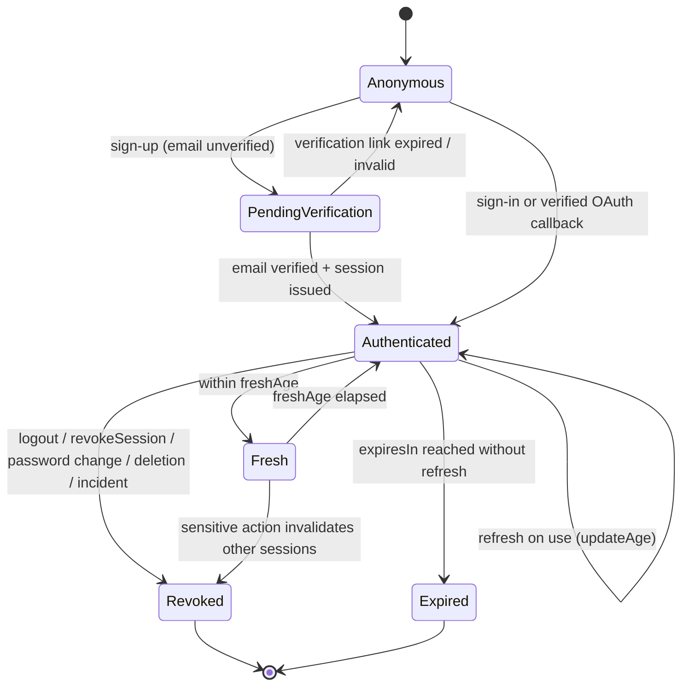

# M7.5-A — Auth Provider Decision (DESIGN ONLY)

| Field | Value |
|---|---|
| Status | **Design only — no implementation in this milestone** |
| Date | 2026-11-26 |
| Repository state at audit time | HEAD `e1a523a8`, branch `phase-1-robustness-safety` |
| Scope | Provider selection and target architecture for **human user authentication** |
| Hard constraint | UI changes uncommitted at audit time were **read only**; no code, config, migration, secret, or dependency was changed |
| External verification | All provider facts/prices below were read from official documentation on **2026-11-26** (source index in §9). Free tiers, limits, and prices change; re-verify at owner decision time. |
| Out of scope | No live provider calls, no credentials, no email sending, no schema migration, no deployment |

**Audit-time state note:** Current-state facts and the "uncommitted" UI label reflect the tree at audit time (HEAD `e1a523a8`); that UI work was subsequently committed externally in `90df75e` and `fdc3f26` (HEAD `fdc3f26` at time of note). The described security behaviour reflects the code as reviewed at audit time and was not re-verified after those commits.

---

## 1. Decision summary

**Recommendation (primary): Better Auth**, self-hosted in the existing Worker, using the built-in SQLite/D1 (Kysely) adapter on the existing `BLAST_DB` D1 binding. It is MIT-licensed open source, supports Workers (Node compatibility is default from compatibility date `2026-08-04`; this repo is `2026-11-22`), stores users/sessions/accounts/verification rows in our own D1, and supports cookie sessions, OAuth/OIDC social sign-in, email verification, password reset, optional TOTP/OTP 2FA, and verified account deletion. [BA-DOC-INTRO] [BA-DOC-CLOUDFLARE] [BA-DOC-DB] [BA-DOC-SESSION] [BA-DOC-EMAIL] [BA-DOC-USERS] [BA-DOC-2FA] [BA-GH]

**Alternative: Clerk**, managed. It gives the fastest polished UX (prebuilt components, hosted Frontend API, 60-second short-lived session JWTs with rotating client token) and its `@clerk/backend` is built for V8 isolates such as Cloudflare Workers. The trade-off is vendor lock-in and recurring per-user cost: Hobby is free up to 50,000 monthly retained users (MRUs) but has a fixed 7-day session and **no MFA**; MFA and custom session lifetime require **Pro at $25/mo ($20/mo annual)**; Business is $300/mo ($250/mo annual); Enterprise is custom. [C-HOW] [C-BACKEND] [C-PRICE] [C-SIGNIN]

**Evaluated and not chosen now: Supabase Auth (or equivalent managed Postgres-coupled auth).** It is capable — password, magic link, OTP, social sign-in, SSO, JWT sessions, MFA — but it uses the Supabase project's **Postgres** database under the hood with an `auth` schema and RLS integration. That introduces a second datastore and a second consistency/authority boundary into a D1-first Worker, where the platform's data and owner scoping already live in D1. [S-AUTH] [S-SESS]

**Owner decision gates (all OPEN — none is resolved by this design doc):**

| Gate | Decision required | Why it blocks implementation |
|---|---|---|
| G1 | Transactional email provider + verified sender domain | Better Auth does **not** send mail by itself; `sendVerificationEmail` / `sendResetPassword` must be wired to a chosen provider. [BA-DOC-EMAIL] |
| G2 | Which OAuth/OIDC providers (if any) at launch | Provider client IDs/secrets and redirect URIs must be provisioned; email-only launch is also valid. [BA-DOC-OAUTH] |
| G3 | Paid-tier budget | Workers/D1 have published free allowances but auth traffic consumes rows; managed add-ons (email, optional Better Auth Infrastructure, Clerk) have separate costs. [CF-D1-PRICE] [BA-INFRA] |
| G4 | Session/recovery SLA (TTLs, revoke window, reset-link lifetime) and final cookie `SameSite` choice (`Lax` for OAuth/top-level navigation, `Strict` otherwise) | Determines `session.expiresIn`, `updateAge`, `freshAge`, cookie-cache policy and browser compatibility. [BA-DOC-SESSION] |
| G5 | Data residency / compliance needs | Determines self-hosted D1 vs managed vendor region; enterprise compliance terms are vendor-specific. [C-PRICE] [S-PRICE] |
| G6 | Account-deletion retention semantics | Better Auth hard-deletes the auth user; application-owned workspace rows need an explicit retain/anonymize/delete policy. [BA-DOC-USERS] |
| G7 | Go/no-go for an implementation milestone | This doc intentionally delivers no code. |

---

## 2. Current-state problem statement (grounded in this repository)

There is **no human identity system**. The only authenticated principal is a single operator/agent secret.

| Repo location | Exact symbol / fact | Consequence |
|---|---|---|
| `web-platform/functions/api/ai/_lib.js` | `agentTokenError(request, env)` (lines 261–270): requires `env.AI_AGENT_TOKEN`, compares `X-Agent-Token` with `constantTimeEqual`, returns 503 if unset / 401 if mismatched. `preflightResponse` (lines 181–190) allows `Content-Type, X-Agent-Token`. | One shared bearer secret; anyone holding it is the same principal. No user, no session, no revocation per person. |
| `web-platform/functions/api/ai/_lib.js` | `getDb(env)` (lines 286–290) returns `env.AI_DB ?? env.BLAST_DB ?? null`. | Auth tables, if added, would share the existing D1 database binding. |
| `web-platform/functions/api/providers/_lib.js` | `requireOwner(request, env)` (lines 147–149) is literally `return agentTokenError(request, env);`. | "Owner" means "presented the operator token", not "is user X". |
| `web-platform/functions/api/workspace/_lib.js` | `deriveOwner(request, env)` (lines 71–83) calls `requireOwner`, reads `X-Agent-Token`, SHA-256 hashes it, and returns `owner_${hex.slice(0, 16)}`. Header comment (lines 1–3) says this is "NOT a user account system" and the raw token is never stored/audited/returned. | Deterministic **token-hash pseudonym**. It separates different issued token values, not different humans. |
| `web-platform/functions/api/workspace/_lib.js` | All workspace SQL pins `owner = ?` (e.g. `getWorkspaceProject`, `listProjectsByOwner`, `updateWorkspaceRun`); `workspaceAudit` writes `actor: owner`. | Authorization is owner-column equality against that pseudonym; no login, no email, no recovery, no per-user device revocation. |
| `web-platform/wrangler.toml` | `assets = { directory = "./public", binding = "ASSETS", run_worker_first = true }`; `[[d1_databases]] binding = "BLAST_DB"` (lines 11, 27–30); staging repeats D1 binding (lines 35–50). No auth/KV/access binding; `compatibility_date = "2026-11-22"`. | The Worker already fronts static assets and API in one isolate — a natural place for `/api/auth/*`. There is no Cloudflare Access/Auth binding to lean on. |
| `web-platform/migrations/0002_ai_platform.sql` | `projects.owner TEXT` (line 9), `audit_events(actor, action, target, detail_json, timestamp)` (lines 140–148). | `owner` is a free-text pseudonym column, reusable during migration but not an identity key. Audit has an actor label only. |
| `web-platform/migrations/0011_workspace.sql` | Reuses `projects.owner` (lines 6–7), adds `datasets.owner`, `workspace_runs.owner`, `provenance_records.owner` and `idx_*_owner_*` indexes (lines 22, 48, 60, 70–75). comment: "ADDITIVE ONLY: no DROP". | A future auth change must be additive too; existing owner values cannot silently be reinterpreted. |

**Why a token-hash owner id is not a user identity:**

1. It is derived from a **shared secret**, so every holder of `AI_AGENT_TOKEN` collapses to one `owner_...` value; there is no way to distinguish, suspend, or audit two humans.
2. It has **no lifecycle**: no proof of email, no password/MFA enrollment, no reset, no session expiry, no device revocation, no consent record tied to a person.
3. It is **secret-equivalent**: possession of the token is the credential. Rotating the token changes the owner id and orphans the row space; leaking it leaks all rows.
4. It cannot support **issuer + subject mapping**: there is no external identity (no `iss`, no `sub`), so federated sign-in and stable cross-provider identity are impossible.
5. It is **not safe for browsers**: the browser would have to hold a long-lived bearer token in JS/storage to use it, which the design explicitly forbids. The Worker-side `X-Agent-Token` must remain agent/operator-only.

The design below therefore keeps the operator token exactly where it is (server-side control plane / local agent) and adds a **separate human-auth surface** using HttpOnly cookies.

---

## 3. Evaluation matrix

Legend: claims carry source IDs defined in §9 with access date 2026-11-26. "Unknown / account-dependent — must verify before owner decision" is used where official docs do not state a number.

| Criterion | Better Auth (primary) | Clerk (alternative) | Supabase Auth (evaluated, not chosen) |
|---|---|---|---|
| Workers compatibility | Runs in Worker; Node APIs available by default at compat date ≥ `2026-08-04` (repo is `2026-11-22`); env read from `process.env`/`env`; Cloudflare guide covers `CF-Connecting-IP` and `waitUntil`. [BA-DOC-CLOUDFLARE] | `@clerk/backend` is built for Node.js/V8 isolates (Cloudflare Workers, Vercel Edge); hosted FAPI/BAPI verify tokens. [C-BACKEND] [C-HOW] | Hosted Auth endpoints + JS/SSR SDKs; usable from a Worker via REST/SDK, but auth itself is a separate hosted service. [S-AUTH] [S-SESS] |
| D1 compatibility | Built-in Kysely adapter takes `database: env.DB` (D1); `getMigrations` supports SQLite/D1; CLI cannot reach D1 directly, so migrations run programmatically. [BA-DOC-DB] | No D1 user store: user data lives in Clerk's managed service; application D1 only stores a user-id foreign key via webhooks/API. [C-HOW] [C-SIGNIN] | **No D1**: Auth uses the Supabase project's **Postgres** under the hood in an `auth` schema. [S-AUTH] |
| Session management | Cookie `session_token`; default `expiresIn` 7 days, `updateAge` 1 day, `freshAge` 1 day; `listSessions`/`revokeSession`/`revokeOtherSessions`/`revokeSessions`; optional signed `session_data` cookie cache (revocation lag until `maxAge`). [BA-DOC-SESSION] [BA-DOC-COOKIES] | Hybrid: long-lived `__client` HttpOnly/SameSite=Lax JWT on FAPI domain with anti-fixation `rotating_token`, plus 60-second `__session` JWT on app domain refreshed every 50 s; device tracking/revocation; Hobby fixed 7-day session, custom lifetime from Pro. [C-HOW] [C-PRICE] | Access JWT (5–60 min typical) + one-time refresh token; DB-backed `auth.sessions`; time-box/inactivity/single-session controls are **Pro and above**; default sessions last indefinitely. [S-SESS] |
| OAuth / OIDC | Built-in OAuth 2.0/OIDC social providers + Generic OAuth plugin; state + PKCE stored in verification storage or encrypted cookie; `(providerId, accountId)` is the stable identity key. [BA-DOC-OAUTH] [BA-DOC-SEC] | Social connections and enterprise SSO (SAML/OIDC/EASIE); enterprise connections from Pro/ Business depending on plan; account linking supported. [C-SIGNIN] [C-PRICE] | Social providers + custom OAuth/OIDC + SAML SSO; SSO metered after included allowance. [S-AUTH] [S-PRICE] |
| Email verification | Token-based verification via `sendVerificationEmail`, `sendOnSignUp`, `requireEmailVerification`, `autoSignInAfterVerification`, before/after callbacks. **Email delivery provider is not included — must be wired.** [BA-DOC-EMAIL] | Email OTP and magic-link verification; verification links expire after 10 minutes; resend cooldown 30 s in prebuilt components. [C-SIGNIN] | Magic link / OTP / password flows; custom SMTP included on all plans; remove branding from Pro. [S-AUTH] [S-PRICE] |
| Password recovery | `sendResetPassword` callback supplies link/token; OTP reset via email-OTP plugin; password change can revoke other sessions. [BA-DOC-EMAIL] [BA-DOC-SESSION] | Sign-in with email code/link and password reset handled by hosted FAPI/prebuilt UI; policies configurable. [C-HOW] [C-SIGNIN] | Password/magic-link/OTP recovery via hosted Auth and SDK. [S-AUTH] |
| MFA | `twoFactor()` plugin: TOTP (default), OTP, backup codes, trusted devices, account lockout; requires DB migration. [BA-DOC-2FA] | SMS, TOTP, backup codes; **requires paid plan in production** (Pro+). [C-PRICE] [C-SIGNIN] | Basic MFA (TOTP) on all plans; Advanced MFA (Phone) $75/mo first project then $10/mo each. [S-PRICE] |
| Account deletion | `user.deleteUser.enabled` (off by default); hard delete from DB; verification via password, fresh session, or `sendDeleteAccountVerification`; `beforeDelete`/`afterDelete` hooks. [BA-DOC-USERS] | User self-deletion toggle in User model; `user.deleted` webhook so the app can delete/flag its own rows. [C-SIGNIN] [C-MIGRATE] | Hosted user management plus Auth hooks; application must reconcile its own data. [S-AUTH] |
| Security maintenance | scrypt password hashing; versioned-secret rotation without downtime; CSRF/origin/Fetch-Metadata protection; OAuth state/PKCE; email-enumeration protection; vulnerabilities via GitHub Security Advisories. [BA-DOC-SEC] | Hosted protections (brute-force prevention, basic protections all plans; advanced protections Business); token signature verification in backend. [C-PRICE] [C-HOW] | Hosted service; leaked-password protection and session controls are paid-plan features. [S-PRICE] |
| Pricing / free tier | Core library **MIT-licensed, free** (https://github.com/better-auth/better-auth, checked 2026-11-26). D1 backing store: Workers Free includes 5M rows read/day, 100k rows written/day, 5 GB storage, 10 databases (https://developers.cloudflare.com/d1/platform/pricing/, checked 2026-11-26). Optional **Better Auth Infrastructure is described as a paid service but its price is unknown / account-dependent — must verify before owner decision** (https://better-auth.com/docs/infrastructure/introduction, checked 2026-11-26). Transactional email pricing is provider-specific and **unknown — must verify**. [BA-GH] [CF-D1-PRICE] [BA-INFRA] | Hobby $0: 50,000 MRUs/app, fixed 7-day session, no MFA, up to 3 social connections; Pro **$25/mo ($20/mo annual)** includes MFA, custom session lifetime, 1 SSO connection; Business **$300/mo ($250/mo annual)**; Enterprise custom. Overage $0.02/MRU (50,001–100,000). (https://clerk.com/pricing, checked 2026-11-26; free tiers/limits change.) [C-PRICE] | Free $0: 50,000 MAU, 500 MB DB, paused after 1 week inactivity, 2 active projects; Pro from **$25/mo** includes 100,000 MAU then $0.00325/MAU; Team from **$599/mo**; Enterprise custom. (https://supabase.com/pricing, checked 2026-11-26; free tiers/limits change.) [S-PRICE] |
| Operational complexity | Highest in-house work: run migrations, wire email, configure trusted origins/IP header, rate-limit storage, monitor dependency updates and secret rotation. No extra vendor. [BA-DOC-CLOUDFLARE] [BA-DOC-RATE] | Lowest UI work; hosted dashboards/FAPI; must configure domains, keys, webhooks, and keep app user rows in sync. [C-HOW] [C-MIGRATE] | Medium: separate project, separate Postgres, SDK/RLS model; sync user identity back to D1. [S-AUTH] |
| Vendor lock-in | Low: MIT code and our D1 tables; export/migrate ourselves; injector-friendly hooks. [BA-GH] [BA-DOC-COMPARE] | High: user records, sessions, MFA, and UI are Clerk-hosted; data export exists but app code depends on Clerk SDK/FAPI. [C-HOW] [C-PRICE] | Medium-high: identity and JWT authority live in Supabase Postgres/Auth; RLS and JWT claims couple app data to it. [S-AUTH] |
| Migration difficulty | Fits additive migration style already used by `0011_workspace.sql`; must map legacy `owner_...` values deliberately (§4.2). | Clerk publishes migration tooling **from** Better Auth, including password hashes, and Better Auth publishes a Clerk→Better Auth guide — bidirectional paths exist, but each is a project. [C-MIGRATE] [BA-DOC-DB] | Supabase-first schema/RLS would need to be reimplemented in D1; no benefit for this repo. [S-AUTH] |
| Suitability for a future commercial research platform | **Best fit**: own the identity data/authority, no per-user fee, extensible to SSO/SCIM/MFA plugins, keeps one D1 source of truth next to workspace/provenance data. [BA-DOC-COMPARE] [BA-DOC-DB] | Good if polished UX/enterprise SSO is the differentiator and per-MRU cost is acceptable; less control over residency/session internals. [C-PRICE] [C-HOW] | Good if the platform moves to Postgres/Supabase as its primary data plane; not aligned with a D1-first Worker. [S-AUTH] |

---

## 4. Detailed recommendation — Better Auth on Workers + D1

### 4.1 Target architecture

```
Browser (static assets via ASSETS binding)
  │  /api/auth/*  (same origin, credentials: same-origin)
  ▼
worker.js ── auth.handler(request, env) ──► Better Auth (self-hosted)
  │                                          │
  │                                          ├─ D1 (BLAST_DB): user, session, account,
  │                                          │   verification, [2FA tables later]
  │                                          └─ transactional email provider (wired by app)
  │
  ├─ /api/workspace/*  → requireHumanSession() → stable internal user id → owner column
  └─ /api/providers/*, agent polling → requireOwner() = agentTokenError() (UNCHANGED, server-only)
```

Key placement decisions:

- `/api/auth/*` is handled by `auth.handler` in the **same Worker** that already serves `run_worker_first = true`; no new service, no new binding. (`web-platform/wrangler.toml`, §2.)
- Use `database: env.BLAST_DB` through the built-in Kysely SQLite/D1 adapter; add auth tables via an **additive** migration in the same `web-platform/migrations/` sequence, and run `getMigrations` programmatically (CLI cannot reach D1). [BA-DOC-DB]
- With `compatibility_date = "2026-11-22"`, Node compatibility is available by default; still configure `advanced.ipAddress.ipAddressHeaders = ["cf-connecting-ip"]` for rate limiting and pass `waitUntil` for background email tasks. [BA-DOC-CLOUDFLARE] [BA-DOC-RATE]
- Cookie defaults: `HttpOnly`, `Secure` in production, opaque `session_token`; `SameSite=Lax` where OAuth/top-level navigation requires it, `Strict` otherwise (final choice recorded at owner gate G4); keep cookies **host-only** (no cross-subdomain cookies unless a real need is proven). [BA-DOC-COOKIES] [BA-DOC-SEC]
- **Do not** enable `session.cookieCache` initially (or keep `maxAge` very short), so revocation is immediate; docs warn cached sessions can remain valid until `maxAge`. [BA-DOC-SESSION]

### 4.2 Identity model: issuer + subject → stable internal user id

Better Auth recognizes external identities by the pair `(providerId, accountId)` in its `account` table; for enterprise/contract purposes we record the OIDC issuer and subject explicitly. [BA-DOC-DB] [BA-DOC-USERS] [BA-DOC-OAUTH]

| Field | Source | Purpose |
|---|---|---|
| `issuer` | OIDC `iss` (or normalized provider id) | Identifies the authority; prevents subject collisions across providers. |
| `subject` | OIDC `sub` / provider immutable id | Stable provider-side identity; never email (email is mutable/unverified at some providers). |
| `internal_user_id` | Better Auth generated id, wrapped as `usr_<id>` | Stable application id used in `projects.owner`, `datasets.owner`, `workspace_runs.owner`, `audit_events.actor`. |
| `auth_user_id` | Better Auth `user.id` | Join key to sessions/accounts/verification; never exposed as a bearer credential. |

Rules:

- Map `(issuer, subject) → internal_user_id` with a UNIQUE constraint; link additional providers only after verified-email or explicit authenticated linking. [BA-DOC-USERS]
- Keep email as a **profile/contact attribute**, never an identity key; do not trust `email_verified` from providers known to omit or misreport it. [BA-DOC-OAUTH]
- Keep security-sensitive fields (`role`, `banned`, internal flags) server-owned (`input: false`) so neither API input nor `mapProfileToUser` can set them. [BA-DOC-DB] [BA-DOC-OAUTH]
- Migration of legacy rows: existing `owner_...` values must be **mapped deliberately** (e.g. to a single operator-owned internal id or per-token import), never silently treated as a user id. This is an owner decision (G6).

### 4.3 Session policy (design defaults, subject to G4)

| Setting | Proposed value | Rationale / source |
|---|---|---|
| `session.expiresIn` | 24 h (7-day Better Auth default is acceptable; choose at G4) | Short window for a research platform handling sequence data. [BA-DOC-SESSION] |
| `session.updateAge` | 1 h | Rolling refresh on use; provider default is 1 day. [BA-DOC-SESSION] |
| `session.freshAge` | 15 min for sensitive actions (deletion, security settings) | Freshness gate; default 1 day. [BA-DOC-SESSION] [BA-DOC-USERS] |
| `session.cookieCache` | disabled (or `maxAge` ≤ 60 s) | Immediate revocation requirement. [BA-DOC-SESSION] |
| Rotation | App-owned: revoke existing sessions and issue a new one on privilege/security changes (password change with `revokeOtherSessions: true`, MFA enrollment, suspected compromise) | Better Auth documents refresh/revocation primitives, **not** automatic rotation of the opaque token on every event; do not assume it. [BA-DOC-SESSION] |
| Revocation | `revokeSession`, `revokeOtherSessions`, `revokeSessions`; also revoke on password change and account deletion | [BA-DOC-SESSION] |

### 4.4 Verification, recovery, deletion, MFA, rate limiting, audit

- **Email verification:** `emailVerification.sendVerificationEmail` + `sendOnSignUp: true` + `emailAndPassword.requireEmailVerification: true`. Use `waitUntil` for sending to avoid timing attacks. Delivery is **our wiring**, not a Better Auth feature. [BA-DOC-EMAIL]
- **Password recovery:** `emailAndPassword.sendResetPassword`; single-use token links; reset must revoke other sessions. [BA-DOC-EMAIL] [BA-DOC-SESSION]
- **MFA (later):** enable `twoFactor()` with TOTP + backup codes, add its table via migration, and require fresh session for enrollment changes; note 2FA enforcement applies to credential sign-in endpoints by default, and other flows need explicit hooks. [BA-DOC-2FA]
- **Account deletion:** enable `user.deleteUser`, require fresh session/email verification or password, use `beforeDelete`/`afterDelete` to apply the application retention policy to workspace rows and audit events. Better Auth deletes the **auth** user; it does not decide what happens to research data. [BA-DOC-USERS]
- **Rate limiting:** Better Auth has built-in limits (production default 10 s / 100 requests; stricter `/sign-in/email` and `/two-factor/*`), but **in-memory storage is not durable across Worker isolates**; use `rateLimit.storage: "database"` on D1 (migrate the `rateLimit` table) or a compliant secondary store. Workers KV is explicitly **not** suitable as `secondaryStorage` (eventual consistency, no atomic ops). [BA-DOC-RATE] [BA-DOC-CLOUDFLARE]
- **Audit events:** reuse `audit_events(actor, action, target, detail_json, timestamp)` from `0002_ai_platform.sql`; write sign-up / verify / login / logout / revoke / reset / delete events with `actor = internal_user_id`. Never put tokens, reset links, cookies, or raw email addresses in `detail_json`. [BA-DOC-SEC]
- **Operator token separation (non-negotiable):** `AI_AGENT_TOKEN` / `X-Agent-Token` remains used only by `agentTokenError` / `requireOwner` / `deriveOwner` on control-plane and agent-polling routes. The browser never receives it; no long-lived credential in HTML, JS, `localStorage`, `sessionStorage`, public responses, or audit rows. Human routes authenticate via the HttpOnly cookie only. The existing CORS preflight advertises `X-Agent-Token`; future human-auth routes must not rely on that header.

### 4.5 What Better Auth does and does NOT provide out of the box

**Provides:** cookie sessions with expiry/refresh/revocation APIs; password hashing (scrypt); OAuth/OIDC social sign-in with state/PKCE; email verification and password-reset *endpoints/token handling*; account management (email change, deletion with verification); optional 2FA, passkey, SSO, organization plugins; built-in rate limiting; CSRF/origin/Fetch-Metadata protections; schema generation/migration helpers. [BA-DOC-SESSION] [BA-DOC-SEC] [BA-DOC-EMAIL] [BA-DOC-USERS] [BA-DOC-2FA] [BA-DOC-RATE]

**Does NOT provide (application must supply):**

1. **Email delivery and sender domain** — we must choose/provision an SMTP/transactional provider and implement `sendVerificationEmail`, `sendResetPassword`, `sendDeleteAccountVerification`. [BA-DOC-EMAIL]
2. **D1 migration execution** — the CLI cannot reach D1; add an additive SQL migration and/or guarded programmatic `getMigrations` path. [BA-DOC-DB]
3. **Trusted-origin and IP configuration** — set `trustedOrigins` (never leave localhost in production) and `ipAddressHeaders: ["cf-connecting-ip"]`; our own routes that call `auth.api` must validate `Origin` themselves. [BA-DOC-SEC] [BA-DOC-CLOUDFLARE]
4. **Durable rate-limit storage in Workers** — choose D1/secondary storage; in-memory buckets per isolate are insufficient. [BA-DOC-RATE]
5. **Application authorization mapping** — `(issuer, subject) → internal_user_id → owner` columns and workspace SQL filters remain our code.
6. **Retention/deletion of research data and artifacts** — deletion callbacks only notify us.
7. **Token encryption for stored provider tokens** — Better Auth explicitly does not encrypt access/refresh tokens by default; use `databaseHooks` if such tokens are ever stored. [BA-DOC-USERS]
8. **Compliance/SLA/email deliverability** — no SLA is implied by using the MIT library. [BA-GH]

### 4.6 Sign-up → verification → login → session (Mermaid)

```mermaid
sequenceDiagram
    autonumber
    participant B as Browser (same origin)
    participant W as Worker /api/auth/*
    participant D as D1 (BLAST_DB)
    participant E as Email provider (app-wired)

    B->>W: POST /sign-up/email (name, email, password)
    W->>D: INSERT user + credential account
    W->>D: INSERT verification token
    W-->>E: sendVerificationEmail(url, token) via waitUntil
    W-->>B: 200 + HttpOnly/Secure/SameSite cookie (Lax for OAuth/top-level nav, else Strict; G4)<br/>(verification required for protected routes)
    Note over B: User opens emailed link (no token in JS/storage)
    B->>W: GET /verify-email?token=...
    W->>D: validate token, mark emailVerified
    W-->>B: redirect to app (cookie already present)

    B->>W: POST /sign-in/email (email, password)
    W->>D: verify scrypt hash; INSERT session(row)
    W-->>B: 200 + rotated session_token cookie
    B->>W: GET /api/workspace/projects (cookie sent automatically)
    W->>D: session lookup + owner = internal_user_id
    W-->>B: owner-scoped JSON; no credentials in body
```

### 4.7 Session lifecycle (Mermaid)



---

## 5. Alternatives

### 5.1 Clerk — when to switch, what changes, risk, migration path

**Switch when:** owner prioritizes time-to-UX over data control; a polished hosted sign-in/account portal and enterprise SSO are commercial requirements; the budget accepts Pro ($25/mo, or $20/mo annual) for MFA/custom session lifetime, or Business ($300/mo, or $250/mo annual) for SOC2/advanced protections; and data residency in Clerk's hosted regions is acceptable. Prices checked 2026-11-26 at https://clerk.com/pricing. [C-PRICE] [C-SIGNIN]

**What changes:** `/api/auth/*` moves to Clerk FAPI + SDK; Worker adds `authenticateRequest` middleware via `@clerk/backend` (Workers-compatible) and maps Clerk `userId` to our `internal_user_id`; a `user.deleted` webhook reconciles workspace rows; session policy becomes Clerk's hybrid 60-second JWT model with 50-second refresh, and Hobby's fixed 7-day session must be upgraded to Pro for custom lifetime. Email/SMS verification and MFA become Dashboard configuration. [C-HOW] [C-BACKEND] [C-SIGNIN]

**Cost/lock-in risk:** recurring MRU billing with published overage ($0.02/MRU in 50,001–100,000 band); application code and UI depend on Clerk-hosted FAPI/components; admin operations require a secret key on the server only. Data export is available, but a future exit is a project, not a flag flip. [C-PRICE] [C-HOW]

**Migration path:** Clerk publishes `clerk migrate export/import` with a Better Auth source that preserves password hashes, dry runs, and undo; Better Auth publishes a Clerk→Better Auth guide. Keep a stable `internal_user_id` column in D1 so either direction can rebind identities without rewriting workspace rows. [C-MIGRATE] [BA-DOC-DB]

### 5.2 Supabase Auth — why not now, what would change the decision

**Why not now:** the platform is D1-first. Supabase Auth stores user data in the Supabase project's Postgres `auth` schema and ties authorization to RLS over Supabase's generated REST API. Adopting it means a second authoritative datastore, a second token/JWT trust boundary, and user-row synchronization back into D1 for `owner` scoping, for no capability gain over Better Auth at this stage. Paid features relevant to a research platform (session timeouts, single-session, leaked-password protection, SAML SSO) add cost: Free 50,000 MAU, Pro from $25/mo (100,000 MAU then $0.00325/MAU), Team from $599/mo; advanced phone MFA $75/mo first project. Prices checked 2026-11-26 at https://supabase.com/pricing. [S-AUTH] [S-SESS] [S-PRICE]

**What would change the decision:** the platform intentionally moves its primary data plane to Supabase Postgres (making RLS the natural authorization layer); enterprise SAML/SSO procurement requires a managed compliance bundle; or the team chooses Supabase Storage/Realtime as core infrastructure. In that world the Postgres coupling becomes an advantage rather than a cost. [S-AUTH] [S-PRICE]

---

## 6. Threat and security considerations

Responsibility split is explicit: **Provider** = Better Auth library behavior when configured as documented; **Application** = our Worker/config wiring and operational choices. [BA-DOC-SEC]

| Threat | Provider handles | Application must implement / verify |
|---|---|---|
| CSRF on state-changing routes | Non-simple requests preferred; Origin validation; Fetch Metadata checks for first-login CSRF; `SameSite=Lax` for OAuth/top-level navigation and `Strict` otherwise (final choice at G4). [BA-DOC-SEC] [BA-DOC-COOKIES] | Set `trustedOrigins` (no localhost in production); validate `Origin`/`Sec-Fetch-Site` in our own `auth.api` routes; never disable `disableCSRFCheck`/`disableOriginCheck`; keep workspace mutations POST+JSON. Existing `corsHeaders()` in `web-platform/functions/api/ai/_lib.js` only echoes same-origin — it is not an auth control. |
| Open redirects via `callbackURL` / `redirectTo` | URL validation against `trustedOrigins`; rejects protocol-relative/backslash/control-char paths. [BA-DOC-SEC] | Never pass untrusted raw URL into `auth.api`; prefer fixed internal paths. |
| OAuth state / nonce / PKCE | State stored in verification storage or encrypted cookie; PKCE code challenge; state/state-mismatch errors; callback GET mutations guarded by state+nonce; provider-signed ID token verification (signature, issuer, audience, exp/nbf/iat). [BA-DOC-SEC] [BA-DOC-OAUTH] | Choose trusted providers; do not override `verifyIdToken` without replicating all checks; reject providers with untrustworthy `email_verified`; avoid `additionalData` as authority (client-supplied). |
| Session fixation / rotation | Fresh session created on sign-in; `revokeSession(s)` and `changePassword({revokeOtherSessions:true})`. [BA-DOC-SESSION] | App-owned rotation on privilege/security change; revoke all sessions on reset/MFA enrollment/incident; do not treat rolling `updateAge` refresh as rotation. |
| XSS and cookie theft | `HttpOnly`, `Secure` (production), opaque `session_token`; cookie cache signed/encrypted if used. [BA-DOC-COOKIES] [BA-DOC-SEC] | Keep CSP/no-store headers already present in `baseHeaders`; never place tokens in HTML, JS, `localStorage`, or `sessionStorage`; sanitize all rendering of user-controlled research metadata. |
| Operator-token leakage | n/a — out of auth library scope | Keep `AI_AGENT_TOKEN` server-side only; never echo `X-Agent-Token` to browsers; do not log headers; keep existing `constantTimeEqual` comparison; no admin UI that displays it. |
| Account enumeration | Generic same sign-up response and synthetic timing when `requireEmailVerification` or `autoSignIn:false`; `onExistingUserSignUp` notification hook. [BA-DOC-SEC] [BA-DOC-EMAIL] | Use uniform error copy in our UI; do not add "email not found" responses in custom endpoints. |
| Credential stuffing / brute force | scrypt hashing; built-in rate limits (stricter `/sign-in/email`, `/two-factor/*`); optional HIBP/captcha plugins. [BA-DOC-SEC] [BA-DOC-RATE] | Durable rate-limit storage (D1/secondary), `cf-connecting-ip` config, monitor 429s and auth events, consider MFA early for privileged accounts. |
| Reconfiguration / secret handling | Versioned-secret rotation; HTTPS-only secure cookies. [BA-DOC-SEC] [BA-DOC-COOKIES] | Store `BETTER_AUTH_SECRET` with `wrangler secret put` per environment (including staging); rotate via versioned secrets; never commit values (repo `wrangler.toml` already follows this pattern). |
| Cross-tenant data access | n/a | Keep every workspace SQL statement pinned by `owner = internal_user_id`, matching the existing pattern in `web-platform/functions/api/workspace/_lib.js`; test that a valid user session cannot read another user's `proj_/ds_/run_` rows. |

---

## 7. Risks, trade-offs, unresolved owner decisions

**Risks / trade-offs**

- **In-house maintenance:** self-hosting means we own upgrades, migration review, and incident response; the library's MIT license gives control but no vendor SLA. [BA-GH] [BA-DOC-COMPARE]
- **Email is a dependency:** no verification/recovery without a working sender; deliverability and sender-reputation problems are ours. [BA-DOC-EMAIL]
- **D1 row/write costs:** sessions, verification rows, and database-backed rate limits add writes; free allowances are per day on Workers Free and usage errors once exceeded. Published rates are in §9/§3; actual bill is **unknown / account-dependent — must verify before owner decision**. [CF-D1-PRICE]
- **Additive-migration constraint:** `0011_workspace.sql` deliberately avoids DROP/redefinition; auth tables and any backfill of legacy `owner_...` values must stay additive and reversible.
- **Revocation vs performance:** disabling cookie cache forces a D1 read per session check; enabling it introduces a revocation lag. Choose at G4. [BA-DOC-SESSION]
- **Staging/production isolation:** `wrangler.toml` already uses separate D1 databases per environment; auth secrets and OAuth redirect URIs must also be per-environment.

**Unresolved questions requiring owner decision**

| ID | Question | Notes |
|---|---|---|
| G1 | Which transactional email provider and sending domain? | Price/deliverability **unknown — must verify**; no provider chosen here. |
| G2 | Launch with email/password only, or add GitHub/Google/OIDC? | Provider client IDs/secrets, consent screens, redirect URIs, and `trustedOrigins` depend on this. |
| G3 | Budget ceiling for paid tiers (Workers Paid, D1 overage, optional managed email/infra, or Clerk fallback)? | Better Auth core $0; D1/Workers unit prices published; total account bill account-dependent. |
| G4 | Session TTL, refresh window, freshness window, reset-link lifetime, revocation SLA, and cookie `SameSite` policy? | Proposed defaults in §4.3 are not yet approved; `Lax` for OAuth/top-level navigation, `Strict` otherwise. |
| G5 | Data residency / retention / compliance target? | Self-hosted D1 vs managed vendor region; audit retention (currently unbounded in `audit_events`). |
| G6 | What happens to existing `owner_...` rows and research data on account deletion? | Retain/anonymize/delete must be specified before any migration. |
| G7 | When (if ever) to authorize an implementation milestone? | **No implementation in M7.5-A.** |

**Explicit scope statement:** This document changes no code, migrations, config, dependencies, secrets, or deployment. No provider service was called and no credential was used. Nothing here should be read as approval to implement.

---

## 8. Decision summary (one-paragraph restatement)

Adopt **Better Auth** as the planned human-auth provider, self-hosted on the existing Cloudflare Worker with the existing D1 binding, with an explicit `(issuer, subject) → internal_user_id` mapping and HttpOnly cookie sessions (`SameSite=Lax` for OAuth/top-level navigation, `Strict` otherwise; final choice at G4) that are strictly separate from the operator `AI_AGENT_TOKEN`. Keep **Clerk** as the managed fallback if UX/SSO speed outweighs cost and lock-in, and keep **Supabase Auth** as a future option only if the data plane moves to Postgres. All provider facts and prices were verified from official docs on 2026-11-26; free tiers and limits can change. Owner gates G1–G7 remain open and **no implementation occurs in this milestone**.

---

## 9. Source index (all accessed 2026-11-26)

| ID | Official source | Checked |
|---|---|---|
| BA-DOC-INTRO | https://better-auth.com/docs/introduction | 2026-11-26 |
| BA-DOC-CLOUDFLARE | https://better-auth.com/docs/guides/cloudflare | 2026-11-26 |
| BA-DOC-DB | https://better-auth.com/docs/concepts/database | 2026-11-26 |
| BA-DOC-SESSION | https://better-auth.com/docs/concepts/session-management | 2026-11-26 |
| BA-DOC-EMAIL | https://better-auth.com/docs/concepts/email | 2026-11-26 |
| BA-DOC-USERS | https://better-auth.com/docs/concepts/users-accounts | 2026-11-26 |
| BA-DOC-2FA | https://better-auth.com/docs/plugins/2fa | 2026-11-26 |
| BA-DOC-OAUTH | https://better-auth.com/docs/concepts/oauth | 2026-11-26 |
| BA-DOC-SEC | https://better-auth.com/docs/reference/security | 2026-11-26 |
| BA-DOC-COOKIES | https://better-auth.com/docs/concepts/cookies | 2026-11-26 |
| BA-DOC-RATE | https://better-auth.com/docs/concepts/rate-limit | 2026-11-26 |
| BA-DOC-COMPARE | https://better-auth.com/docs/comparison | 2026-11-26 |
| BA-GH | https://github.com/better-auth/better-auth (MIT license) | 2026-11-26 |
| BA-INFRA | https://better-auth.com/docs/infrastructure/introduction | 2026-11-26 |
| C-HOW | https://clerk.com/docs/guides/how-clerk-works/overview | 2026-11-26 |
| C-BACKEND | https://clerk.com/docs/guides/development/sdk-development/backend-only | 2026-11-26 |
| C-PRICE | https://clerk.com/pricing | 2026-11-26 |
| C-SIGNIN | https://clerk.com/docs/guides/configure/auth-strategies/sign-up-sign-in-options | 2026-11-26 |
| C-MIGRATE | https://clerk.com/docs/guides/development/migrating/overview | 2026-11-26 |
| S-AUTH | https://supabase.com/docs/guides/auth | 2026-11-26 |
| S-SESS | https://supabase.com/docs/guides/auth/sessions | 2026-11-26 |
| S-PRICE | https://supabase.com/pricing | 2026-11-26 |
| CF-D1-PRICE | https://developers.cloudflare.com/d1/platform/pricing/ | 2026-11-26 |

**Numbers/claims explicitly NOT verified and requiring owner action:**

1. Better Auth Infrastructure paid pricing and plan limits — **unknown / account-dependent — must verify before owner decision**.
2. Transactional email provider price, sending quota, and deliverability — **unknown — must verify** (no provider selected).
3. Total Cloudflare bill for this account (Workers + D1 rows read/written + storage) — **unknown / account-dependent**; only published unit allowances/rates in §3/§9 are verified.
4. Clerk Enterprise and Supabase Enterprise custom pricing — **unknown / account-dependent — must verify** (both official pages state "custom").
5. Future changes to any free tier or price — not verifiable; re-check at G3.
