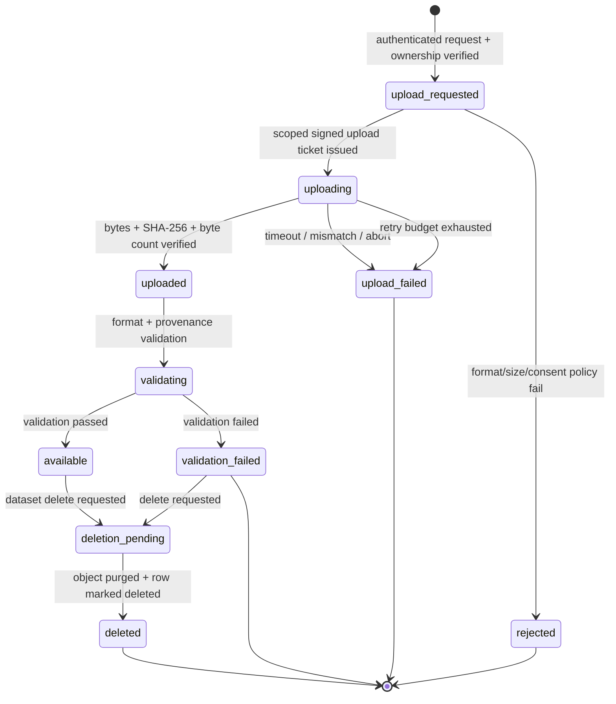

# M7.5-A — Dataset & Artifact Data Lifecycle (DESIGN ONLY)

> **SCOPE BANNER — DESIGN ONLY.** This document is a design proposal. It does **not** activate storage, add a binding, create a bucket, write code, change a migration, change `wrangler.toml`, add a secret, make a live Galaxy call, or claim any new capability. Nothing in this document has been implemented at audit time (HEAD `e1a523a8`, branch `phase-1-robustness-safety`). All proposed values are explicitly labelled and require an **owner decision gate** before any implementation. UI changes present in the working tree at audit time were read-only and untouched.
>
> **Note on repository state:** those UI edits were subsequently committed externally as `90df75e` and `fdc3f26` (HEAD `fdc3f26` at time of note); this document describes the code as reviewed at audit time, not the current tree.
>
> Status: **PROPOSAL — AWAITING OWNER DECISION.** Date: 2026-11-26.

---

## 0. Decision gates (owner input required)

| # | Gate | Default in this proposal | Owner decision needed? |
|---|---|---|---|
| G1 | Activate Cloudflare R2 as canonical object store | **NO — not activated in this milestone** | Yes, before any bucket/binding |
| G2 | Choose provider implementation | R2 recommended; S3-compatible alternative | Yes |
| G3 | Human identity (Better Auth recommended) vs operator token | Keep operator token now; add human identity later | Yes |
| G4 | Per-project / per-account byte quotas and retention window | Proposed numbers in §3/§4 are **proposals only** | Yes |
| G5 | Legal / research retention period and deletion policy | Undefined — `unknown / owner input` | Yes |
| G6 | External-provider egress consent model | Preserve existing single-use consent + governor | No change proposed |

Provider-neutral rule: **R2 is a recommended target, not an activated target.** The storage abstraction must be provider-neutral so that switching to an S3-compatible backend does not change endpoint semantics.

---

## 1. Principles

1. **Metadata references are not file storage.** A D1 row containing a path, hash, provider id or `metadata-only://...` marker is not durable bytes. The words "stored", "available" and "retained" must always name *which layer* they apply to.
2. **D1 is a metadata / control plane only.** No file bytes ever pass through D1. Large objects bypass the Worker via short-lived signed tickets; small text may live inline only where the existing code already does so and under an explicit cap.
3. **Galaxy histories are execution references, not canonical long-term storage.** A Galaxy `history_id` / `galaxy_dataset_id` names a provider-side execution result. The platform does not control its lifetime, versioning or availability; retrieval is a live, verified proxy call, not a read of platform-owned durable storage.
4. **Private by default.** No permanent public URLs. No public bucket. Download and upload are short-lived, scoped, audited capabilities.
5. **Separate human identity from operator identity.** A future human login (Better Auth recommended) is a distinct principal from the operator token (`X-Agent-Token`). Authorization must never conflate them.
6. **Fail closed.** Missing binding/key, expired ticket, failed consent, hash mismatch, oversize body → deny/503/400; never degrade to a public path.
7. **Verify, then persist.** Authentication → ownership → format/size → authorization → write → SHA-256/byte verify → register/audit. Integrity failure removes any partial write.
8. **No compliance claims.** This project makes no HIPAA / GDPR / regulated-data claim. Underlying provider certifications may exist but are not a project guarantee.
9. **Honest stage separation.** Execution ≠ artifact retrieval ≠ validation (aligned with `providers/workspace/states.js` and its authoritative map in `functions/api/workspace/_lib.js`).

---

## 2. Current-state dataset / file audit (verified from code at audit time, HEAD `e1a523a8`)

### 2.1 Endpoints that accept file bytes, and where the bytes go

| Endpoint | Accepts bytes? | Bytes go to | Durable platform-owned content? | Cap today |
|---|---|---|---|---|
| `PUT /api/artifacts/upload?ticket=...` | Yes — raw `request.body` stream | Streams into private R2 object via `bucket.put()` in `storage/r2.js` | **Intended yes, but INERT today**: no `ARTIFACTS` binding → `getStore()` returns error → 503 before body read | `MAX_ARTIFACT_BYTES = 64 * 1024 * 1024` (64 MiB) |
| `POST /api/providers/galaxy/upload` | Yes — raw `request.body` | Buffered ≤1 MiB, SHA-256 verified, UTF-8 decoded, handed to Galaxy adapter (`upload1`) → **Galaxy history** | **No** — only metadata + provider ids in `galaxy_artifacts` | `MAX_UPLOAD_BYTES = 1 * 1024 * 1024` (1 MiB) |
| `POST /api/blast/submit` | Yes — FASTA as a JSON string field (`fasta`/`sequence`/`query`) | Sent to NCBI via URL query; only `input_hash` + `result_tsv` stored in D1 | **No input bytes stored**; result text inline in D1 | `MAX_BODY_CHARS = 64 * 1024` (characters, not bytes) |
| `POST /api/ai/requests` (legacy path) | Yes — inline FASTA (`fasta_text`) | Inline text in D1 under `d1://datasets/...` marker (per `M7_4_WORKSPACE_DESIGN.md` / `DATA_TRANSPORT.md`) | Text inline in D1, bounded | ≤64 KiB (documented) |
| `POST /api/workspace/projects/:id/datasets` | **No** — metadata only | Nothing | **No** — `bytes_uploaded: false`, `fasta_text: NULL` | n/a |

`GET /api/artifacts/content?ticket=...` streams bytes *out* (R2 path, currently inert). `GET /api/providers/galaxy/datasets/:id/download` proxies bytes *out* of Galaxy through the adapter, bounded to 1 MiB and hash-verified. These are retrieval paths, not storage paths.

### 2.2 Metadata-only vs actual persistent content

| Record / artifact | Durable bytes owned by platform? | Where content actually lives |
|---|---|---|
| `datasets` row from workspace registration | **No** | Nowhere. `storage_ref` is `metadata-only://provider-history` or `metadata-only://none` — a **label, not a resolvable location** |
| `galaxy_artifacts` row | **No** | Galaxy Europe history. Row holds `galaxy_dataset_id`, `job_id`, `history_id`, filename/ext, `direction`, SHA-256, byte count, `project_id`, `created_at`, `deleted_at` |
| `galaxy_artifact_downloads` row | **No** | Append-only retrieval audit (`actor` is a non-secret owner label, never a token/key) |
| `provider_artifacts` row inserted by `api/artifacts/upload.js` (`functions/api/artifacts/upload.js:23`, `functions/api/providers/_lib.js:37`) | Would be if R2 enabled | status `stored`, stored column is `object_key` (`storage_ref` appears only in the response DTO); today the endpoint fails closed (503) |
| `report_runs.report_html` | Text inline in D1 | Not an object-store artifact; authorization via parent run |
| `blast_requests.result_tsv` | Text inline in D1 | Not an object-store artifact |
| Legacy `datasets.fasta_text` | Text inline in D1 | Legacy `/api/ai/requests` path only; **never** set by workspace registration |

> **Explicitly:** a provider/history reference, a SHA-256, a byte count, a `d1://` marker and a `metadata-only://` marker are **not** proof that any file exists anywhere. Migration `0009_galaxy_artifacts.sql` states this verbatim: *"file bytes live exclusively in the Galaxy Europe history. D1 holds metadata, hashes, provenance pointers... No byte blob is ever written to D1."*

### 2.3 FASTA processing — client vs server

**Client-side (`web-platform/public/js/fasta.js`)** — pure browser module, no I/O:
- `parseFasta(text)` builds records (`record_number`, `id`, `description`, `header_line`, `sequence`, `length`), file-level errors `SEQUENCE_BEFORE_HEADER` / `NO_FASTA_RECORDS`.
- `validateFasta(text, sequenceType)` with `dna` / `protein` alphabets (`ALPHABETS`): record errors `EMPTY_HEADER`, `EMPTY_SEQUENCE`, `DUPLICATE_ID`, `INVALID_SYMBOLS`; warnings `AMBIGUOUS_SYMBOLS`, `STOP_SYMBOLS`; counters `ambiguous_count`, `stop_count`, `canonical_count`; result flag `file_valid`.
- This validation is **advisory UI validation only** — it does not itself upload or persist anything.

**Server-side:**
- `POST /api/blast/submit` re-validates with its own `validateFasta` (`functions/api/blast/_lib.js`), checks database/program, SHA-256 `hashInput`, resolves and atomically consumes single-use consent **before** the NCBI egress, audits the egress (`target`, `input_hash`, `payload_bytes`, `mock`, `transmitted`, `success`, `status`). Sequence text is transmitted to NCBI in the request URL; only the hash/RID/result are stored.
- The Galaxy upload path performs **no biological FASTA parsing**: extension allow-list + SHA-256 + byte count + strict UTF-8 decode only. Format validity is *not* asserted server-side on that path.
- `storage/r2.js` performs no FASTA parsing either — it enforces extension allow-list, byte cap and SHA-256 during streaming.

### 2.4 Galaxy history / dataset id references

- Migration `0009_galaxy_artifacts.sql`: `public_id`, `dataset_id` (platform `ds_...`), `galaxy_dataset_id` (provider id), `job_id`, `history_id`, `filename`, `ext`, `direction` (`input`/`output`), `sha256`, `bytes`, `project_id`, `created_at`, `deleted_at`. Unique index `(dataset_id, direction)`; indexes on `history_id`, `galaxy_dataset_id`.
- `storage/galaxy-artifacts.js`: `resolve(id)` accepts artifact public id, platform `ds_` id, or provider dataset id. `register()` deduplicates per `(dataset_id, direction)` (409 `duplicate_artifact`) and soft-deletes via `deleted_at`. `uploadDataset()` resolves the provider dataset id from the submit result (or exact filename match in the history) and refuses to bind an unrelated dataset. `inspectDataset()` verifies the dataset exists, is not `deleted`/`purged`/`expired` (→410), belongs to the recorded history and that the recorded job's history matches.
- Consent gate in `functions/api/providers/galaxy-artifacts/_lib.js`: `X-Consent-Id` (`pcon_...`) must be granted, unexpired, unused and scoped to `provider=galaxy` **and** the exact dataset; `consumeConsent()` is an atomic single-use claim performed before any provider transmission. This existing consent/governor behaviour **must be preserved**.
- Workspace `datasets.provider_history_ref` is a reference label, never a file location (`0011_workspace.sql` comment).

### 2.5 Outputs and reports retrieval today

| Output kind | Retrieval | Authorization |
|---|---|---|
| Galaxy input/output dataset | `GET /api/providers/galaxy/datasets/:id/download` — adapter proxy, ≤1 MiB, SHA-256 verified, streamed, download audit row | owner token only; `requireGalaxy` enabled |
| Galaxy live metadata | `GET /api/providers/galaxy/datasets/:id/metadata` — `inspectDataset()`, no credentials returned | owner token only |
| Galaxy artifact registry | `GET /api/providers/galaxy/artifacts` — metadata-only list | owner token only |
| R2 artifact (inert) | `GET /api/artifacts/:id/download-url` (300 s ticket) → `GET /api/artifacts/content` | owner token **or** valid unexpired `consent_id` bound to the same dataset; download headers `no-store, private`, CSP `default-src 'none'`, `X-Artifact-SHA256` |
| BLAST result | `GET /api/blast/results` reads `result_tsv` from D1 by RID | RID-based, per existing endpoint contract |
| Workspace report | `report_runs.report_html` keyed by `job_id = run_...` | via parent `workspace_runs` (`public_id + owner`); 404 if absent — no fabricated report |

### 2.6 Size limits — verified vs proposed

| Limit | Value | Source / label |
|---|---|---|
| R2 artifact max | 64 MiB | **Verified** `MAX_ARTIFACT_BYTES` (`storage/r2.js`) |
| R2 ticket TTL | 900 s default, clamped to [30, 900] | **Verified** `DEFAULT_TICKET_TTL_SECONDS`, `sign()` |
| R2 download ticket TTL | 300 s | **Verified** `download-url.js` |
| R2 transfer ledger marker | `now + 30 days` | **Verified** in `upload.js` insert (marker only; no enforced deletion job exists) |
| Galaxy upload/download cap | 1 MiB | **Verified** `MAX_UPLOAD_BYTES` (`storage/galaxy-artifacts.js`) |
| BLAST request body | 64 KiB characters | **Verified** `MAX_BODY_CHARS` (`blast/submit.js`) |
| Legacy inline FASTA | ≤64 KiB | Documented in `DATA_TRANSPORT.md` / `M7_4_WORKSPACE_DESIGN.md` |
| Future per-file / per-project / per-account caps | **PROPOSAL — requires owner approval (G4)** | §4.3 |
| R2 account quota, free-tier eligibility, jurisdiction availability | **unknown / account-dependent** | Not verifiable from code |

### 2.7 Binding / configuration reality

- `web-platform/wrangler.toml`: only `BLAST_DB` D1 binding (production + staging). **No `[[r2_buckets]]` binding is active.** Lines 20–23 are comments describing optional provisioning (`binding = "ARTIFACTS"`, `wrangler secret put ARTIFACT_SIGNING_KEY`); no public bucket is assumed.
- `storage/r2.js` `createArtifactStore(env)` throws when `env.ARTIFACTS` is missing or `env.ARTIFACT_SIGNING_KEY` is missing; all `/api/artifacts/**` handlers return 503. There is no R2 write path that can execute at this HEAD.
- Artifact object key scheme already coded: `datasets/${dataset_id}/${sha256}/${sanitizeFilename(filename)}` — project-scoped by dataset id, content-addressed by hash, unguessable in practice, no public URL.
- `GALAXY_ENABLED = "false"` in production, `"true"` in staging (`wrangler.toml`). Galaxy calls are gated by `isEnabled`.

---

## 3. Dataset lifecycle state machine (PROPOSED)

Applies to a **platform-owned dataset upload** (the future object-store path). It does **not** claim that today's metadata-only rows pass through these states.

### 3.1 States

| State | Meaning | Bytes exist? |
|---|---|---|
| `upload_requested` | Authenticated request registered; upload session/ticket issued; no bytes yet | No |
| `uploading` | Client is streaming bytes to the signed upload target | Partially |
| `uploaded` | Byte count and SHA-256 verified against the signed ticket | Yes (object written) |
| `validating` | Format/biological validation and metadata reconciliation in progress | Yes |
| `available` | Validation passed; dataset is project-scoped and downloadable | Yes |
| `rejected` | Format/size/policy or consent check failed **before** a durable write; terminal | No |
| `upload_failed` | Transfer, checksum or timeout failure; partial object removed; terminal | No |
| `validation_failed` | Bytes are intact but format validation failed; terminal (quarantine candidate) | Yes (quarantined) |
| `deletion_pending` | Logical delete requested; authorization revoked; physical removal queued | Yes (until purge) |
| `deleted` | Logical row deleted and physical object purged (or verified absent); terminal | No |

### 3.2 Transition diagram



### 3.3 Forbidden transitions (must be rejected by a single transition map)

- Any transition *into* `upload_requested` from another state (no re-registration by a second upload).
- `upload_requested → uploaded`, `uploading → available`, `uploaded → available` (validation cannot be skipped).
- `available → uploading`, `uploaded → uploading` (no silent overwrite of an existing dataset).
- Any transition *out of* `deleted`, `rejected`, `upload_failed` (terminal), except audit-only annotation that does not change state.
- `deletion_pending → available` (no undelete without an explicit, separately authorized restore feature — out of scope).
- `validation_failed → available` without a fresh validation pass under a new upload session.

Mirror the workspace pattern: exactly one authoritative transition table and one state list, with a deprecated compatibility shim re-exporting it (as `providers/workspace/states.js` does for `functions/api/workspace/_lib.js`). No second transition map.

### 3.4 Idempotency, timeouts, retries

| Concern | Rule |
|---|---|
| Idempotency key | Upload session id + dataset id + declared SHA-256. Replaying a completed session returns the existing artifact, never a second object. |
| Duplicate registration | One registration per `(dataset_id, direction)`; conflict returns 409 (mirrors `galaxy_artifacts` unique index). |
| Ticket replay | Signed tickets are single-purpose (`op=upload`/`download`/`delete`); expiry enforced constant-time; a ticket cannot be escalated to another op. |
| Upload timeout | **PROPOSAL: 15 min ticket TTL** (matches today's 900 s default); requires owner approval (G4). |
| Retry budget | **PROPOSAL: ≤3 retries** with jittered backoff on transient failure; `upload_failed` after exhaustion. Requires owner approval (G4). |
| Integrity failure | Delete partial object immediately; never mark `uploaded`. |
| Concurrency | Last-writer-wins only when explicitly allowed; default is create-once via conditional put (`If-None-Match: *`) where the provider supports it. |

### 3.5 Upload session semantics

1. Session is created only after authenticated request + project ownership verification.
2. Session binds: dataset id, sanitized filename, declared byte count, declared SHA-256, MIME, artifact id, project/owner, expiry, operation.
3. The signed ticket carries the *signed* values; the upload handler uses those values, never caller-supplied repeats (`storage/r2.js` already returns the verified payload in `createUploadTicket`).
4. A session is not a durable dataset. It is a short-lived capability. It is revoked when the project is archived/deleted, the owner is disabled, or the dataset is logically deleted.
5. Completing a session is atomic with respect to registration: object write verified → D1 metadata row written → audit/provenance row written. A failure between these steps is reconciled by a future reconciler (out of scope here).

---

## 4. End-to-end upload pipeline (10 steps, PROPOSED)

```mermaid
sequenceDiagram
    actor U as Human / browser
    participant W as Worker (API)
    participant D as D1 metadata
    participant S as Storage abstraction
    participant O as Object store (R2 / S3-compatible)

    U->>W: 1. Authenticated upload request (human session or operator token)
    W->>W: 2. Verify project ownership (owner + project_id)
    W->>D: 3. Register upload_requested metadata / upload session
    W->>W: 4. Size + format checks (allow-list, declared SHA-256)
    W->>S: 5. Authorize upload (scoped short-lived signed ticket)
    S-->>U: upload_url + expiry + declared bytes/hash
    U->>O: 6. Stream bytes directly to private object store (no D1 bytes)
    O-->>S: 7. SHA-256 + byte count verified on the stream
    S->>D: 8. Mark uploaded; persist object_key, hash, bytes, provenance
    W->>W: 9. Validate format / biological content; mark validating → available
    W->>D: 10. Audit + provenance record (actor, time, hash, bytes, outcome)
```

### 4.1 Step contract

| # | Step | Must hold |
|---|---|---|
| 1 | Authenticated request | Human identity (Better Auth recommended) **separate** from operator token; no anonymous upload |
| 2 | Project ownership | `deriveOwner` + `getProject(db, project_id, owner)`; 404 for foreign project (existing workspace pattern) |
| 3 | Metadata registration | `upload_requested` row; no bytes; no public URL field accepted |
| 4 | Size/format checks | Extension allow-list, byte cap, SHA-256 shape; reject before any ticket is issued |
| 5 | Upload authorization | Signed ticket bound to dataset/project/owner/op/expiry; fail closed if key/binding missing |
| 6 | Durable object write | Direct client→object-store streaming; Worker never buffers large files |
| 7 | SHA-256 verify | Compute while streaming; delete object on mismatch or over-cap; fail closed |
| 8 | Registration update | `uploaded` with verified hash/bytes/object_key; one row per dataset per direction |
| 9 | Availability | Format validation (including biological validation where applicable); `validating → available` |
| 10 | Audit/provenance | Append-only record; non-secret actor label; never a token or API key |

### 4.2 Multipart / resumable upload (future, gated)

- Above a **proposed** threshold (e.g. 64 MiB — requires owner approval, G4), use multipart/resumable upload: initiate → upload parts → complete; publish only on `CompleteMultipartUpload`. R2 supports multipart uploads and conditional completion (S3-compatible API, checked 2026-11-26).
- Part-level checksums plus a final whole-object SHA-256; incomplete uploads are aborted and never registered as datasets.
- Resume key is the upload session id; a resumed session reuses the same signed intent and cannot change filename/size/hash.

### 4.3 Proposed limits (NOT active — owner approval required)

| Limit | Proposal | Status |
|---|---|---|
| Single file max (object store) | 64 MiB (matches existing constant) | PROPOSAL for enforcement in new path |
| Multipart threshold | 64 MiB | PROPOSAL |
| Max parts / part size | `unknown / account-dependent` (provider limits not yet verified for this account) | UNKNOWN |
| Per-project quota | `unknown / account-dependent` | UNKNOWN — owner input G4 |
| Per-account quota | `unknown / account-dependent` | UNKNOWN — owner input G4 |
| Upload ticket TTL | 15 min | PROPOSAL |
| Download ticket TTL | 5 min (matches existing 300 s) | PROPOSAL |
| Delete ticket TTL | 5 min (matches existing default) | PROPOSAL |
| Retry budget | 3 | PROPOSAL |
| No bytes through D1 | **Invariant** (not a proposal) | REQUIRED |

---

## 5. Storage abstraction design (PROPOSED interface)

### 5.1 Interface methods

```js
// Provider-neutral contract. Implementations must never expose a public URL.
createStorageProvider(env) -> {
  presignUpload({ objectKey, sizeBytes, sha256, mime, ttlSeconds, uploadId? }) -> { url, method, headers, expiresAt }
  completeUpload({ uploadId, objectKey, parts? }) -> { objectKey, bytes, sha256 }
  presignDownload({ objectKey, filename, mime, ttlSeconds }) -> { url, expiresAt }
  stat({ objectKey }) -> { objectKey, bytes, sha256, createdAt } | null
  delete({ objectKey }) -> { deleted: true }
  list({ prefix, limit, cursor? }) -> { objects, cursor }
  copy({ fromKey, toKey }) -> { objectKey }
}
```

- `presignUpload` / `presignDownload` return **short-lived scoped capabilities**, never permanent URLs.
- `stat` and `list` are metadata-only reads; `copy` preserves custom metadata (hash, dataset id, project id).
- The Worker remains the authorization boundary; the storage provider does not decide who may download.

### 5.2 Object key scheme (provider-neutral, non-public, project-scoped, unguessable)

```
datasets/{project_id}/{dataset_id}/{sha256}/{sanitized_filename}
```

- `project_id` and `dataset_id` are opaque public ids (`proj_...`, `ds_...`), not emails or account names.
- `sha256` makes the key content-addressed; re-uploading identical content is deduplicable and cannot silently overwrite a different object.
- Filename sanitized to `[A-Za-z0-9._-]`, max 200 chars (mirrors existing code).
- `copy` uses an `artifacts/{project_id}/{run_id}/{artifact_id}/{sha256}/{filename}` namespace for analysis outputs.
- No bucket is ever made public; no `r2.dev` domain or custom public domain is enabled.

### 5.3 R2 implementation vs S3-compatible alternative

| Concern | R2 implementation (recommended) | S3-compatible alternative |
|---|---|---|
| Binding | `env.ARTIFACTS` Worker R2 binding | S3 API endpoint + bucket-scoped credentials as secrets |
| API | Worker R2 API (`put`/`get`/`head`/`delete`/`list`/multipart) | AWS SDK with `endpoint`, `region=auto` |
| Presigning | Worker-issued signed ticket → Worker streams to bucket (existing pattern) or provider presigned URL | Native presigned URLs |
| Egress | No egress fees for direct R2 access (checked 2026-11-26) | Vendor-dependent — `unknown / account-dependent` |
| Cost basis | Storage + Class A/B ops (checked 2026-11-26) | Vendor-dependent — `unknown / account-dependent` |
| Lock-in | Provider-neutral interface keeps handlers unchanged | Same interface |

Verified R2 facts (official docs, **checked 2026-11-26**):
- Object storage, S3-compatible API, no egress fees, strong global consistency: `https://developers.cloudflare.com/r2/`, `https://developers.cloudflare.com/r2/api/s3/`, `https://developers.cloudflare.com/r2/how-r2-works/`.
- Pricing (Standard): **$0.015/GB-month**, Class A $4.50/million, Class B $0.36/million; free tier 10 GB-month storage, 1M Class A, 10M Class B per month; deletes free: `https://developers.cloudflare.com/r2/pricing/`. *Applicability to this account and any plan-specific exceptions: `unknown / account-dependent`.*
- Infrequent Access: $0.01/GB-month, $0.01/GB retrieval, 30-day minimum storage duration: same pricing page (checked 2026-11-26).
- Encryption at rest AES-256 (GCM preferred) and in transit TLS: `https://developers.cloudflare.com/r2/reference/data-security/` (checked 2026-11-26).
- SSE-C available via `ssecKey` in the Workers API; bucket-scoped tokens and presigned URLs documented: `https://developers.cloudflare.com/r2/api/tokens/`, `https://developers.cloudflare.com/r2/api/workers/workers-api-reference/` (checked 2026-11-26).
- Durability designed for 99.999999999% annual durability: `https://developers.cloudflare.com/r2/reference/durability/` (checked 2026-11-26). **This is a provider design claim, not a project SLA or compliance claim.**
- Cloudflare publishes compliance certifications, but this document makes **no regulatory compliance claim** for the toolkit.

### 5.4 Private buckets, encryption, retention, quotas, audit

- **Private bucket:** no public access policy, no public domain, no anonymous read. All reads via authenticated Worker or short-lived capability.
- **Encryption:** TLS in transit; AES-256 at rest by provider (checked 2026-11-26). Optional SSE-C with a secret-managed key is a future option; key custody and rotation are `unknown / account-dependent` and require owner decision.
- **Retention:** bucket lifecycle rules may expire objects; planned retention window is **owner input G5** (`unknown / owner input`). Object versioning / object-lock availability and cost are `unknown / account-dependent`.
- **Quotas/usage accounting:** enforce at the Worker using D1 counters per `(owner, project)`; reconcile against provider usage reports. Thresholds are proposals only (§4.3). Provider-side hard quota: `unknown / account-dependent`.
- **Audit history:** every upload, download, delete and failed authorization writes an append-only row with actor label, dataset, bytes, hash, status, timestamp. Never store tokens, API keys or raw provider bodies.

### 5.5 Explicit statement: R2 is NOT enabled

> **No R2 binding is added in this milestone. No bucket is created. No `ARTIFACT_SIGNING_KEY` is provisioned. No migration changes storage semantics.** The existing `/api/artifacts/**` handlers remain fail-closed (503) without the binding/key. This section is a design target only.

Operational/cost implications if enabled later:

| Implication | Label |
|---|---|
| New binding + secret per environment; both must be provisioned or endpoints stay 503 | Verified from code / wrangler comments |
| Storage billed per GB-month; ops billed Class A/B; deletes free | Verified (checked 2026-11-26) |
| Free-tier eligibility for this account | `unknown / account-dependent` |
| Bucket count limits, jurisdiction/data-location options | `unknown / account-dependent` |
| Monthly cost at this project's actual usage | `unknown / account-dependent` — no usage data collected |
| Backup/versioning/object-lock cost | `unknown / account-dependent` |
| Migration of existing Galaxy references into object storage | Not designed; owner decision required |

---

## 6. Download authorization (PROPOSED rules)

1. **Authenticated only.** Human session (Better Auth recommended) or operator token; never anonymous. Human and operator principals remain distinct.
2. **Project-scoped.** Resolve dataset → project → owner before issuing any capability. A foreign project yields 404/403.
3. **Short-lived signed URLs or streaming proxy.** Two supported modes: (a) 5-minute scoped signed URL (`presignDownload`), or (b) Worker streaming proxy that re-checks authorization per request. No permanent public URLs in either mode.
4. **Revocation.** Issued capabilities are invalidated when: project archived/deleted, dataset `deletion_pending`/`deleted`, owner account disabled or deleted, or explicit ticket revocation. Since a URL cannot be un-issued, the proxy path must re-verify; the signed-URL path relies on short TTL plus object deletion.
5. **Audit every download.** Success and failure both logged with actor label, dataset, bytes, hash, status, time. Never log tokens/keys.
6. **Artifact authorization ≠ dataset authorization.** An analysis output artifact may be reachable via a run/report grant that does not grant access to the source dataset; conversely, dataset access does not automatically grant access to a derived report. Authorize each resource through its own parent chain.
7. **Report access rules.** `report_runs.report_html` is reached only via parent `workspace_runs` (`public_id + owner`); missing parent → 404, no fabricated report. Reports inherit the run's project scope, not the dataset's.

Security headers pattern to preserve (from `api/artifacts/content.js` and Galaxy download): `Cache-Control: no-store, private`, `Content-Disposition: attachment`, `Content-Security-Policy: default-src 'none'`, `X-Content-Type-Options: nosniff`, `Referrer-Policy: no-referrer`, hash response header.

---

## 7. Deletion & retention (PROPOSED)

### 7.1 Logical vs physical deletion

| Layer | Logical deletion | Physical deletion |
|---|---|---|
| Dataset row | `deleted_at` / state `deletion_pending` — immediately unauthorized | Row purged only after retention window (owner input G5) |
| Object store object | Mark metadata `deletion_pending`, revoke tickets | `delete({ objectKey })`; verify `stat()` returns null → `deleted` |
| Galaxy artifact row | `deleted_at` set (existing `markArtifactDeleted`); no further registration allowed (`unique (dataset_id, direction)`) | Platform cannot delete Galaxy-side bytes; provider purge is external and `unknown / account-dependent` |
| Download audit | Retained as append-only evidence | Retention requirement `unknown / owner input` |

"Deleted" must mean both unauthorized *and* object absent (or verified absent). A soft-deleted row alone is not deletion of bytes.

### 7.2 Derived artifacts

- Deleting a source dataset does **not** automatically delete derived analysis artifacts/reports; each has its own retention binding to the run. Policy for cascade is **owner input G5**.
- Derived artifacts remain retrievable only while their parent run/report is authorized (§6, rule 6).
- Quarantined `validation_failed` objects follow the same deletion path; they must never become `available`.

### 7.3 Galaxy-side vs platform-owned data

- **Platform-owned:** object-store bytes and D1 metadata — deletable by the platform.
- **Galaxy-side:** execution results in an external history — the platform can only delete its *reference* (`deleted_at`); actual bytes remain under provider control until a provider-side purge. `inspectDataset()` maps deleted/purged/expired to 410. The platform makes no durability or deletion guarantee for Galaxy data.

### 7.4 Account deletion cascade (future, gated)

1. Disable all tickets; revoke human sessions and operator token grants.
2. Set every owned dataset/artifact/run/report to `deletion_pending`.
3. Queue physical object deletion and D1 row purge after the retention window.
4. Write a final audit record; retain only what policy requires (`unknown / owner input G5`).
5. Galaxy references are soft-deleted; external data is not touched by the platform.

### 7.5 Backup / versioning implications

- If bucket versioning is enabled, a simple `delete()` may leave prior versions; physical deletion must enumerate and remove versions. Availability/cost: `unknown / account-dependent`.
- Provider backups and D1 point-in-time recovery may retain data after logical deletion; reconcile before claiming `deleted`.
- Retention/legal hold policy is **undefined** and needs owner input; no compliance claim is made.

---

## 8. Biological data considerations

- **Sensitivity.** Sequence data may be sensitive or personally identifiable in context. Treat all uploaded biological data as private by default; no public URLs, no indexing by search engines, no telemetry containing sequences.
- **Minimization.** Store hashes and metadata instead of duplicates where possible; deduplicate by SHA-256; do not store FASTA in D1 on new paths. Client-side validation reduces invalid transfers.
- **Project isolation.** All reads filtered by `(owner, project_id)`; index coverage already exists (`idx_datasets_owner_project`, `idx_workspace_runs_owner_project`). Cross-project access must 404.
- **Explicit external-provider transfer consent.** Preserve the existing single-use consent gate for Galaxy and BLAST: granted, unexpired, provider-specific, dataset/hash/program/database-scoped, atomically consumed before egress, audited. No change to the governor in this milestone.
- **Encryption.** TLS in transit including browser→Worker and Worker→provider; AES-256 at rest for provider storage (checked 2026-11-26). Signing keys are secrets, never committed.
- **Auditability.** Append-only audit of uploads, egress, downloads and deletions; non-secret actor labels only; provider bodies/credentials never echoed.
- **No compliance claims.** The toolkit does not claim HIPAA, GDPR, or any regulatory compliance. Underlying provider certifications are not a project guarantee. Data-location/jurisdiction options are `unknown / account-dependent`.

---

## 9. Artifact lifecycle for analysis outputs

### 9.1 Lifecycle

| Stage | Meaning | Durable content? |
|---|---|---|
| Created | A step produces an output; artifact row reserved with dataset/run binding | No |
| Retrieved | Bytes obtained from execution provider (Galaxy) or written to object store | Provider-side or object-store |
| Validated | Hash/byte count and format checks pass; bound to run/report | Yes (verified ref) |
| Bound | `artifact_refs_json` / provenance links artifact to run and report | Metadata |
| Retained | Held under run/report retention policy (G5) | Per policy |
| Deleted | Logical + physical removal, audited | No |

### 9.2 Run-stage distinction (must stay consistent with `providers/workspace/states.js`)

Authoritative states in `functions/api/workspace/_lib.js` (`WORKSPACE_STATES` / `STATE_TRANSITIONS`), re-exported by the deprecated shim:

```
draft → planned → awaiting_approval → queued → running → execution_completed
     → artifact_retrieval → validation → succeeded
     (failed / cancelled reachable from defined stages; terminal)
```

Rules:
- `execution_completed` means a job ran — it does **not** imply artifacts were retrieved.
- `artifact_retrieval` is a distinct stage; only its `artifact_retrieval_state` (`not_required`/`pending`/`retrieved`/`failed`) records retrieval.
- `validation` is a distinct stage; only `validation_state` (`unvalidated`/`pending`/`passed`/`warn`/`failed`) records validation.
- `succeeded` requires a provenance record; no stage may be skipped.
- Artifact lifecycle events must attach to these stages, never replace them. An artifact being "available" does not advance the run state.

### 9.3 Binding to run/report

- `workspace_runs.artifact_refs_json` and `provenance_records.record_json` carry artifact references (metadata only — no public URL keys; forbidden URL keys are already rejected by `_lib.js`).
- `report_runs.job_id = run_...`; report authorization via parent run (§6, rule 7).
- Retrieval of a derived artifact requires both run authorization and artifact authorization (§6, rule 6).

---

## 10. Acceptance / verification criteria for a FUTURE implementation (tests only — no implementation now)

These are criteria a later implementation must satisfy; this milestone writes no code.

| ID | Criterion | Verification (offline, no live Galaxy, no credentials) |
|---|---|---|
| A1 | No public URLs | Static scan: no public bucket config, no `r2.dev`/custom public domain, no URL keys accepted in payloads |
| A2 | R2 not active | Assert `wrangler.toml` has no active `[[r2_buckets]]`; artifact endpoints 503 without binding/key |
| A3 | Metadata-only invariant | Assert dataset registration returns `bytes_uploaded:false`, `storage_ref` starts `metadata-only://`, `fasta_text:null` |
| A4 | No bytes in D1 | SQL metadata assertions: no byte/blob column on `datasets`/`galaxy_artifacts`; provider bodies not persisted |
| A5 | State machine | Unit test every allowed transition; assert every forbidden transition in §3.3 is rejected; one transition map |
| A6 | Idempotency | Replay upload session → one object, one row; duplicate `(dataset_id, direction)` → 409 |
| A7 | Integrity | Tampered SHA-256 / declared byte count → object deleted, state `upload_failed`, no `uploaded` row |
| A8 | Size caps | 64 MiB+ upload rejected on R2 path; 1 MiB+ Galaxy upload rejected; 64 KiB+ BLAST body rejected |
| A9 | FASTA client | `parseFasta`/`validateFasta` unit tests for each error/warning code and `file_valid` |
| A10 | FASTA server | BLAST consent required even in mock; single-use claim atomic; failed NCBI call leaves token burned |
| A11 | Galaxy consent | Missing/mismatched/expired/spent consent → no adapter call; `consumeConsent` happens before transfer |
| A12 | Galaxy reference | `resolve()` accepts all three id forms; deleted/purged → 410; history/job mismatch → 409 |
| A13 | Download auth | Foreign project → 403/404; expired ticket → 403; `consent_id` must match dataset and be unexpired |
| A14 | No permanent URL | All download URLs have `expiresAt`; headers include `no-store, private`, CSP `default-src 'none'` |
| A15 | Revocation | Deleting dataset/project revokes new tickets; proxy path re-checks authorization |
| A16 | Audit | Every upload/download/delete/failure writes one append-only row with non-secret actor; no token/key present |
| A17 | Deletion | Logical delete flips state immediately; physical delete verified via `stat()===null`; terminal `deleted` |
| A18 | Artifact vs dataset auth | Report reachable only via owned parent run; derived artifact not reachable via dataset grant alone |
| A19 | Run stages | No transition skipping `execution_completed → artifact_retrieval → validation`; shim re-exports one map |
| A20 | Neutral abstraction | Same handler tests pass against an in-memory fake implementing the full interface (§5.1) |
| A21 | Cost/quota labels | Docs/tests keep all account-dependent numbers labelled `unknown / account-dependent` |
| A22 | No compliance claim | Docs contain no HIPAA/GDPR compliance assertion |

---

## Appendix A — Source-of-truth files inspected (at audit time, HEAD `e1a523a8`)

`web-platform/functions/api/artifacts/{_lib.js,upload-url.js,upload.js,content.js,delete.js,[id]/download-url.js}`; `web-platform/storage/{r2.js,galaxy-artifacts.js}`; `web-platform/functions/api/providers/galaxy-artifacts/{_lib.js,upload.js,artifacts.js,datasets/[id]/metadata.js,datasets/[id]/download.js}`; `web-platform/functions/api/workspace/projects/[id]/datasets.js`; `web-platform/functions/api/blast/submit.js`; `web-platform/public/js/fasta.js`; `web-platform/migrations/{0009_galaxy_artifacts.sql,0011_workspace.sql}`; `web-platform/wrangler.toml`; `web-platform/functions/api/workspace/_lib.js`; `web-platform/providers/workspace/states.js`; `docs/DATA_TRANSPORT.md`; `docs/M7_4_WORKSPACE_DESIGN.md`.

## Appendix B — Open items labelled `unknown / account-dependent` or awaiting owner input

- R2 free-tier eligibility, bucket limits, jurisdiction/data-location, SSE-C key custody, backup/versioning/object-lock availability and cost, actual monthly spend.
- S3-compatible vendor pricing, egress and availability.
- Galaxy-side history retention and purge behaviour (external provider; not controlled by the platform).
- Per-file/per-project/per-account quotas, retry/timeout values, retention window, legal hold and account-deletion cascade policy (G4/G5).
- Human identity provider configuration (Better Auth recommended, G3) — not implemented here.
- No live Galaxy call, no credential, no code/config/migration change was made in producing this document.
