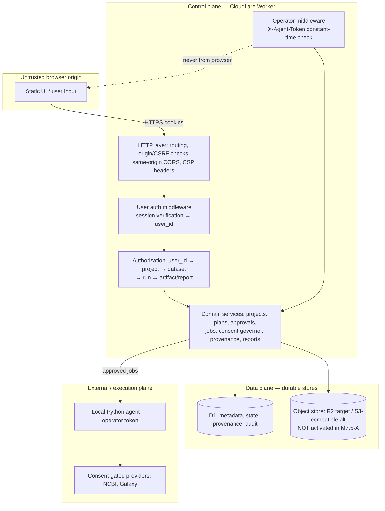
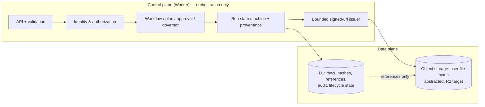
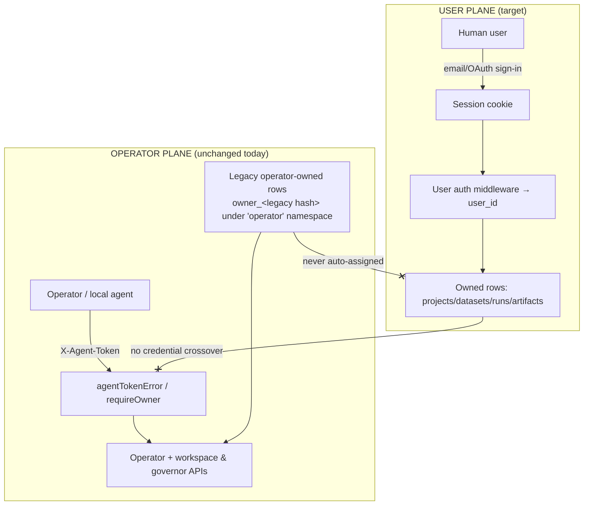
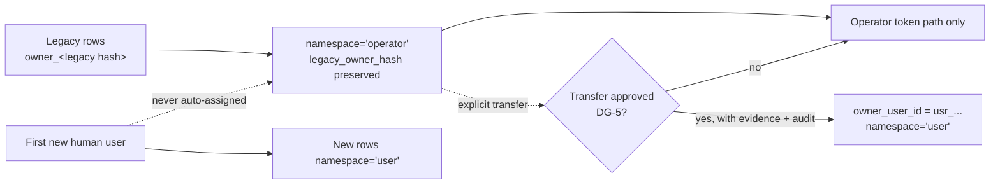

# M7.5-A — Public Research Platform Foundation: Umbrella Architecture Design

> ## 🛑 DESIGN ONLY — NOTHING IMPLEMENTED
>
> This document is a **design blueprint**. No code, migration, binding, secret, configuration change,
> deployment, or live Galaxy/NCBI call was made for M7.5-A. Every "target", "proposed", "must", or
> "should" statement below is a **requirement for a future milestone**, not a claim about the system
> that exists today. No implementation may begin until the owner has explicitly approved the decision
> gates in §1.3.
>
> **Document date:** 2026-11-26 · **Branch:** `phase-1-robustness-safety` · **HEAD at audit time:** `e1a523a8`
> **Repository root:** `D:\smart-bioinformatics-toolkit-milestone-0_5_0\smart-bioinformatics-toolkit-milestone-0.5.0\smart-bioinformatics-toolkit`
> **Scope:** M7.5-A (design-only umbrella document). This is the architecture "top document"; the four
> companion documents are named in §13.
>
> **Audit-time state note:** References below to "uncommitted UI" and HEAD `e1a523a8` describe the tree at audit time; that UI work was subsequently committed externally in `90df75e` and `fdc3f26` (HEAD `fdc3f26` at time of note). The security behaviour described reflects the code as reviewed at audit time and was not re-verified after those commits.

---

## 0. Contract, scope, and how to read this document

### 0.1 Working agreement (applies to all five M7.5-A documents)

| Rule | Meaning |
|---|---|
| Read-only tree | The UI changes that were uncommitted at audit time (HEAD `e1a523a8`: `public/*.html`, `public/css/components.css`, `public/js/workspace.js`, `tests/workspace.e2e.mjs`, then-untracked `public/js/project-context.js`) are **read-only evidence**. Nothing in this milestone modifies, stages, commits, reverts, cleans, or overwrites them. |
| No touched files | No code, migration, `wrangler.toml`, `package.json`, secret, or config was changed. Only this assigned doc file was created. |
| No live calls | No Galaxy or other provider call was made. No credential appears in these documents. |
| History preserved | `PRODUCT_VISION.md`, `PRODUCT_REQUIREMENTS.md`, `SYSTEM_ARCHITECTURE.md`, `AI_AGENT_ARCHITECTURE.md`, `COMPUTE_INFRASTRUCTURE.md`, `API_INTEGRATION_ROADMAP.md`, `docs/M7_4_WORKSPACE_DESIGN.md`, `docs/M7_4_FINAL_REPORT.md`, `docs/M7_3_PHYLOGENETICS_WORKFLOW_REPORT.md`, `docs/THREAT_MODEL.md`, and `docs/PRIVACY_NOTE.md` are evidence and are **not erased or rewritten**. `SYSTEM_ARCHITECTURE.md` §12 already records this design-only milestone; this document expands it. |
| Date discipline | Every web claim is attributed to an official source and marked "checked 2026-11-26" (§2). Prices and capabilities that could not be verified are labelled **unknown / account-dependent — verify before decision**, never invented. |
| No compliance claims | This design does **not** claim regulatory compliance (HIPAA/GDPR/FISMA/etc.). It records engineering controls only. |

### 0.2 Status label legend

| Label | Meaning in this document |
|---|---|
| **VERIFIED TODAY** | Read directly from the repository at audit time (HEAD `e1a523a8`: code, migrations, config, or UI then uncommitted). |
| **TARGET** | A proposed future capability. Not implemented in M7.5-A. |
| **UNVERIFIED** | Could not be confirmed from official sources during this design pass; must be verified before a decision. |

### 0.3 What this umbrella document owns

It defines the **whole-system architecture**: the honest current state (§3), the target identity/authorization/storage model (§4–§8), the API and UX shape (§9–§10), operations and cost posture (§11), and risks/non-goals (§12). Detailed decisions live in the four companion documents (§13); where they contain more detail, this document summarises and points to them. It does not introduce a new scientific engine, a new consent/governor mechanism, a new approval flow, a new provenance format, or new run states — those are preserved (§12.3).

---

## 1. Executive summary

### 1.1 The problem in one paragraph

The platform today has a **real, working scientific core and control plane**, but it has **no human users**. The only authenticated identity is a single operator secret (`AI_AGENT_TOKEN` presented as `X-Agent-Token`). The M7.4 workspace added owner scoping by hashing that token into a non-secret `owner_<hex16>` principal — this is isolation between token holders, **not** a user account system. Dataset bytes are not durably stored by the platform: the legacy inline FASTA path is capped at 64 KiB in D1, workspace dataset registration is metadata-only, and Galaxy histories are provider references. R2 code exists but there is **no R2 binding and no signing key**, so artifact endpoints fail closed. M7.5-A designs the foundation that would make a genuine multi-user public research platform possible **without** rewriting the science, consent, approval, provenance, or staged run-state machinery.

### 1.2 Fixed recommendations (do not contradict across the five documents)

| Area | Fixed decision | Status |
|---|---|---|
| Human authentication | **Better Auth** is the primary recommended provider (TypeScript, first-class Cloudflare Workers guidance, D1-compatible via an appropriate adapter); **Clerk** is the alternative; **Supabase Auth evaluated but not recommended** (Postgres/RLS/JWT-centred, does not fit the D1-on-Workers store without a second database and MAU-based billing). | TARGET — owner decision gate DG-1 |
| Object storage | **Cloudflare R2 recommended as the target object store, NOT activated in this milestone.** No R2 binding exists; artifact endpoints fail closed. Must sit behind a **provider-neutral storage abstraction**, with an **S3-compatible alternative** preserved. | TARGET — owner decision gates DG-2, DG-3 |
| R2 activation | Requires an **explicit owner decision gate** before any binding, key, or write path is enabled. | TARGET — DG-2 |
| Identity separation | Human sessions are **strictly separate** from the operator `X-Agent-Token`. No AI_AGENT_TOKEN in the browser, ever. | TARGET — DG-4 |
| Legacy rows | Legacy operator-owned rows are isolated under an `operator` namespace with their legacy owner hash and are **never auto-assigned to a new human user**. | TARGET — DG-5 |
| Scientific core | Engines, consent/usage governor, approval flow, provenance, and staged run states are **preserved, not rewritten**. | Invariant |

### 1.3 Owner decision gates (implementation blocked until approved)

| Gate | Decision required | Why it blocks work |
|---|---|---|
| **DG-1** | Choose the human auth provider: Better Auth (recommended) vs Clerk (alternative). | Determines schema, session/cookie design, middleware and migration shape. |
| **DG-2** | Approve (or defer) R2 activation: bucket, binding name, private-only policy, signing key custody, environment separation. | No R2 binding or key may be added without this. |
| **DG-3** | Approve the storage abstraction boundary and the S3-compatible fallback contract. | Determines the interface all byte-handling code must target. |
| **DG-4** | Approve strict separation policy: operator token never in browser; human sessions via HttpOnly cookies; operator plane gated by the existing token only; record the final cookie `SameSite` choice (`Lax` for OAuth/top-level navigation, `Strict` otherwise). | Determines middleware order, cookie compatibility and the browser threat model. |
| **DG-5** | Approve the legacy data transfer procedure (evidence, audit, rollback) and confirm no auto-assignment to first new user. | Determines migration safety and whether legacy rows become visible at all. |
| **DG-6** | Approve retention/expiry periods and per-destination data policy before any durable byte store is enabled. | Retention must be published before objects are written. |

**Canonical decision-gate crosswalk (by subject).** This is the single mapping across the five M7.5-A documents; each document's local gate id appears under its own column. "—" means that document has no local gate for that subject; "preserved" means existing behaviour is retained rather than newly gated. All FOUNDATION references in this document use the DG-1…DG-6 column.

| Subject (owner decision) | FOUNDATION (DG-1…6) | AUTH (G1…7) | DATA_LIFECYCLE (G1…6) | ROADMAP (G1…7) | THREAT_MODEL sign-off (1…7) |
|---|---|---|---|---|---|
| Auth provider choice (Better Auth primary / Clerk alternative) | DG-1 | Fixed recommendation in §1; budget input G3 | G3 (human identity vs operator token) | G1 | 1 |
| Email provider for verification / reset mail | — | G1 | — | G2 | 2 |
| OAuth / OIDC providers at launch | — | G2 | — | G5 | 5 |
| R2 activation: bucket, binding, privacy, signing key, budget | DG-2 | G3 (paid-tier budget) | G1 | G3 | 3 |
| Storage abstraction and S3-compatible fallback contract | DG-3 | — | G2 | — | — |
| Retention / deletion / expiry (periods, account deletion, quota window) | DG-6 | G4, G6 | G4 (byte quotas), G5 (legal retention) | G6 | 6 |
| External-provider egress consent (single-use consent + governor) | Preserved invariant (§1.2) | — | G6 | Preserved control | Preserved control |
| Legacy ownership transfer / no auto-assignment | DG-5 | G6 (as cross-referenced in §4.2) | — | G4 | 4 |
| Identity separation / operator token never in browser (incl. rotation) | DG-4 | Fixed constraint (§4.4) | G3 | G7 | 7 |
| Paid-tier budget / quotas for this account | — | G3 | G4 | G3 (part of R2 activation) | 3 (part of R2 activation) |
| Session / recovery SLA and cookie `SameSite` policy | DG-4 (cookie policy) | G4 | — | — | — |
| Data residency / compliance target | — | G5 | — | — | — |
| Implementation go/no-go | — | G7 | — | — | — |

---

## 2. Official sources consulted (checked 2026-11-26)

All URLs below were accessed and confirmed on **2026-11-26**. Verified published figures are quoted in the auth and storage companion docs (`docs/M7_5_AUTH_PROVIDER_DECISION.md`, `docs/M7_5_DATA_LIFECYCLE.md`) and are date-checked 2026-11-26; applicability to this account, including free-tier eligibility, remains **unknown / account-dependent — verify before decision**. No new price figures are asserted here.

| # | Official source | What it was used to confirm |
|---|---|---|
| S1 | Better Auth — Introduction and features: `https://better-auth.com/docs/introduction` (docs index via `https://better-auth.com/docs/llms.txt`) | Framework-agnostic TypeScript auth framework; documented plugins for 2FA, passkey, organizations, multi-session. **Checked 2026-11-26.** |
| S2 | Better Auth — Cloudflare Guide: `https://better-auth.com/docs/guides/cloudflare` | Node.js compatibility for Workers (enabled by default from compatibility date 2026-08-04; our date is 2026-11-22); `BETTER_AUTH_SECRET` via Wrangler secrets; `CF-Connecting-IP` for rate limiting; HTTP-based DB drivers required (no cross-request pooled connections). **Checked 2026-11-26.** |
| S3 | Clerk — Backend-only SDK: `https://clerk.com/docs/guides/development/sdk-development/backend-only` and docs index `https://clerk.com/docs/llms.txt` | `@clerk/backend` is built for Node.js/V8 isolates including Cloudflare Workers; Clerk is a viable alternative. **Checked 2026-11-26.** |
| S4 | Supabase Auth: `https://supabase.com/docs/guides/auth` | Uses JWTs and Supabase Postgres with Row Level Security; MAU-based billing. Basis for "evaluated but not recommended" in our D1-only stack. **Checked 2026-11-26.** |
| S5 | Cloudflare R2 overview: `https://developers.cloudflare.com/r2/` | Object storage without egress bandwidth fees; private/public bucket options; bucket-scoped tokens. **Checked 2026-11-26.** |
| S6 | Cloudflare R2 S3 API compatibility: `https://developers.cloudflare.com/r2/api/s3/api/` | R2 implements the S3 API; documents supported/unsupported operations. Basis for the S3-compatible alternative. **Checked 2026-11-26.** |
| S7 | Cloudflare Workers Static Assets: `https://developers.cloudflare.com/workers/static-assets/` | `assets.binding`, `run_worker_first`, `env.ASSETS.fetch(request)` pattern and routing behaviour. Matches our `wrangler.toml`. **Checked 2026-11-26.** |
| S8 | OWASP Session Management Cheat Sheet: `https://cheatsheetseries.owasp.org/cheatsheets/Session_Management_Cheat_Sheet.html` | Explicit guidance: do not store tokens/session IDs/JWTs in `localStorage`/`sessionStorage`; use `HttpOnly; Secure; SameSite=Strict` cookies; regenerate session ID at privilege change (session fixation). **Checked 2026-11-26.** |
| S9 | OWASP CSRF Prevention Cheat Sheet: `https://cheatsheetseries.owasp.org/cheatsheets/Cross-Site_Request_Forgery_Prevention_Cheat_Sheet.html` | Origin/Referer checks and synchronizer tokens as CSRF defence (target control). **Checked 2026-11-26.** |

Repository-local evidence (migrations, handlers, `wrangler.toml`, `worker.js`, docs) is cited inline by path and is the primary source for §3.

---

## 3. Honest current architecture audit (VERIFIED TODAY)

This section is deliberately blunt. It describes what existed at audit time (HEAD `e1a523a8`), including the UI then uncommitted, and does not upgrade any target into a current capability.

### 3.1 Frontend and control plane

- **Control plane is a Cloudflare Worker**, not a Pages project: `web-platform/worker.js` is the entrypoint (`main = "worker.js"` in `wrangler.toml`). Existing `functions/api/**` modules keep Pages-Functions-shaped `onRequest(context)` handlers; `worker.js` adapts a Worker `Request` to that shape.
- **`wrangler.toml` (VERIFIED TODAY):** `compatibility_date = "2026-11-22"`; `assets = { directory = "./public", binding = "ASSETS", run_worker_first = true }`. The comment explains that `pages_build_output_dir` was deliberately removed because in Wrangler 4.x it would switch validation to Pages mode and conflict with `main` + `assets`. This matches the official static-assets pattern (S7).
- **Frontend** is vanilla HTML/CSS/ES modules in `web-platform/public/**` (`index.html`, `ai.html`, `blast.html`, `phylo.html`, `workspace.html`, `js/*.js`, `css/components.css`). `public/_headers` pins a strict CSP (`default-src 'self' blob:`, `script-src 'self'`, `connect-src 'self'`, `form-action 'self'`, `frame-src 'none'`). The then-uncommitted `public/js/project-context.js` is a read-only navigation note: it reads `?project=<id>` from the URL and displays a text-only label; it makes **no API call and sends no token**.
- **Static pages are not authentication.** Loading `workspace.html` proves only that a static asset was served. It does **not** prove that an ordinary visitor can call any authenticated API.

### 3.2 Routing and middleware (VERIFIED TODAY)

- `worker.js` declares an **explicit route table** `ROUTES` and a stable `handlers` map. Specific/dynamic sub-paths are ordered before generic `/:id` captures (e.g. `/api/workspace/projects/:id/archive` before `/api/workspace/projects/:id`; static provider paths before `/api/providers/:id`). `names` maps capture groups into handler `params`.
- `makeContext` supplies `next: () => errorResponse("API route not found.", 404, request)` — **API requests never fall through to static assets**. Unknown `/api/**` paths return a 404 JSON envelope. Invalid URL encoding returns 400; a missing handler returns 503; a thrown handler returns 500; handler responses are returned untouched so their security headers remain.
- Non-API paths call `serveAsset(request, env)`: if `env.ASSETS` is missing or `fetch` throws, the Worker returns 503 with restrictive headers (`Content-Security-Policy: default-src 'none'`, `nosniff`, `no-referrer`, `no-store`).
- Response headers from `functions/api/ai/_lib.js` `baseHeaders`: CSP `default-src 'none'; frame-ancestors 'none'; base-uri 'none'`, `X-Content-Type-Options: nosniff`, `Referrer-Policy: no-referrer`, `Cache-Control: no-store`. `corsHeaders` sets `Access-Control-Allow-Origin` **only** when `Origin === new URL(request.url).origin` (same-origin only), with `Vary: Origin`. `preflightResponse` allows `Content-Type, X-Agent-Token`.
- **No user-level auth middleware exists.** There is no session lookup, cookie parsing, user/role check, or per-user authorization context anywhere in the route path.

### 3.3 D1 and migrations (VERIFIED TODAY)

- Only durable store is **D1**, bound as `BLAST_DB` (`getDb(env)` in `ai/_lib.js` returns `env.AI_DB ?? env.BLAST_DB ?? null`; `AI_DB` is an optional future binding that is not configured).
- Production DB id `d277fe22-f99d-46d8-9ae9-6de17942a6a9`; staging has its **own separate** D1 DB id `72a07465-f0fe-4d32-93af-72bdc18b0cc0` under `[env.staging.d1_databases]`. Bindings are not inherited in Wrangler, so staging repeats `assets` and D1. Production and staging never share a row space.
- Feature flags in `[vars]` all default `"false"`: `GALAXY_ENABLED`, `SMARTSBIO_ENABLED`, `NINEROUTER_ENABLED`. `[env.staging.vars]` enables **Galaxy only**. Secrets are set with `wrangler secret put` and never committed.
- Migrations present: **0001–0011** (note: no `0005` file).

| Migration | Adds |
|---|---|
| `0001_create_blast_requests.sql` | `blast_requests` + `idx_blast_requests_created_at` |
| `0002_ai_platform.sql` | `projects`, `datasets`, `ai_requests`, `plans`, `approvals`, `jobs`, `tool_runs`, `artifacts`, `evidence_references`, `report_runs`, `audit_events` + indexes |
| `0003_blast_consent.sql` | `blast_consents` (single-use egress grants) |
| `0004_blast_consent_unique.sql` | unique `jobs(plan_id, step_id)`, `approvals(plan_id, step_id)` |
| `0006_agent_heartbeat.sql` | `agent_heartbeats` (token hash or explicit agent id; raw token never stored) |
| `0007_provider_governor.sql` | `provider_governor_state`, `governor_alerts`, `provider_jobs`, `provider_transfers`, `provider_consents`, `provider_artifacts` + indexes |
| `0008_consent_used_at.sql` | `ALTER provider_consents ADD COLUMN used_at` |
| `0009_galaxy_artifacts.sql` | `galaxy_artifacts`, `galaxy_artifact_downloads` + indexes (unique `(dataset_id, direction)`) |
| `0010_provider_jobs_detail.sql` | `ALTER provider_jobs ADD COLUMN detail_json` |
| `0011_workspace.sql` | Extends `projects`/`datasets`; adds `workspace_runs`, `provenance_records` + owner indexes. **Additive only** — no `DROP`, no column redefinition, no row rewrite. |

### 3.4 Authentication: every token symbol, and who can call what

#### 3.4.1 Token / secret / principal inventory (VERIFIED TODAY)

| Symbol | Kind | Where it lives | Current role | Browser-visible? |
|---|---|---|---|---|
| `AI_AGENT_TOKEN` | Operator/agent secret (env) | Cloudflare secret; read as `env.AI_AGENT_TOKEN` | The **one** authenticated identity. Checked by `agentTokenError` using a constant-time compare; 503 when unset, 401 on mismatch. | **No today** in shipped code; the operator manually types it into the UI (uncommitted at audit time). Target: never. |
| `X-Agent-Token` | HTTP header | Request headers | Carrier for `AI_AGENT_TOKEN`. Allowed in CORS preflight. | Present only when a human operator opts into "operator mode" by pasting the token into the page. |
| `requireOwner` | Function | `functions/api/providers/_lib.js` | Re-export of `agentTokenError`; the name means "operator token is present", **not** "human owner". | n/a |
| `deriveOwner` | Function | `functions/api/workspace/_lib.js` | Calls `requireOwner`, then SHA-256 hashes the presented token via `crypto.subtle.digest` and returns `owner_<first16hex>`. Raw token is never stored, logged, audited, or returned. | n/a |
| `owner_<hex16>` | Non-secret principal | DTOs, D1 `owner` columns, audit `actor` | Derived isolation key for workspace rows. One operator identity; different token values derive different principals. | Returned in DTOs; safe (not reversible). |
| `hashInput` | Helper | `functions/api/blast/_lib.js` | SHA-256 text fingerprint (datasets, consent bindings). | n/a |
| `blast_consents.token` / `consent_token` | Single-use capability | D1 `blast_consents`; returned by `/api/ai/plans/:id/approve` | Binds `(input hash, database, program)` to one external NCBI `CMD=Put` egress; short TTL; `used_at` claim. | Issued to the approved client; not an identity. |
| Artifact tickets (`op=upload|download|delete`) | HMAC-SHA256 signed, short-lived | `storage/r2.js` `sign`/`verify` | Capability URLs for R2 objects; **inoperative today** (no binding/key). | Would be returned to clients if activated; must remain scoped and short-lived. |
| `rsv_`, `pcon_`, `xfer_`, `pjob_`, `gal_`, `prov_` ids | Reference identifiers | D1 provider tables | Non-secret references for reservations, consents, transfers, jobs, governor alerts, provenance. | Returned as references only. |
| `BLAST_DB` | D1 binding | `wrangler.toml`; `getDb(env)` | Sole durable store. | No |
| `AI_DB` | Optional D1 binding | `getDb(env)` fallback | Not configured; reserved for future split. | No |
| `ARTIFACTS` | R2 binding | **Only a comment in `wrangler.toml`** | Optional private bucket. **No binding exists.** | No |
| `ARTIFACT_SIGNING_KEY` | Secret | **Only a comment in `wrangler.toml`** | Signs artifact tickets. **Not set.** | No |
| `GALAXY_ENABLED` / `SMARTSBIO_ENABLED` / `NINEROUTER_ENABLED` | Feature flags | `wrangler.toml` (false) / staging (Galaxy true) | Provider enablement via `isEnabled`/`requireEnabled`. | Non-secret config; reflected in API responses. |
| `AI_EXECUTION_MODE`, `MOCK_NCBI` | Config | env | Force `mock` labelling; mock never contacts NCBI. | Non-secret; `execution_mode` is in every response. |
| `GALAXY_API_KEY`, `GALAXY_BASE_URL`, `NCBI_TOOL`, `NCBI_EMAIL`, `NINEROUTER_API_KEY`, `NINEROUTER_BASE_URL`, `NINEROUTER_MODEL`, `AI_LLM_PROVIDER`, `AI_LLM_TIMEOUT_SECONDS` | Provider/LLM config/secrets | Worker secrets / env per existing docs | Server-side only; adapters read from env. **No value is reproduced here.** | **Never** (values are secret or operator configuration). |
| `BETTER_AUTH_SECRET` | Proposed secret | TARGET only | Auth signing secret if DG-1 selects Better Auth; per S2 set with `wrangler secret put`. | No |

**Public ID grammar:** `^(req|ds|plan|job|art|apr|run|proj|ref|pcon|pjob|xfer|rsv|gal|prov|rpt)_[0-9a-f]{16}$` (`ai/_lib.js`). IDs are validated by `isPublicId`; this is not authorization.

#### 3.4.2 Public vs operator-only API surface (VERIFIED TODAY by tracing `requireOwner`/`agentTokenError`/`deriveOwner` calls)

| Surface | Auth class | Notes |
|---|---|---|
| `GET /api/tools` | **Public** | Registry listing; no token. |
| `POST /api/ai/requests` | **Public** | Inline FASTA + text → dataset/plan. 64 KiB FASTA cap; 128 KiB body cap. |
| `GET /api/ai/plans/:id`, `GET /api/ai/runs/:id`, `/provenance`, `/report` | **Public** | Reads by public id; no per-user check. (Target: owner/user checks — §5.) |
| `POST /api/ai/plans/:id/approve` | **Public (approval gate)** | Human approval step; issues single-use BLAST consent token. No identity check. |
| `GET /api/ai/jobs`, `POST /api/ai/jobs/:id/result`, `GET/POST /api/ai/jobs/:id/report` | **Operator** (`agentTokenError`) | Agent queue and result submission; result body capped at 2 MiB; hashes recomputed server-side. |
| `POST /api/blast/submit` | **Public but consent-gated** | No identity; requires a valid, unexpired, unused consent token bound to input hash/database/program. |
| `GET /api/blast/status/:rid`, `/results/:rid`, `/history` | **Public** | RID-only polling; history publishes recent RIDs (see legacy `docs/THREAT_MODEL.md` Gap G1). |
| `GET /api/providers/*` (list, detail, capabilities, limits, usage, chat, plan, consent, jobs list/detail) | **Public** | Metadata/listing and operator-configured provider calls; most do not check a token. |
| `POST /api/providers/budget`, `/emergency-stop`, `/transfers`, `GET /api/providers/galaxy-artifacts/artifacts`, `POST .../jobs/:id/cancel` | **Operator** (`requireOwner`) | Governor/transfer controls. |
| `GET /api/providers/galaxy-artifacts/datasets/:id/{metadata,download}`, `.../upload` | **Mixed** | Metadata/download are operator-checked; upload is ticket/adapter driven. All fail closed when Galaxy is disabled. |
| `/api/workspace/**` (projects, datasets, runs, workflows, demo, provenance, report, archive/activate) | **Operator** (`deriveOwner`) | Every row read/write is filtered by `owner = ?`; cross-owner returns 404. `archive`/`activate` delegate to owner-checked `status.js`. |
| `/api/artifacts/upload-url`, `/upload`, `/content` | **Ticket capability** (no identity check) | No bytes touch the ticket endpoint; `content`/`upload` validate HMAC tickets. **Currently inoperative** — `getStore()` throws with 503 without binding/key. |
| `GET /api/artifacts/:id/download-url`, `POST /api/artifacts/delete` | **Operator OR ticket/consent** | Either an owner token or, respectively, a valid dataset-scoped consent / signed delete ticket is accepted (`download-url.js`, `delete.js`); still inoperative without R2. |

#### 3.4.3 Browser token handling and localStorage facts (VERIFIED TODAY at audit time, UI then uncommitted)

- `public/js/workspace.js` default mode is **local browser session**: it stores only metadata JSON under the explicitly labelled key `m74_workspace_local_v1` via `localStorage.setItem`/`getItem`. The stored shape is `{projects, datasets, runs}` only. Sample objects carry `SAMPLE / PRECOMPUTED`, `is_demo: true`, `execution_mode: "precomputed"` and a disclaimer. The "Clear local sample/session" control removes **only** that key.
- The operator token lives in a module-scoped variable `let token = ""` ("memory only"). It is set from an `<input>` by the "Operator access" panel, attached to `fetch` as `headers["X-Agent-Token"] = token`, and cleared on disable. The code never writes the token to `localStorage`, `sessionStorage`, a URL, or a link; comments explicitly say "never stored as a fallback".
- `project-context.js` is text-only and has no token.
- **BLUNT CONCLUSION:** a browser holding the operator token is the **operator**, not a user. There is no signup, login, session, cookie, email/password, external identity mapping, verification, recovery, MFA, or revocation. `localStorage` here is a local display scratchpad — it is **not** a session, **not** proof of authentication, and **not** durable server storage. Ordinary visitors cannot call any `/api/workspace/**` endpoint without the operator secret.

### 3.5 Existing data model (exact names and columns, VERIFIED TODAY)

| Table (migration) | Key columns (exact) | Notes |
|---|---|---|
| `blast_requests` (0001) | `rid TEXT PK`, `status`, `created_at`, `last_checked_at`, `input_hash`, `result_tsv` | No sequence column; RID is the capability. |
| `projects` (0002 + 0011) | `id INT PK AUTOINC`, `public_id TEXT UNIQUE`, `name`, `owner`, `settings_json`, `created_at`; added `description`, `scientific_objective`, `status DEFAULT 'active'`, `updated_at` | `owner` existed in 0002; 0011 **reuses** it. |
| `datasets` (0002 + 0011) | `id`, `public_id UNIQUE`, `project_id`, `filename`, `sha256`, `size_bytes`, `mime`, `storage_ref`, `fasta_text`, `created_at`; added `file_format`, `source`, `validation_state`, `provider_history_ref`, `uploaded_at`, `owner`, `is_demo DEFAULT 0` | `fasta_text` is legacy inline path only; workspace registration writes `NULL` and `storage_ref = "metadata-only://provider-history"` or `"metadata-only://none"`. |
| `ai_requests` (0002) | `id`, `public_id UNIQUE`, `project_id`, `dataset_id`, `raw_text`, `inferred_intent`, `confidence`, `created_at` | NL request record. |
| `plans` (0002) | `id`, `public_id UNIQUE`, `request_id`, `version DEFAULT 1`, `plan_json`, `created_at` | Immutable versions. |
| `approvals` (0002) | `id`, `public_id UNIQUE`, `plan_id`, `step_id`, `approved_by`, `consents_json`, `approved_at`, `expires_at` | Human gate evidence. |
| `jobs` (0002) | `id`, `public_id UNIQUE`, `plan_id`, `step_id`, `status`, `tool_id`, `params_json`, `inputs_json`, `consent_json`, `backend`, `agent_id`, `attempts`, `timeout_s`, `execution_mode`, `created_at`, `started_at`, `finished_at`, `result_json`, `validation_json`, `explanation_json`, `provenance_json`, `report_json` | Source of truth for executed scientific steps. |
| `tool_runs` (0002) | `id`, `public_id UNIQUE`, `job_id`, `tool_id`, `tool_version`, `params_json`, `input_refs_json`, `output_refs_json`, `provenance_json`, `started_at`, `finished_at` | Per-invocation provenance. |
| `artifacts` (0002) | `id`, `public_id UNIQUE`, `run_id`, `name`, `kind`, `storage_ref`, `sha256`, `bytes`, `mime`, `content`, `created_at` | `content` is inline TEXT (`d1://artifacts/...`). |
| `evidence_references` (0002) | `id`, `public_id UNIQUE`, `key`, `title`, `url`, `doi`, `license`, `verified_by`, `verified_at`, `notes`, `verified DEFAULT 0` | Curated ledger (physical table for logical "references"). |
| `report_runs` (0002) | `id`, `public_id UNIQUE`, `plan_id`, `job_id`, `report_ref`, `explanation_ref`, `validation_ref`, `report_html`, `created_at` | Reports reuse this table; for workspace runs `job_id` holds the `run_...` id. **No `owner` column** — authorization is through the parent `workspace_runs` row. |
| `audit_events` (0002) | `id`, `public_id UNIQUE`, `actor`, `action`, `target`, `detail_json`, `timestamp` | Append-only; actor is the derived owner or a label such as `provider-api`. |
| `blast_consents` (0003) | `token PK`, `input_hash`, `database`, `program`, `granted`, `expires_at`, `created_at`, `used_at` | Single-use. |
| `agent_heartbeats` (0006) | `agent_id PK`, `last_seen_at`, `last_job_count` | Raw token never stored. |
| `provider_governor_state` (0007) | `singleton PK`, `state_json`, `updated_at` | Singleton governor state. |
| `governor_alerts` (0007) | `public_id PK`, `provider`, `unit`, `category`, `ratio`, `kind`, `at` | Advisory. |
| `provider_jobs` (0007 + 0010) | `public_id PK`, `provider`, `tool_id`, `operation`, `status`, `provider_job_id`, `reservation_id`, `dataset_id`, `input_hash`, `byte_count`, `consent_id`, `transfer_id`, `params_json`, `created_at`, `finished_at`; added `detail_json` | Governed provider work. |
| `provider_transfers` (0007) | `public_id PK`, `dataset_id`, `source`, `destination`, `input_hash`, `byte_count`, `consent_id`, `operation`, `status`, `created_at`, `expires_at`, `deleted_at` | Transfer ledger. |
| `provider_consents` (0007 + 0008) | `public_id PK`, `dataset_id`, `provider`, `destination`, `scope_json`, `granted DEFAULT 0`, `created_at`, `expires_at`; added `used_at` | Single-use consent via atomic `consumeConsent`. |
| `provider_artifacts` (0007) | `public_id PK`, `dataset_id`, `object_key`, `filename`, `mime`, `sha256`, `bytes`, `status`, `created_at`, `deleted_at` | R2-oriented metadata; soft delete. |
| `galaxy_artifacts` (0009) | `public_id PK`, `dataset_id`, `galaxy_dataset_id`, `job_id`, `history_id`, `filename`, `ext`, `direction`, `sha256`, `bytes`, `project_id`, `created_at`, `deleted_at` | **Metadata only**; unique `(dataset_id, direction)`; provider references. |
| `galaxy_artifact_downloads` (0009) | `public_id PK`, `artifact_id`, `dataset_id`, `actor`, `at`, `bytes`, `sha256`, `status`, `detail_json` | Download audit; `actor` is a non-secret label, never a token/key. |
| `workspace_runs` (0011) | `id`, `public_id UNIQUE`, `project_id`, `workflow_id`, `workflow_version`, `objective`, `input_datasets_json`, `params_json`, `execution_provider`, `execution_mode DEFAULT 'real'`, `state DEFAULT 'draft'`, `created_at`, `completed_at`, `steps_json`, `artifact_refs_json`, `validation_json`, `provenance_json`, `error_json`, `owner`, `is_demo DEFAULT 0` | Owner-scoped project-level index over jobs/tool_runs/artifacts and planned work. |
| `provenance_records` (0011) | `id`, `public_id UNIQUE`, `run_id`, `record_json`, `created_at`, `owner` | Immutable final record written only at `succeeded`. |

**Run lifecycle (preserved, not rewritten):** 11 states — `draft → planned → awaiting_approval → queued → running → execution_completed → artifact_retrieval → validation → succeeded`, with `failed` and `cancelled`. `execution_completed`, `artifact_retrieval`, and `validation` are distinct and cannot be skipped. `validateProvenanceRecord` is the honesty gate: a run cannot reach `succeeded` on incomplete evidence.

### 3.6 File handling: bytes, references, and limits (VERIFIED TODAY)

| Question | Honest answer |
|---|---|
| Which endpoints accept bytes? | `POST /api/ai/requests` accepts inline FASTA **text** (≤64 KiB, IUPAC alphabet, `>` header, 10,000-char validate cap); `POST /api/ai/jobs/:id/result` accepts artifact **text** (≤2 MiB total content, ≤20 artifacts, 64-hex SHA-256 required); `PUT /api/artifacts/upload` accepts a **stream** but is inoperative without R2. Workspace dataset registration accepts **no bytes** and rejects public-URL-shaped fields (`url`, `download_url`, `public_url`, `href`, `link`, `uri`, `artifact_url`). |
| Where are bytes stored? | Legacy inline in D1 (`datasets.fasta_text`, `artifacts.content`, `report_runs.report_html`, `jobs.result_json` etc.) with `d1://...` markers. Optional `storage/r2.js` (64 MiB per object, allow-listed extensions, HMAC tickets, streaming hash/byte verification, delete-on-mismatch) exists but is **not bound**. `storage/galaxy-artifacts.js` (1 MiB cap, text extensions, `upload1`) keeps bytes in Galaxy history only and records references in D1. |
| Limits | 128 KiB JSON body (`MAX_REQUEST_BODY_CHARS`), 64 KiB FASTA (`MAX_FASTA_BYTES`), 10,000 FASTA chars, 2 MiB result (`MAX_RESULT_BODY_CHARS`), 20 artifacts, 16 KiB workspace params, 64 KiB/32 KiB bookkeeping caps. Galaxy artifacts: 1 MiB. R2 (future): 64 MiB. |
| FASTA processing | `validateFasta` checks structure, IUPAC alphabet, record/sequence presence; `hashInput` fingerprints; the legacy approval path binds a single-use consent token to `(hash, database, program)` before NCBI `CMD=Put`. |
| Galaxy history references | `galaxy_artifacts.galaxy_dataset_id`, `history_id`, `job_id` are **provider references**, not platform-owned canonical storage. `inspectDataset` verifies the live dataset still exists, is not deleted/purged/expired (410), belongs to the recorded history, and matches the job's history. Downloads recompute SHA-256 and reject truncation/mismatch. |
| Output/report retrieval | `GET /api/ai/runs/:id/report` serves `report_runs.report_html` from D1. `GET /api/workspace/runs/:id/report` first loads the parent `workspace_runs` row by `public_id AND owner`, then reads `report_runs` by `job_id`; 404 if absent — it never fabricates a report. |
| Metadata-only vs real content | Workspace `storage_ref` is the literal marker `metadata-only://provider-history` or `metadata-only://none`; `toDatasetDto` exposes `fasta_text_present: false` and `storage_policy: "metadata-only"`. These are **labels**, not resolvable locations and not proof that bytes exist. |

> **BLUNT STATEMENT:** D1 metadata, `d1://` markers, `metadata-only://` markers, `provider_history_ref`, and Galaxy dataset/history IDs are **not durable platform-owned file storage**. Today the platform cannot guarantee that a user's uploaded bytes survive, can be re-downloaded, or are under the platform's retention control. R2 is the intended remedy but is not active.

---

## 4. Target architecture (TARGET — not implemented)

### 4.1 Visitor flow (sign-up → verified artifacts)

### 4.2 Trust boundaries

**Boundaries:** (1) browser↔Worker — HTTPS, validated JSON, origin/CSRF checks, no credentials in browser storage; (2) user plane↔operator plane — different middleware and different credentials, never crossed; (3) control plane↔data plane — Worker holds metadata and issues bounded capabilities, object bytes never buffered without limit; (4) Worker↔external providers — consent-gated, server-side secrets, audited.

### 4.3 Control-plane / data-plane split

The Worker never executes heavy science (per `COMPUTE_INFRASTRUCTURE.md`); it stores metadata, validates, and hands approved work to the local agent. Byte movement goes through a **provider-neutral storage abstraction** so the target (R2) and the S3-compatible alternative are interchangeable.

### 4.4 Operator plane vs user plane

### 4.5 Human identity model (TARGET)

| Capability | Target design | Source / note |
|---|---|---|
| Stable internal user IDs | Each human gets an opaque, stable internal `user_id` (e.g. `usr_<random>`). External identities are mapped by `(issuer, subject)`; email is mutable and is **not** the identity key. | Better Auth core schema (`user`, `account`, `session`, `verification`) plus a mapping table; Clerk provides stable user ids. |
| Sign-in / sign-out | Email+password or magic link/OAuth via the chosen provider; sign-out invalidates the server session and clears the cookie. | S1, S3, S4. |
| Session lifecycle | Server-side session record with `created_at`, `expires_at`, `last_used_at`, revocation flag; idle + absolute expiry; sign-out and admin revoke delete/invalidate. | OWASP S8. |
| Session rotation | Regenerate/rotate the session identifier on privilege change (sign-in, password change, MFA enrolment) to prevent session fixation. | OWASP S8 §"renew or regenerated by the web application after any privilege level change". |
| Verification / recovery | Email verification before sensitive actions; password reset / recovery tokens single-use and short-lived; verification state recorded. | Better Auth email docs (S1); Supabase comparison (S4). |
| Future MFA | TOTP/passkey MFA as an opt-in plugin/phase, **not** in this milestone. | Better Auth 2FA/passkey plugins (S1). |
| Server-side verification | Every request resolves the session server-side in middleware; browser-supplied identity claims are never trusted. Cookies are verified against D1/session store. | S8. |
| User-level auth middleware | A single middleware that turns a valid session into a `user_id` context; all `/api/**` user routes run through it. Operator routes use a **separate** middleware. | §4.4. |
| OAuth state/nonce/PKCE | Where OAuth/OIDC is used: enforce `state`, `nonce`, and PKCE; validate redirect URIs against an allow-list; verify tokens server-side. | S1 (OAuth errors include `state_mismatch`, `state_invalid`), S9. |
| Cookie attributes | `HttpOnly; Secure; Path=/`, `__Host-` prefix. `SameSite=Lax` where OAuth/top-level navigation requires it, `Strict` otherwise; final choice recorded at owner gate DG-4. `SameSite=None` only with `Secure` and never relied upon alone. | OWASP S8 §"Set-Cookie: __Host-SessionID=…; Secure; HttpOnly; SameSite=Strict; Path=/"; OAuth/top-level-navigation compatibility (§4.4, §4.6). |
| CSRF/origin checks | Origin/Referer validation plus synchronizer token for all cookie-authenticated mutations; the existing same-origin CORS helper is a start, not a complete CSRF defence. | S9. |
| XSS considerations | Existing CSP (`script-src 'self'`, no `unsafe-inline`) and `textContent`-only dynamic rendering are preserved; adding auth must not introduce inline scripts or HTML-parsed user data. | `public/_headers`, `workspace.js` comments. |
| No browser credentials | `AI_AGENT_TOKEN` never in HTML/JS/localStorage/sessionStorage/public responses; no long-lived credentials of any kind in browser storage; object-store signed URLs are short-lived and scoped, never permanent. | OWASP S8 "Do not store authentication tokens … in localStorage or sessionStorage". |

### 4.6 Auth provider decision (summary; detail in companion doc)

- **Better Auth — primary recommendation.** Official Cloudflare guidance exists (S2), it is framework-agnostic TypeScript (S1), works with HTTP-based D1 access, and provides the plugins needed later (2FA, organizations, multi-session). Its auth tables can live in the **same D1 database** as the platform, behind additive migrations (owner decision gate DG-1).
- **Clerk — alternative.** `@clerk/backend` targets Workers/V8 isolates (S3), with hosted sign-in UI and MFA; trade-off is an external identity dependency and configuration of cookies/CSP.
- **Supabase Auth — evaluated, not recommended.** JWT + Supabase Postgres + RLS + MAU billing (S4) does not fit a D1-only Worker stack without adding a second database and a new authorization model.
- Published figures for these providers are quoted in `docs/M7_5_AUTH_PROVIDER_DECISION.md` (checked 2026-11-26); applicability to this account and free-tier eligibility remain **unknown / account-dependent — verify before decision**. No price is asserted here.

---

## 5. Multi-user authorization (TARGET)

Authorization is a chain from the verified `user_id` to every resource. **Ownership is the primary rule**; optional memberships are additive and never weaken the owner's control.

| Resource | Owner rule | Optional membership | Access rule |
|---|---|---|---|
| User | `user_id` stable; `(issuer, subject)` unique-mapping row | n/a | Only the user (and explicit admin flow) may modify identity. |
| Project | `projects.owner_user_id` (TARGET; today `owner` is the token hash) | `project_members(project_id, user_id, role)` — future, `viewer`/`editor`, never implicit | Owner full control; member read/edit by role; everyone else 404. |
| Dataset | `datasets.project_id` + `datasets.owner_user_id`; hash `sha256` dedupe scoped to owner | Inherits project role | Must belong to an owned/member project; bytes accessible only via bounded capability. |
| Run | `workspace_runs.project_id` + `owner_user_id`; state machine unchanged | Inherits project role | Only owner/member by role; cross-owner reads 404 (no existence leak). |
| Artifact / Report | Referenced by run via `artifact_refs_json` / `report_runs.job_id` | Inherits run access | Authorization resolved through the **parent run** (the M7.4 pattern), never a standalone public URL. |
| Audit actor | `audit_events.actor` becomes the stable `user_id` (TARGET) while legacy rows keep their `owner_<hash>` label | n/a | Append-only; actor is non-secret; raw token/secret never recorded. |

Rules:
1. Every user-facing query pins `owner_user_id = ?` (and `project_id = ?` where applicable), matching the existing SQL-equality style so both real D1 and the metadata-driven fake D1 enforce the same filter.
2. Cross-owner access returns **404**, not 403, preserving the current non-leak convention.
3. Human sessions and operator tokens are **disjoint**: a user session cannot reach operator/governor endpoints; the operator token cannot be used as a user credential.
4. Teams/organizations are **considered but not implemented** in this milestone; the membership table is a design seam only.
5. Approval/consent records gain a `user_id` actor but the **approval flow semantics are unchanged** (plan → approval → consent → job).

---

## 6. Legacy data migration strategy (TARGET — non-destructive)

### 6.1 Principles

- **Non-destructive and additive:** no `DROP`, no column redefinition, no row rewrite, no `UPDATE` of legacy `owner` values. New columns/tables are added with additive migrations, following the `0011_workspace.sql` precedent.
- **Isolation:** existing operator-owned rows (`projects.owner = 'owner_<hash>'`, `datasets.owner`, `workspace_runs.owner`, `provenance_records.owner`) remain under the **`operator` namespace** identified by their **legacy owner hash**. They are never relabelled to a human `user_id`.
- **Never auto-assign:** the first new human user must never inherit legacy operator rows. Ownership transfer happens only through the explicit procedure in §6.3.
- **Operator-only access until transferred:** legacy rows remain reachable only via the existing `X-Agent-Token` operator path. No user-plane query returns them.

### 6.2 Ownership migration map

| Row class | Today | After additive migration (TARGET) | Visible to new user? |
|---|---|---|---|
| `projects`, `datasets`, `workspace_runs`, `provenance_records` with `owner = 'owner_<legacy hash>'` | Operator token holder | Same rows, `namespace = 'operator'`, `legacy_owner_hash` preserved; new `owner_user_id` stays `NULL` | **No** until explicit transfer |
| New human rows | n/a | `namespace = 'user'`, `owner_user_id = usr_...` | Yes, to that user only |
| `blast_requests`, `blast_consents`, `audit_events`, provider governor/transfer tables | Operator/public anonymous | Unchanged; audit actor gains optional `user_id` for new events only | Legacy rows unchanged |
| Reports (`report_runs`) | Authorized via parent run | Authorization continues via parent run's namespace + owner | Only with parent |

### 6.3 Explicit transfer procedure (owner approval required)

1. Operator selects the exact legacy row set (project + datasets + runs + provenance) and records a **transfer request** with justification and evidence (hashes, row ids, original timestamps).
2. Owner (DG-5) approves; an `audit_events` row records actor (operator), action `legacy_transfer_approved`, target ids, and evidence JSON.
3. A **new** row set is created under the human `owner_user_id` by copying metadata and re-pointing references; legacy rows remain intact (or are marked `transferred_at` via an added nullable column — never deleted).
4. Byte objects (if a store is ever activated) are copied/re-keyed to the new owner's key prefix; the transfer ledger records source/destination, hash, byte count, and consent reference.
5. Verification queries (§6.4) run before the user is granted access; the user sees transferred data only after step 5 passes.

### 6.4 Verification queries (TARGET, to be implemented and tested)

- `SELECT count(*) FROM projects WHERE namespace='operator' AND legacy_owner_hash=?` equals the pre-transfer count (legacy rows untouched).
- `SELECT count(*) FROM projects WHERE owner_user_id=?` equals the expected transferred set for the new user.
- `SELECT count(*) FROM datasets WHERE project_id IN (<user projects>) AND owner_user_id <> ?` = 0 (no cross-owner bleed).
- `SELECT count(*) FROM workspace_runs WHERE public_id=? AND owner_user_id=?` = 1 for each transferred run; 0 for a different user.
- `SELECT count(*) FROM artifact/report rows reachable without an owned parent run` = 0.
- Audit contains exactly one `legacy_transfer_approved` event per approved transfer; no raw token appears in `detail_json`.

### 6.5 Rollback

Because the migration is additive and the transfer creates new rows, rollback is: (a) revoke the new user's access by clearing `owner_user_id` on the transferred copies (or deleting the copies created by the transfer, which are new), (b) leave all legacy rows unchanged, (c) append an audit event `legacy_transfer_rolled_back`, and (d) keep the object-store re-key reversible by retaining the original keys until a retention window closes (DG-6). No destructive rollback of legacy data is ever required.

---

## 7. Dataset lifecycle + storage abstraction (summary)

**Detail lives in `docs/M7_5_DATA_LIFECYCLE.md`; this section is the umbrella summary.**

- Datasets move through explicit lifecycle states (registration → validation → approved use → retrieval → retention/deletion). Metadata and bytes are tracked separately at every step.
- A **provider-neutral storage abstraction** is the seam: today's Galaxy-history references, the legacy inline D1 path, and the future R2 path all implement the same narrow interface (issue bounded upload/download/delete capabilities; verify hash and byte count; record lifecycle state).
- **Cloudflare R2 is the recommended target object store but is NOT activated in this milestone** (S5). `wrangler.toml` has only a comment describing `[[r2_buckets]] binding = "ARTIFACTS"` and `ARTIFACT_SIGNING_KEY`; `storage/r2.js` requires both and throws otherwise; artifact endpoints return 503. Activation requires DG-2 and DG-3.
- An **S3-compatible alternative** is preserved behind the same abstraction (R2 itself implements the S3 API — S6), so the platform is not locked to one vendor.
- **Galaxy histories are provider references, not platform-owned canonical storage.** Existing `galaxy_artifacts` verification (history/job membership, 410 on deletion, hash check on download) is retained.
- Retention periods and a user-visible deletion flow must be published (DG-6) before any durable byte store is enabled; until then, metadata-only labels must not imply durable content.

---

## 8. D1 model proposal (TARGET, additive)

Metadata stays in D1; **bytes never do** (the legacy 64 KiB inline FASTA path is preserved for compatibility but is not the target pattern). The table below is the proposed target model; see `docs/M7_5_IMPLEMENTATION_ROADMAP.md` for the additive-migration guidance and its compact DDL appendix.

| Table | PK | FK / relationship | Unique / index | Deletion / soft-delete / retention |
|---|---|---|---|---|
| `users` | `user_id` | — | unique `(issuer, subject)`, unique email | Soft-delete (`deleted_at`); retention per DG-6 |
| `sessions` | `session_id` | `user_id → users` | index `(user_id)`, `(expires_at)` | Hard delete on sign-out/revoke; idle + absolute expiry |
| `verifications` | `verification_id` | `user_id → users` | index `(user_id, expires_at)` | Hard delete after use/expiry |
| `projects` (extended) | `id` / `public_id` | `owner_user_id → users` | unique `public_id`; index `(owner_user_id, status)` | Soft-delete via existing `status='archived'`; retention after archive |
| `datasets` (extended) | `id` / `public_id` | `project_id → projects`, `owner_user_id → users` | unique `public_id`; index `(owner_user_id, project_id)`, `(sha256)` | Soft-delete; object bytes deleted via store; retention per DG-6 |
| `workspace_runs` (extended) | `id` / `public_id` | `project_id → projects`, `owner_user_id → users` | unique `public_id`; index `(owner_user_id, state)` | Terminal states immutable; retention after `succeeded`/`failed` |
| `provenance_records` (extended) | `id` / `public_id` | `run_id → workspace_runs` | unique `public_id`, index `(owner_user_id, run_id)` | Immutable; retained with run |
| `artifacts` / `provider_artifacts` (extended) | `public_id` | `run_id`/`dataset_id` | index `(dataset_id)`, `(run_id)` | `deleted_at` soft-delete; object deletion via store |
| `report_runs` (reused) | `public_id` | `job_id → workspace_runs.public_id` (logical) | index `(job_id)` | No owner column; access via parent run |
| `audit_events` (extended) | `public_id` | optional `actor_user_id → users` | index `(timestamp)` | Append-only; retention per DG-6 |
| `project_members` (future seam) | `(project_id, user_id)` | both FKs | unique pair; index `(user_id)` | Hard delete on member removal; **not implemented now** |

All changes remain additive and must keep the existing fake-D1 SQL metadata contract working (equality predicates only, no joins/aggregates in new statements), preserving the test suite.

---

## 9. Unified API surface (summary; detail in `docs/M7_5_IMPLEMENTATION_ROADMAP.md`)

| Group | Today | Target |
|---|---|---|
| `/api/workspace/**` | Operator token via `deriveOwner` | User-session middleware → `user_id`; operator token path retained separately for legacy rows |
| `/api/ai/requests`, `/plans/:id`, `/runs/:id` | Public | User-scoped; plan/run reads require ownership |
| `/api/ai/jobs`, `/jobs/:id/result` | Operator token | Local agent keeps operator token; result submission still hash/state checked |
| `/api/blast/submit|status|results|history` | Public + single-use consent | Consent gate preserved; add per-user actor and rate limiting |
| `/api/providers/**` | Mixed public/operator | Governor and transfer controls remain operator-only; provider reads user-scoped where data is user-owned |
| `/api/artifacts/**` | Ticket capability, fail-closed | Storage-abstraction capabilities with owner checks; still fail-closed until DG-2 |
| Auth endpoints | None | `auth/**` routes from the chosen provider; cookies, CSRF, verification |

The route-registration discipline in `worker.js` (specific before dynamic, fail-closed unknown `/api/**`) is preserved; new auth routes must be added to the same explicit table.

---

## 10. UX evolution from the M7.4 workspace (no unrelated redesign)

The M7.4 workspace remains the design basis. The target adds identity and durable data around it; it does not restyle or replace the existing scientific pages.

| M7.4 today | M7.5-A target (after owner gates) |
|---|---|
| Local browser session via `localStorage` key `m74_workspace_local_v1`; metadata JSON only | Same local display mode retained for anonymous exploration; labelled as local, not persisted |
| "Operator access" panel where a human pastes `X-Agent-Token` | **Removed from the visitor path**; operator token replaced by user sign-in/out UI. Operator access moves to a separate, clearly operator-only surface. |
| No signup/login/session | Sign up, email verification, sign in/out, password reset; session expiry indication |
| Cross-page `?project=<id>` text note | Preserved (`project-context.js` behaviour unchanged) |
| 11-state run lifecycle with distinct stages | Unchanged; UI gains owner/user labels and durable artifact/report access |
| `SAMPLE / PRECOMPUTED` demo | Unchanged labelling; never presented as a fresh run |
| Metadata-only dataset registration | Same UI, plus real byte upload only after storage provider is activated (DG-2) |

Accessibility conventions (labels, `aria-live` status, keyboard focus, `hidden` panels), CSP, and `textContent`-only dynamic rendering are preserved (NFR-7 in `PRODUCT_REQUIREMENTS.md`, OWASP S8).

---

## 11. Operations and cost summary (verified-or-unknown labelling)

| Item | Status | Note |
|---|---|---|
| Workers + D1 free tier | **VERIFIED from existing repo docs** (`COMPUTE_INFRASTRUCTURE.md` §5) | Default tier is free; published figures are quoted in the companion docs (checked 2026-11-26), but exact current quotas/price and this account's eligibility are **unknown / account-dependent — verify before decision**. |
| R2 object storage | **VERIFIED (S5):** no egress bandwidth fees; private buckets and scoped tokens available | Published figures are quoted in `docs/M7_5_DATA_LIFECYCLE.md` (checked 2026-11-26); exact free allowance, overage price and this account's eligibility are **unknown / account-dependent — verify before decision**. Not activated in this milestone. |
| Better Auth | **VERIFIED (S1, S2):** open-source framework; runs on Workers; uses D1 via adapters | Published figures (core MIT-licensed, D1 allowances) are quoted in `docs/M7_5_AUTH_PROVIDER_DECISION.md` (checked 2026-11-26); hosted-feature pricing and this account's eligibility are **unknown / account-dependent — verify before decision**. |
| Clerk | **VERIFIED (S3):** hosted user management with Workers SDK | Published free/paid thresholds are quoted in `docs/M7_5_AUTH_PROVIDER_DECISION.md` (checked 2026-11-26); applicability to this account and free-tier eligibility are **unknown / account-dependent — verify before decision**. |
| Supabase Auth | **VERIFIED (S4):** MAU-based billing model | Published rates are quoted in `docs/M7_5_AUTH_PROVIDER_DECISION.md` (checked 2026-11-26); applicability to this account and free-tier eligibility are **unknown / account-dependent — verify before decision**. Not recommended here. |
| NCBI BLAST URL API | **VERIFIED from repo docs:** free subject to rate limits, consent-gated | Limits must be re-verified per `API_INTEGRATION_ROADMAP.md` before enabling new use. |
| Galaxy | **VERIFIED from repo docs:** free public servers with quotas; provider references today | Account/quota specifics are **unknown / account-dependent — verify before decision**; no live call in this milestone. |
| Secrets | **VERIFIED:** all via `wrangler secret put` / env, never committed | No credential value appears in any M7.5-A document. |
| Environments | **VERIFIED:** production and staging have separate D1 ids; staging enables Galaxy only | Any new binding/key must be set per environment. |

---

## 12. Risks and non-goals

### 12.1 Current realistic risks (exist today)

| ID | Risk | Evidence |
|---|---|---|
| R-C1 | **No human authentication**: public endpoints (requests, plans, runs, BLAST history/results) have no per-user isolation; known RID/public id can be read by another caller. | §3.4.2; legacy `docs/THREAT_MODEL.md` Gap G1 |
| R-C2 | **No global abuse control**: anonymous submit/AI calls can exhaust NCBI quota and D1 writes; in-memory rate limiter is per-isolate and not durable. | `providers/_lib.js` `rateLimit`; legacy `docs/THREAT_MODEL.md` Gap G2 |
| R-C3 | **Single shared operator identity**: anyone with `AI_AGENT_TOKEN` is the operator; pasting it into a browser makes that browser the operator. | §3.4.3; `workspace.js` (uncommitted at audit time) |
| R-C4 | **No durable byte storage / retention / user deletion flow**: metadata markers are not content. | §3.6 blunt statement; `DATA_TRANSFER_AND_PRIVACY.md` §8 |
| R-C5 | **Artifact endpoints fail closed but are unfinished**: R2 code exists with no binding/key; a future misconfiguration could change that. | `wrangler.toml` comment; `storage/r2.js` |
| R-C6 | **Known minor web gaps** (CSV formula injection, `esc()` lacking `'`, benchmark inline CSP gap, CLI raw FASTA output) remain from the threat model. | legacy `docs/THREAT_MODEL.md` Gap G3–G7 |
| R-C7 | **Browser-local UI metadata is not server state**: `localStorage` metadata can be cleared or forged locally; it is not authoritative. | §3.4.3 (then-uncommitted UI) |

### 12.2 Future risks introduced by the target (mitigations required before activation)

| ID | Risk | Required mitigation |
|---|---|---|
| R-F1 | Session theft/XSS leading to account takeover | HttpOnly/Secure/SameSite cookies, no tokens in browser storage, preserved CSP, `textContent` rendering (S8) |
| R-F2 | Session fixation / stale sessions | Session rotation on privilege change, idle+absolute expiry, revocation (S8) |
| R-F3 | CSRF on cookie-authenticated mutations | Origin/Referer checks + synchronizer token (S9) |
| R-F4 | Cross-user data leak via object URLs | Owner-scoped keys, short-lived bounded capabilities, parent-run authorization, 404 on cross-owner |
| R-F5 | Accidental exposure of legacy operator rows to first user | `operator` namespace isolation + no auto-assignment + explicit transfer (§6) |
| R-F6 | Vendor lock-in / cost surprise | Provider-neutral abstraction, S3-compatible alternative, owner decision gates, verify pricing |
| R-F7 | R2 misconfiguration (public bucket, long-lived URLs) | Private-only policy, signing key custody, short TTL, audit issuance (DG-2/3) |
| R-F8 | Retention/legal exposure from durable bytes | Publish retention, user deletion flow, sweeper before activation (DG-6); no compliance claim |

### 12.3 Explicit non-goals for M7.5-A

- No implementation of any kind; no code, migration, binding, secret, config, deployment, or live provider call.
- No new/rewritten scientific engine; the Python engine, plugins, FASTA/16S/phylo paths are untouched.
- No changes to the consent/usage governor, approval flow, provenance format, locality receipt, evidence ledger, or the 11-state staged run machine.
- No activation of R2, Galaxy, smarts.bio, or any new provider; no new feature flag flips.
- No multi-tenant teams/organizations, billing, or admin console (design seams only).
- No claims of regulatory compliance, clinical validity, or publication-grade accuracy.
- No modification of the UI changes that were uncommitted at audit time.
- No invented prices, quotas, or capabilities.

---

## 13. Cross-references to the other four M7.5-A documents

| Filename | Owns | Relationship to this document |
|---|---|---|
| `docs/M7_5_AUTH_PROVIDER_DECISION.md` | Human auth provider comparison, fixed recommendation (Better Auth primary, Clerk alternative, Supabase evaluated/not recommended), cookie/session/security details | Expands §1.2 DG-1 and §4.5–§4.6 |
| `docs/M7_5_DATA_LIFECYCLE.md` | Dataset lifecycle, provider-neutral storage abstraction, R2 target/not activated, S3-compatible alternative, retention | Expands §7 and §8; authoritative byte-handling detail |
| `docs/M7_5_THREAT_MODEL.md` | STRIDE-style analysis of the target multi-user design, trust boundaries, session/CSRF/XSS/object-store threats (IDs **T-01…T-16**) | Expands §4.2 and §12; its IDs are `T-01`…`T-16`, not the legacy gap IDs |
| `docs/M7_5_IMPLEMENTATION_ROADMAP.md` | Sequenced future phases, additive migration DDL, unified API surface, test/verification plan | Expands §8, §9, and §1.3 decision gates |

Together with this file, these are the **five M7.5-A deliverables** listed in `SYSTEM_ARCHITECTURE.md` §12.

---

## 14. Facts not verified / open questions

| Question | Status |
|---|---|
| Applicability of published R2/Clerk/Better Auth/Supabase figures (quoted and date-checked 2026-11-26 in the auth/storage companion docs) to this account, including free-tier eligibility | **unknown / account-dependent — verify before decision** (S5, S3, S4) |
| Whether the chosen Better Auth D1 adapter/migration tooling is fully stable at the project's installed version | **UNVERIFIED** — verify against the version actually installed before DG-1 |
| Provider account retention/delete capabilities (Galaxy, smarts.bio) | **unknown / account-dependent — verify before decision** (per `DATA_TRANSFER_AND_PRIVACY.md` §8) |
| Final retention periods per data class | Not decided — DG-6 |
| Whether any new human user should ever see legacy operator data by default | **No** by fixed policy; transfer only via §6.3 |
| Live feasibility of full multi-step remote phylogenetics | **UNVERIFIED / blocked** — see `docs/M7_3_PHYLOGENETICS_WORKFLOW_REPORT.md` (MAFFT executed once; full run not achieved; key not rotated) |
| Current NCBI rate-limit/RID-lifetime specifics | Must be re-verified per `API_INTEGRATION_ROADMAP.md`; not assumed here |
| Office dashboard command availability | `D:\Apps\Star-Office-UI\office-status.cmd` was not present at execution time; status updates could not be written |

---

**End of document — design only. No implementation was performed.**
