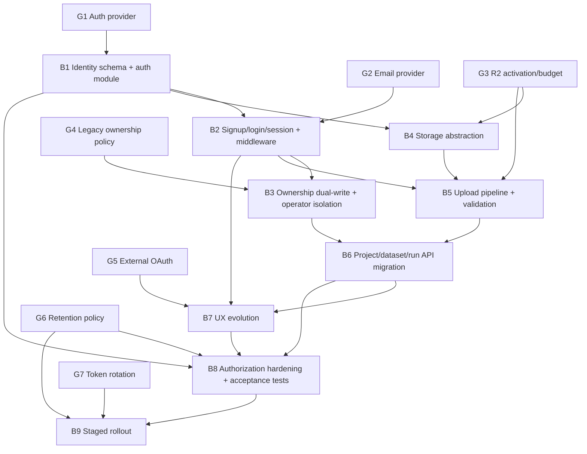

# M7.5-A Implementation Roadmap — Public Research Platform Foundation

**Status:** DESIGN ONLY. This document is a blueprint. **No implementation has started and none may start** until architecture review and explicit owner approval of the decision gates in §3/§6 are recorded. No code, migration, `wrangler.toml`, `package.json`, secret, binding or deployment was changed for M7.5-A; no live Galaxy call was made.

**Date:** 2026-11-26
**Repository state at audit time:** HEAD `e1a523a8`, branch `phase-1-robustness-safety`. UI edits were then present under `web-platform/public/` and were **read only**. This document does not modify, stage, commit or revert them. **Note:** the UI work was subsequently committed externally as `90df75e` and `fdc3f26` (HEAD `fdc3f26` at time of note); this document describes the code as reviewed at audit time, not the current tree.

## Companion documents (M7.5-A design set)

| Document | Relationship to this roadmap |
|---|---|
| `M7_5_FOUNDATION_DESIGN.md` | Target architecture and capability boundaries that these milestones realize |
| `M7_5_AUTH_PROVIDER_DECISION.md` | Human-identity provider decision inputs (subject-based gate mapping; see note below) |
| `M7_5_DATA_LIFECYCLE.md` | R2 activation, retention/deletion and external-provider consent decision inputs (subject-based gate mapping; see note below) |
| `M7_5_THREAT_MODEL.md` | Source of the acceptance tests referenced in each milestone (T-01…T-16) |
| **`M7_5_IMPLEMENTATION_ROADMAP.md` (this file)** | Ordered, reviewable milestone plan with gates, rollback and guardrails |

Gate IDs are **document-local** and are not interchangeable across the five documents; the G1–G7 identifiers used below are local to this roadmap. For the mapping by decision subject, use the canonical gate crosswalk in `M7_5_FOUNDATION_DESIGN.md` rather than assuming a shared numbering.

Source of truth for the five-document set: `SYSTEM_ARCHITECTURE.md` §12.

## Fixed contract (applies to every milestone)

- Human identity = **Better Auth primary / Clerk alternative**, never a bespoke credential store.
- **R2 is recommended but not activated**; it stays behind an abstraction and is enabled only via owner approval (Gate G3).
- **Operator token stays strictly separate** from human identity; it is never a fallback user credential and never exposed to researcher UX.
- **D1 = metadata only** in the target state; legacy inline FASTA is preserved, not rewritten.
- **Legacy operator-owned rows are never auto-assigned** to a new human user.
- **No compliance claims**; privacy/retention wording is descriptive.
- **No implementation now** — all file lists below are "likely touched", not changes.

---

## 1. Guiding principles

1. **Additive-only schema changes.** Every migration uses `ALTER TABLE … ADD COLUMN` or `CREATE TABLE IF NOT EXISTS`; no `DROP`, no column redefinition, no row rewriting (pattern already established by `0011_workspace.sql`).
2. **One small, reviewable change per milestone.** Each milestone is independently deployable behind a flag and independently rollbackable.
3. **Dual-read/dual-write before cutover.** Ownership and storage migrate through a period where both old and new representations are read; writes go to both.
4. **Fail closed.** If an auth binding, R2 binding, or signing key is missing, endpoints return errors rather than silently opening access (matches current `createArtifactStore` and router behavior).
5. **Do not break 16S or workspace.** The existing `/api/ai/requests → approve → BLAST` path and the M7.4 workspace API/UI must keep working in local/operator mode throughout.
6. **Owner gates are hard stops.** No milestone that depends on an unapproved gate may be merged or deployed.

---

## 2. Decision gates (hard stops)

| Gate | Decision | Blocks milestones | Owner input required |
|---|---|---|---|
| **G1** | Auth provider selection (Better Auth primary / Clerk alternative) | B2, B3 | Approve provider; no bespoke auth |
| **G2** | Email provider for verification/reset mail | B2 | Provider + credentials supplied as secrets |
| **G3** | R2 activation + budget (bucket, binding, signing key, size/quota caps) | B4, B5 | Explicit approval; R2 stays off until then |
| **G4** | Legacy operator-owned row ownership transfer policy | B3, B6 | Confirm rows stay isolated; never auto-assigned |
| **G5** | External OAuth providers (if any) | B7 | Approve before any external integration |
| **G6** | Retention policy (period, deletion SLA, backup) | B5, B8, B9 | Policy value; currently **unknown / not set** |
| **G7** | Operator token rotation | B9 (and any live rollout) | Confirm rotation; **no live Galaxy until confirmed** |

---

## 3. Milestones

Each milestone lists **Scope**, **Dependencies**, **Files likely touched (no changes now)**, **Acceptance criteria**, **Rollback**, **Verification tests**, and **"Do not break 16S/workspace" guardrails**.

### M7.5-B1 — Identity schema (additive migration) + auth module wiring

- **Scope:** Add additive D1 tables/columns for identity (users, accounts, sessions, verification tokens) in the shape required by the chosen provider. Introduce a thin auth module that exposes `getSession(request, env)` and integrates with the existing `errorResponse`/`baseHeaders` helpers. No login UI yet.
- **Dependencies:** G1 (provider choice) may be needed to finalize the exact table shape; schema skeleton can be drafted pending choice.
- **Files likely touched (no changes now):** `web-platform/migrations/0012_identity.sql` (new, additive), `web-platform/functions/api/auth/_lib.js` (new), `web-platform/worker.js` (import/wire only), `docs/M7_5_FOUNDATION_DESIGN.md`.
- **Acceptance criteria:** Migration applied to staging with zero errors; existing rows unchanged; `getSession` returns `null` unauthenticated; no secret literal in code; all responses keep existing CSP/nosniff/no-store headers.
- **Rollback:** Skip/feature-flag the auth module; additive tables harmless if left in place; no destructive down-migration (do not drop tables in rollback).
- **Verification tests:** schema introspection (new tables present, old columns intact); `TL-01` static secret scan; baseline 16S/workspace tests unchanged.
- **Guardrails:** Do not alter `BLAST_DB` binding name; do not touch `projects.owner`; leave `0011_workspace.sql` semantics intact.

### M7.5-B2 — Signup/login/session + middleware

- **Scope:** Enable Better Auth (or approved Clerk) handlers for signup, email verification, login, logout and session cookies. Add a router-level middleware that attaches `session` to context and an `requireHuman(request)` guard. Operator token path remains for admin only.
- **Dependencies:** B1, G1, G2.
- **Files likely touched (no changes now):** `web-platform/functions/api/auth/*` (new), `web-platform/worker.js` (middleware), `web-platform/functions/api/ai/_lib.js` (shared guard), `public/_headers` (cookie/CSP review), `docs/M7_5_AUTH_PROVIDER_DECISION.md`.
- **Acceptance criteria:** Signup email verified; session cookie `HttpOnly; Secure` with short TTL (`ST-02`) and `SameSite` per the G4/DG-4 policy (Lax for OAuth/top-level navigation, Strict otherwise); revoked session rejected (`ST-01`); CSRF token required on state-changing calls (`CSRF-01/02`); no token in response bodies (`TL-01`).
- **Rollback:** Feature flag `AUTH_ENABLED=false` restores current behavior; sessions table rows may be ignored.
- **Verification tests:** `AT-01`, `AT-02`, `ST-01`, `ST-02`, `CSRF-01`, `CSRF-02`, `XSS-01`, `XSS-02`.
- **Guardrails:** Existing public `/api/ai/requests` and `/api/blast/*` routes keep working anonymously until B6; operator mode in `workspace.js` must still succeed.

### M7.5-B3 — Ownership dual-write/migration tooling + operator isolation

- **Scope:** Introduce `owner_user_id` alongside derived operator `owner`; dual-write on create; backfill tool that transfers ownership **only under explicit owner-approved mapping**; legacy operator-owned rows remain isolated (never assigned to first signup). Add operator/admin route segregation.
- **Dependencies:** B2, G4.
- **Files likely touched (no changes now):** `web-platform/migrations/0013_owner_user_id.sql` (new additive), `web-platform/functions/api/workspace/_lib.js` (`deriveOwner`/`getProject` ownership logic), `web-platform/functions/api/ai/_lib.js` (`SQL` owner predicates), `scripts/` (migration/verification script, new), `docs/M7_5_DATA_LIFECYCLE.md`.
- **Acceptance criteria:** New rows dual-written; read path prefers `owner_user_id` then falls back to operator owner while flag on; zero rows auto-assigned to a new user; researcher cannot reach operator routes (`PRIV-01`); role change audited (`PRIV-02`).
- **Rollback:** Flip dual-read flag back to operator owner; dual-written columns ignored; no data deleted.
- **Verification tests:** `CROSS-01`, `CROSS-02`, `IDOR-01`, `PRIV-01`, `PRIV-02`; ownership verification queries (§5).
- **Guardrails:** Keep `owner_<hex16>` derivation for legacy rows; do not change `toProjectDto`/`toDatasetDto` field names used by `workspace.js`.

### M7.5-B4 — Storage abstraction + R2 decision gate

- **Scope:** Define a `createArtifactStore(env)` interface already present in `storage/r2.js` behind a provider abstraction; add a no-op/local-disabled implementation for when R2 is off. **R2 activation is gated** — add binding/signing key only after owner approval; endpoints continue to fail closed when absent.
- **Dependencies:** G3 (activation), B1 (config path).
- **Files likely touched (no changes now):** `web-platform/storage/index.js` (new abstraction), `web-platform/storage/r2.js` (implement interface), `web-platform/functions/api/artifacts/_lib.js` (`getStore`), `wrangler.toml` (binding only post-approval), `docs/M7_5_DATA_LIFECYCLE.md`.
- **Acceptance criteria:** With R2 off, artifact endpoints return 503 and no public bucket is assumed; with R2 on (approved), tickets remain HMAC-signed, TTL-bound, operation-bound; no long-lived URL in any response.
- **Rollback:** Remove/disable binding and flag; store returns unavailable; data written during trial remains in the (private) bucket and is not deleted by rollback.
- **Verification tests:** `URL-01`, `URL-02`, `DL-01`, `DL-02`, `TL-01`.
- **Guardrails:** Do not expose `ARTIFACT_SIGNING_KEY` in config or responses; preserve `verify()` constant-time and `exp` checks.

### M7.5-B5 — Upload pipeline + validation

- **Scope:** Require human auth to mint upload tickets; add durable per-user quota, magic-byte/type validation, quarantine before `stored` status, and retention hooks. Keep streaming hash/byte verification.
- **Dependencies:** B4, B2, G3, G6.
- **Files likely touched (no changes now):** `web-platform/functions/api/artifacts/upload-url.js`, `upload.js`, `web-platform/storage/r2.js`, `web-platform/migrations/0014_upload_meta.sql` (new additive), `docs/M7_5_DATA_LIFECYCLE.md`.
- **Acceptance criteria:** Anonymous ticket denied (`UP-02`); oversize/hash mismatch rejected + object removed (`UP-01`, `MF-02`); disguised executable rejected (`MF-01`); quota returns 429 (`UP-03`, `DOS-01`); retention flag recorded per object.
- **Rollback:** Disable new validation via flag, revert to prior ticket path; quarantined objects quarantined, not auto-promoted.
- **Verification tests:** `UP-01`, `UP-02`, `UP-03`, `MF-01`, `MF-02`, `DOS-02`, `RET-01`.
- **Guardrails:** Keep 64 MiB cap and extension allowlist; no server-side execution of uploads; workspace metadata-only dataset flow unchanged.

### M7.5-B6 — Project/dataset/run APIs migrated to human identity

- **Scope:** Move `/api/workspace/**` authorization from derived operator owner to authenticated `owner_user_id`; add object-level authorization centrally; migrate/lock legacy public routes (`/api/ai/requests`, `/api/blast/*`) behind auth or ownership checks; issue reports/downloads only through authenticated endpoints.
- **Dependencies:** B3, B5.
- **Files likely touched (no changes now):** `web-platform/functions/api/workspace/**`, `web-platform/functions/api/ai/requests/index.js`, `web-platform/functions/api/blast/*`, `web-platform/functions/api/ai/_lib.js`, `worker.js` (route guard wiring).
- **Acceptance criteria:** Cross-user reads return 404 (`CROSS-01`, `IDOR-01`); legacy RID reads ownership-scoped (`IDOR-02`); no URL fields leak (`URL-01`); consent-bound downloads enforced (`DL-01/02`); existing 16S and workspace flows still pass their baselines.
- **Rollback:** Dual-read flag back to legacy owner/public behavior; no destructive delete; feature flag per route group.
- **Verification tests:** `CROSS-01`, `CROSS-02`, `IDOR-01`, `IDOR-02`, `DL-01`, `DL-02`, `URL-01`, `SQLI-01`.
- **Guardrails:** Preserve `STATE_TRANSITIONS`, provenance honesty gate, DTO field names, and the labelless demo/sample semantics that `workspace.js` depends on.

### M7.5-B7 — UX evolution

- **Scope:** Replace the operator-token input in `workspace.html` with human signup/login/session UI; keep an admin-only operator path hidden from researchers; no long-lived credential in DOM/storage; continue `textContent`-only rendering; keep local-browser mode as a clearly labelled fallback.
- **Dependencies:** B2, B6, G5 (if external OAuth shown).
- **Files likely touched (no changes now):** `public/workspace.html`, `public/js/workspace.js`, `public/js/project-context.js`, `public/js/auth.js` (new), `public/css/components.css`, `tests/workspace.test.mjs`, `tests/workspace.e2e.mjs`.
- **Acceptance criteria:** No token in DOM/localStorage/sessionStorage (`TL-01`); logged-out user sees no operator field; `textContent` only (`XSS-01`); CSP unchanged/strongened (`XSS-02`); local/operator baselines still green.
- **Rollback:** Feature flag restores current UI and token field; session UI hidden.
- **Verification tests:** `TL-01`, `XSS-01`, `XSS-02`, `ST-01`, `PRIV-01`, plus existing `workspace` unit/e2e suites.
- **Guardrails:** Do not break the 16S/phylo links that pass `?project=`; keep `project-context.js` validation regex; no new execution introduced by the workspace page.

### M7.5-B8 — Authorization hardening + threat acceptance tests

- **Scope:** Run the full §6 catalogue of `M7_5_THREAT_MODEL.md` against staging; add any missing guards; harden CSRF/IDOR/egress/retention; enable audit alerting on deny paths.
- **Dependencies:** B1–B7, G6.
- **Files likely touched (no changes now):** test suites under `web-platform/tests/`, guard helpers in `functions/api/**`, `docs/M7_5_THREAT_MODEL.md` (residual-risk update).
- **Acceptance criteria:** All mandatory **(neg)** tests pass; residual risks in the threat model match observed results; no High residual without an owner-approved mitigation or explicit acceptance.
- **Rollback:** Tests/guards can be flag-gated; no schema deletion.
- **Verification tests:** Entire catalogue `AT-*`, `ST-*`, `CROSS-*`, `IDOR-*`, `URL-*`, `DL-*`, `UP-*`, `MF-*`, `DOS-*`, `TL-*`, `CSRF-*`, `XSS-*`, `SQLI-*`, `EGRESS-*`, `RET-*`, `PRIV-*`.
- **Guardrails:** Re-run 16S and workspace regression baselines; no provider enabled in production without its flag.

### M7.5-B9 — Staged rollout

- **Scope:** Deploy to staging first, then production with explicit owner approval; keep feature flags for gradual enablement; monitor auth failures, 429s, deny-audit events; prepare rollback to pre-milestone flags. **No live Galaxy calls until the owner confirms token rotation (G7).**
- **Dependencies:** B1–B8, G7, plus owner go/no-go for production.
- **Files likely touched (no changes now):** `wrangler.toml` (flags only), `docs/DEPLOYMENT.md`, `docs/IMPLEMENTATION_LOG.md`, monitoring/alert config (owner-supplied).
- **Acceptance criteria:** Staging green for a defined soak period (duration **unknown / owner-set**); production deployment only after written approval; rollback rehearsed; 16S and workspace baselines green in both environments.
- **Rollback:** Flags off restores legacy behavior; D1 additive columns remain; R2 objects retained; no destructive deletes.
- **Verification tests:** Full §6 catalogue + smoke of `/api/ai/requests`, `/api/blast/*`, `/api/workspace/**`, artifact round-trip.
- **Guardrails:** Production flags default OFF; Galaxy production flag stays `false` (currently `GALAXY_ENABLED = "false"` top-level in `wrangler.toml`).

---

## 4. Dependency graph



Critical path: `G1 → B1 → B2 → B3 → B6 → B7 → B8 → B9`. The R2/storage branch (`G3 → B4 → B5`) can proceed in parallel once its gate is approved but must join before B6.

---

## 5. Migration and rollback strategy

### 5.1 Additive-only D1 changes

- Every new migration (e.g., `0012_identity.sql`, `0013_owner_user_id.sql`, `0014_upload_meta.sql`) uses `ALTER TABLE … ADD COLUMN` or `CREATE TABLE IF NOT EXISTS` only — mirroring `0011_workspace.sql`, which explicitly states "no DROP, no column redefinition, no rewrite of existing rows".
- No destructive deletes, no `DROP TABLE`, no changing `projects.owner` semantics. Legacy inline `datasets.fasta_text` is left untouched.
- `BLAST_DB` binding name is preserved (`wrangler.toml` comment: handlers read `env.BLAST_DB`).

#### Proposed DDL appendix (PROPOSED — NOT EXECUTED)

> **PROPOSED, NOT EXECUTED.** No migration file was created or run, no D1 row was written, and no binding, code or secret was changed. The statements below are the concrete shape of the additive changes described above, consistent with the `M7_5_FOUNDATION_DESIGN.md` §8 D1 proposal and the `0011_workspace.sql` additive style. They are targets for a future, owner-approved milestone — not instructions to implement now.

```sql
-- Identity: new tables (FOUNDATION §8). user_id is the opaque internal usr_<id>.
CREATE TABLE IF NOT EXISTS users (
  user_id TEXT PRIMARY KEY,
  auth_user_id TEXT,                 -- provider user.id; never a credential
  issuer TEXT NOT NULL,
  subject TEXT NOT NULL,
  email TEXT,
  created_at TEXT NOT NULL,
  deleted_at TEXT,                   -- soft delete; retention per G6
  UNIQUE (issuer, subject),
  UNIQUE (email)
);

CREATE TABLE IF NOT EXISTS sessions (
  session_id TEXT PRIMARY KEY,
  user_id TEXT NOT NULL REFERENCES users(user_id),
  created_at TEXT NOT NULL,
  expires_at TEXT NOT NULL,
  last_used_at TEXT,
  revoked_at TEXT                    -- hard delete on sign-out / revoke
);
CREATE INDEX IF NOT EXISTS idx_sessions_user ON sessions (user_id);
CREATE INDEX IF NOT EXISTS idx_sessions_expires ON sessions (expires_at);

CREATE TABLE IF NOT EXISTS verifications (
  verification_id TEXT PRIMARY KEY,
  user_id TEXT REFERENCES users(user_id),
  created_at TEXT NOT NULL,
  expires_at TEXT NOT NULL,
  used_at TEXT                       -- hard delete after use / expiry
);
CREATE INDEX IF NOT EXISTS idx_verifications_user_expires ON verifications (user_id, expires_at);

-- Ownership namespace on existing tables. owner / projects.owner already exist
-- (0002, 0011) and are never redefined; these are ADD COLUMN only.
ALTER TABLE projects ADD COLUMN owner_user_id TEXT REFERENCES users(user_id);
ALTER TABLE projects ADD COLUMN namespace TEXT NOT NULL DEFAULT 'operator';
ALTER TABLE projects ADD COLUMN legacy_owner_hash TEXT;
ALTER TABLE datasets ADD COLUMN owner_user_id TEXT REFERENCES users(user_id);
ALTER TABLE datasets ADD COLUMN namespace TEXT NOT NULL DEFAULT 'operator';
ALTER TABLE datasets ADD COLUMN legacy_owner_hash TEXT;
ALTER TABLE workspace_runs ADD COLUMN owner_user_id TEXT REFERENCES users(user_id);
ALTER TABLE workspace_runs ADD COLUMN namespace TEXT NOT NULL DEFAULT 'operator';
ALTER TABLE workspace_runs ADD COLUMN legacy_owner_hash TEXT;
ALTER TABLE provenance_records ADD COLUMN owner_user_id TEXT REFERENCES users(user_id);
ALTER TABLE provenance_records ADD COLUMN namespace TEXT NOT NULL DEFAULT 'operator';
ALTER TABLE provenance_records ADD COLUMN legacy_owner_hash TEXT;
CREATE INDEX IF NOT EXISTS idx_projects_owner_user_status ON projects (owner_user_id, status);
CREATE INDEX IF NOT EXISTS idx_datasets_owner_user_project ON datasets (owner_user_id, project_id);
CREATE INDEX IF NOT EXISTS idx_workspace_runs_owner_user_state ON workspace_runs (owner_user_id, state);
CREATE INDEX IF NOT EXISTS idx_provenance_records_owner_user_run ON provenance_records (owner_user_id, run_id);

-- Dataset / upload / artifact metadata: extend existing tables only.
ALTER TABLE provider_artifacts ADD COLUMN retention_expires_at TEXT;  -- upload/retention hook (B5, G6)
ALTER TABLE artifacts ADD COLUMN deleted_at TEXT;                     -- soft delete; absent in 0002
ALTER TABLE audit_events ADD COLUMN actor_user_id TEXT REFERENCES users(user_id);
```

Existing indexes are preserved, not re-created: `idx_artifacts_run` on `artifacts(run_id)` (0002), `idx_provider_artifacts_dataset` on `provider_artifacts(dataset_id, created_at)` (0007), `idx_report_runs_job` on `report_runs(job_id)` and `idx_audit_events_timestamp` on `audit_events(timestamp)` (0002). `report_runs` is reused as-is: no owner column; authorization stays with the parent `workspace_runs` row (`public_id + owner`).

Deletion / retention notes (TARGET): legacy rows keep `namespace='operator'` and `legacy_owner_hash`, with `owner_user_id` left `NULL` until an explicitly approved, audited transfer (G4); `users` are soft-deleted via `deleted_at` under the G6 retention policy; `sessions` and `verifications` are hard-deleted on revoke/use; `artifacts` and `provider_artifacts` are soft-deleted via `deleted_at` and their object bytes are deleted through the storage provider — never as a D1 blob; derived artifacts and reports stay under the parent run's retention binding. D1 remains metadata-only.

### 5.2 Feature-flag rollout

- All new behavior behind flags defaulting OFF (pattern: `GALAXY_ENABLED`, `SMARTSBIO_ENABLED`, `NINEROUTER_ENABLED` all `"false"` at top level in `wrangler.toml`).
- Suggested flags: `AUTH_ENABLED`, `OWNER_USER_ID_READ`, `DUAL_WRITE`, `ARTIFACT_STORAGE_ENABLED`, `UPLOAD_VALIDATION_ENABLED`, `LEGACY_ROUTES_AUTH`, `RETENTION_ENABLED`. Flag names are proposals, not configured today.
- Production flags remain OFF until B9 explicit approval.

### 5.3 Dual-read / dual-write period

- **Write:** new `owner_user_id` (when a human session exists) **and** legacy derived `owner` are both written while `DUAL_WRITE` is on.
- **Read:** prefer `owner_user_id`; fall back to legacy `owner` for operator/legacy rows while `OWNER_USER_ID_READ` is on. After the soak period, switch to human-only with owner approval.
- Legacy operator-owned rows stay under their original `owner` hash; they are **never** assigned to a newly signing-in user (G4).

### 5.4 Operator fallback

- Admin/operator routes remain available via `X-Agent-Token` for break-glass and migration tooling, kept separate from human sessions.
- The operator token is **not** accepted as a substitute for a human session on researcher endpoints once B6 lands (enforced by `PRIV-01`).
- No live Galaxy calls until G7 rotation is confirmed; operator token rotation must not invalidate already-issued human sessions.

### 5.5 Verification queries (run pre- and post-migration on staging)

```sql
-- Count rows by ownership representation (expect legacy rows unchanged)
SELECT COUNT(*) AS total_projects FROM projects;
SELECT COUNT(*) AS legacy_owner_rows FROM projects WHERE owner_user_id IS NULL;
SELECT COUNT(*) AS human_owner_rows FROM projects WHERE owner_user_id IS NOT NULL;

-- No legacy operator row was auto-assigned to a human
SELECT COUNT(*) AS unexpected_assignments
FROM projects
WHERE owner LIKE 'owner_%' AND owner_user_id IS NOT NULL;

-- Dataset metadata remains metadata-only on the legacy path
SELECT COUNT(*) AS legacy_inline_fasta FROM datasets WHERE fasta_text IS NOT NULL;

-- Consent rows remain scoped/expiring
SELECT COUNT(*) AS unexpired_consents FROM blast_consents WHERE expires_at > datetime('now');
```

Expected at all times: `legacy_owner_rows` never decreases without an audited transfer; `unexpected_assignments = 0`; `total_projects` unchanged by a pure schema migration.

### 5.6 Backup and staged deployment

- Take a D1 export/backup before each migration; verify backup restorability on staging.
- Deploy order: **local tests → staging → (owner approval) → production**. Production is always last and requires explicit written sign-off.
- Rollback = flip flags off + restore prior code artifact; do **not** delete additive columns or R2 objects. If a restore is needed, use the pre-migration backup.
- Keep per-environment secrets separate (`wrangler secret put … [--env staging]`); never commit secrets.

---

## 6. Owner approval gates (summary)

| Gate | Required approval | Consequence if not approved |
|---|---|---|
| G1 | Better Auth primary vs Clerk alternative | Auth module cannot be finalized; B2 blocked |
| G2 | Email provider + credentials | Verification/reset unavailable; B2 blocked |
| G3 | R2 binding, bucket privacy, signing key, budget/quotas | R2 stays inactive; artifact endpoints keep failing closed; B4/B5 blocked |
| G4 | Legacy row ownership transfer policy | B3/B6 blocked; legacy rows stay isolated |
| G5 | External OAuth providers | External identity integration omitted from B7 |
| G6 | Retention period, deletion SLA, backup policy | Retention/deletion controls omitted; residual risk stays Medium |
| G7 | Operator token rotation; no live Galaxy until confirmed | B9 production rollout and any live provider work blocked |

---

## 7. Complexity estimate and external dependencies

### 7.1 Complexity (qualitative; person-effort numbers intentionally not invented)

| Milestone | Relative complexity | Main risk |
|---|---|---|
| B1 | Small–Medium | Provider-specific schema shape (G1) |
| B2 | Medium | Session/CSRF correctness, email delivery (G2) |
| B3 | **Large** | Ownership dual-write correctness; legacy isolation (G4) |
| B4 | Small–Medium | Staying fail-closed while abstracting storage |
| B5 | Medium–Large | Streaming validation + quarantine + quota |
| B6 | **Large** | Centralizing object-level authorization across many routes |
| B7 | Medium | Removing token from UX without breaking local/operator baselines |
| B8 | Medium | Full negative-test catalogue must pass |
| B9 | Medium | Coordination + owner approvals + rollback rehearsal |

Overall complexity is **high** because B3 and B6 touch authorization semantics across the whole API. Numeric effort estimates and calendar durations are **unknown / owner-set** and are deliberately not asserted.

### 7.2 External dependencies

- **Auth provider** (Better Auth or Clerk) — docs must be re-checked with a "date checked" annotation at implementation time; no external claim is made here.
- **Email provider** for verification/reset (owner-supplied; none configured today).
- **Cloudflare D1 / Workers / R2** — configuration and limits must be verified against official docs when implementing.
- **External research providers** (NCBI BLAST, Galaxy, SmartBio, NineRouter) — remain external trust boundaries; no live calls until G7.
- **Secret management** — `wrangler secret put` per environment; no secrets in repository.

---

## 8. Concise implementation sequence checklist

- [ ] 0. Architecture review of all five M7.5-A docs; record approvals for G1–G7.
- [ ] 1. **B1** — additive identity migration + auth module (flag off).
- [ ] 2. **B2** — signup/login/session + `requireHuman` + CSRF (G1, G2).
- [ ] 3. **B3** — `owner_user_id` dual-write, legacy isolation, operator segregation (G4).
- [ ] 4. **B4** — storage abstraction; keep R2 off; fail-closed (G3 for later activation).
- [ ] 5. **B5** — authenticated upload tickets, validation, quota, retention hook (G3, G6).
- [ ] 6. **B6** — migrate workspace/legacy APIs to human identity with object-level auth.
- [ ] 7. **B7** — human signup/login UX; remove researcher token field (G5 if OAuth).
- [ ] 8. **B8** — run full `M7_5_THREAT_MODEL.md` §6 catalogue; close High residuals.
- [ ] 9. **B9** — staging soak → owner approval → production, flags gradually on; **no live Galaxy until G7**.
- [ ] 10. Update `IMPLEMENTATION_LOG.md` / `SYSTEM_ARCHITECTURE.md` with verified outcomes (never rewrite historical evidence).

---

## 9. Verification notes and limits

- All current-state statements are derived from local source at audit time (HEAD `e1a523a8`) plus a read-only inspection of the UI files as then present; no live endpoints were called and no credentials were used.
- File paths under "Files likely touched" are projections, not created files. No new file was created for M7.5-A by this document.
- External provider documentation was not consulted for this roadmap; provider-specific behavior must be verified against official docs with a "date checked" note at implementation time.
- Retention period, soak duration, effort estimates and RID entropy are **unknown / owner-set** and intentionally not quantified.
- No compliance certification or guarantee is claimed.
