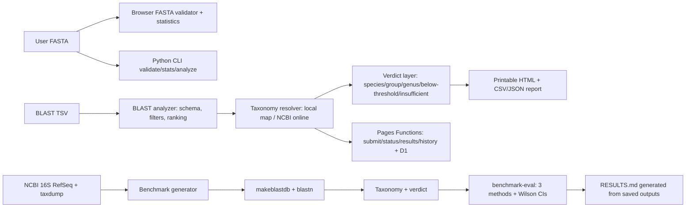

# Project summary (Milestone 1.0.0)

## What field
16S rRNA isolate identification from BLAST hits: turning raw similarity evidence into a conservative, explained verdict plus a reproducible benchmark. Research and education use only; not a clinical diagnostic.

## What gap
Plain top-hit naming confidently reports a species even when the true species is absent from the reference database. A fixed 98.65% identity cutoff helps but still names a wrong relative when a close sibling clears the cutoff. Users need an explicit "insufficient evidence" outcome and an auditable, reproducible comparison.

## What evidence
- Real NCBI BLAST+ 2.17.0+ local execution against the curated bacterial 16S RefSeq targeted-loci database (26,888 records).
- NCBI taxdump (nodes.dmp + names.dmp) and accession-to-taxid extracted from the GenBank flatfile release; all downloads, dates, URLs and SHA-256 hashes recorded in `benchmark_data/RESULTS.md`.
- Query sets generated with fixed seeds; held-out (true accessions removed from the database) and noisy (sanity) modes; 3 seeds x 200 queries; 500 nt; 0.5% simulated substitutions.

## What result (REAL numbers, generated from saved outputs)
Held-out: plain top hit named a wrong species 143.3 times per 200 on average (100% call rate). The 98.65% cutoff baseline made 38.0 wrong calls across 87.7 calls. The Toolkit verdict made 12.7 wrong calls across 49.7 calls, abstaining on 150.3 queries (76 of 200 abstentions in seed 1 had the correct genus). Wrong rate among calls: 0.717 / 0.431 / 0.257 respectively. Noisy sanity: 9.0 / 9.0 / 1.3 wrong calls. Full per-seed data, Wilson 95% intervals and limitations are in `benchmark_data/RESULTS.md`; raw JSON in `benchmark_data/benchmark_runs_heldout4/` and `benchmark_runs_noisy2/`.

Honest takeaway: the Toolkit makes far fewer confident wrong species calls than both baselines, but it does so by calling species much less often. It is not "more accurate at naming species" in general; it is more conservative. Compare call rates together with wrong counts.

## What limits
- Truth comes from FASTA headers (can be wrong); one database release; simulated substitutions are not real sequencing errors.
- Queries are the first 500 nt (V1-V3-like region); group-level containment of truth was 0 in these runs (no difficult-group members among held-out truths).
- Frontend verified by unit tests only in this session; the paired real browser rejected the pages.dev TLS certificate in this environment. Cloudflare API confirmed the preview deployment stage succeeded at `https://4e5048a8.smart-bioinformatics-toolkit.pages.dev`.
- Difficult-group member lists need curator review; unnamed novel species are not inferred.

## Architecture (Mermaid)

